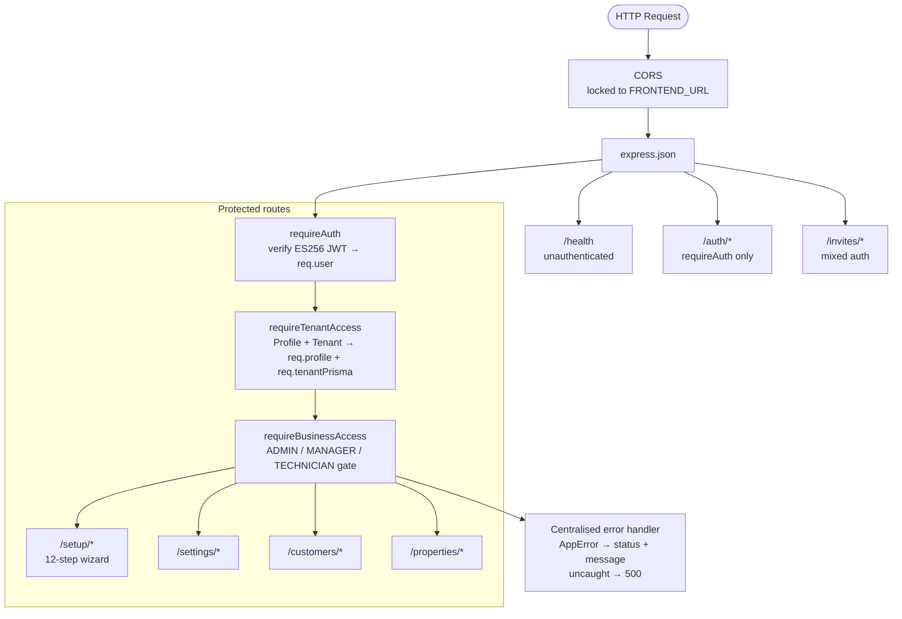
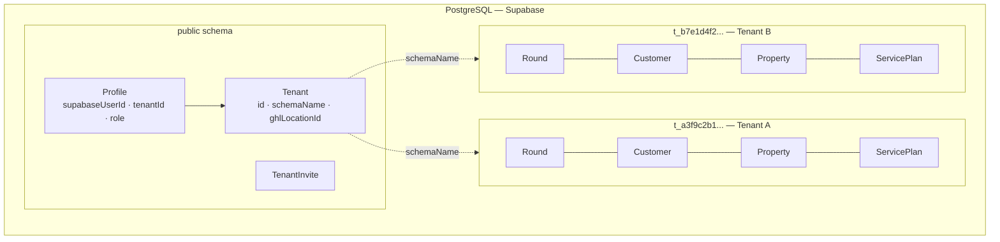
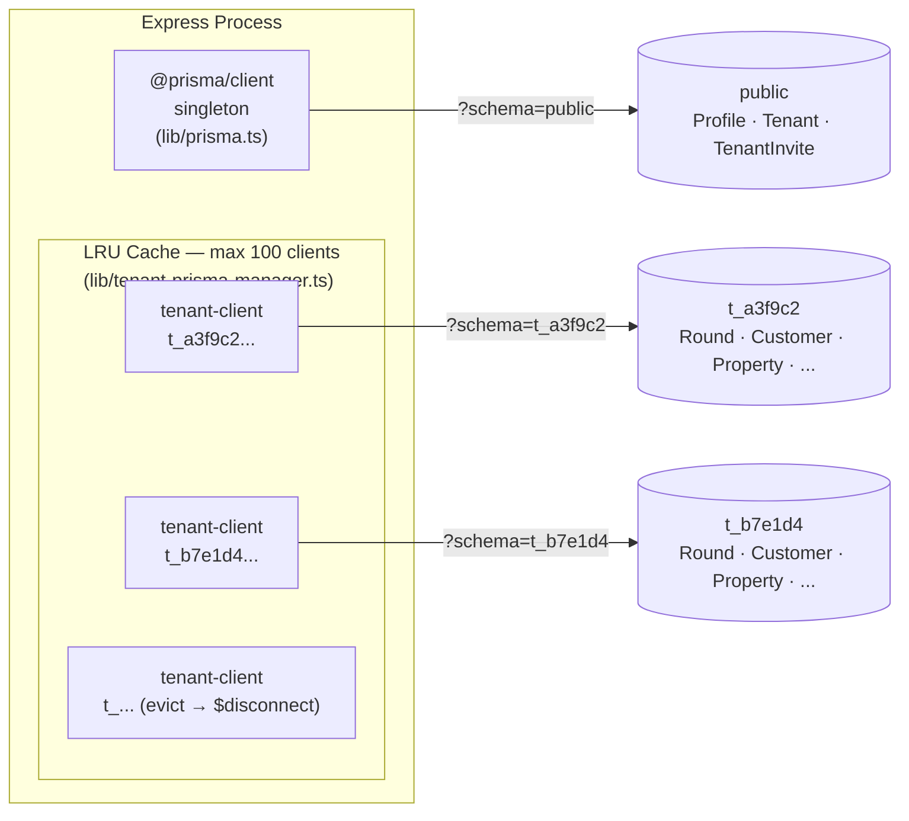
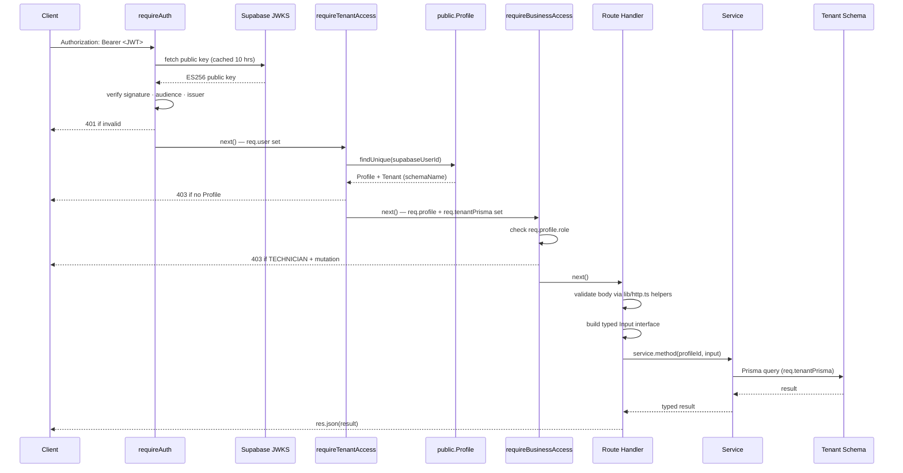
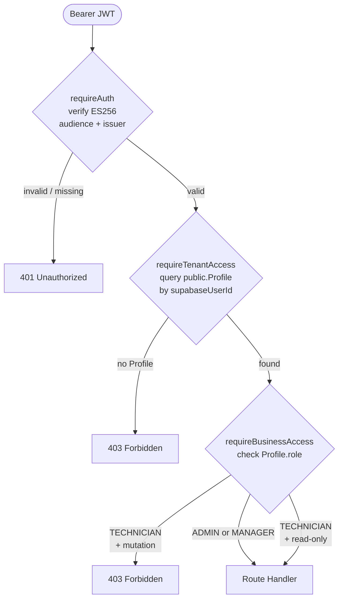
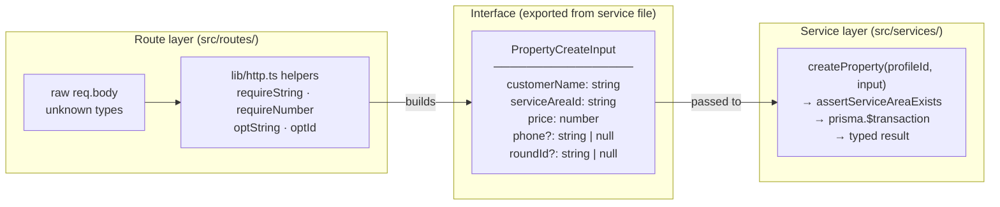
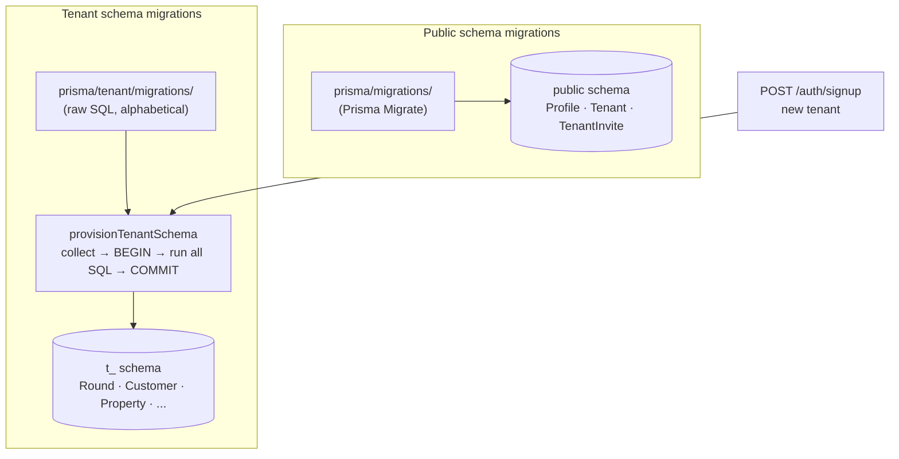

# RoundFlow Backend Architecture — Latest

> **This is the living architecture doc.** It supersedes `ARCHITECTURE.md` for anything that touches GHL —
> that file described a *planned* design before the integration was built; sections of it are now stale
> (file paths that don't exist, a token-storage location that moved, event types that were never implemented).
> Everything in this file has been checked against the current code (`src/`, `prisma/tenant/schema.prisma`)
> and the docs team handoff (`docs/GHL_AUTOMATION_OWNER_HANDOFF.md`) as of 2026-10-23. Keep updating **this**
> file as the GHL/automation work progresses — not `ARCHITECTURE.md`.

## 1. Overview

RoundFlow is a multi-tenant SaaS backend for UK window-cleaning businesses. Each business (tenant) operates in complete isolation — they share the same Express/TypeScript process and the same PostgreSQL instance, but their operational data lives in a dedicated Postgres schema. The backend is deployed on Railway and communicates with a React frontend; it has no HTML rendering concerns.

**Phase 1 target:** GHL-connected clients only. RoundFlow is sold as a private integration to businesses already on Agentum's GoHighLevel agency — not listed on the GHL Marketplace yet. GHL connection is required in Phase 1; marketplace listing and standalone mode are Phase 2.

Note: the code already supports **both** a marketplace-style OAuth install flow and a direct Private-Integration-Token (PIT) connect flow (see §10.2) — the "not listed on the Marketplace yet" line is about business/listing status, not a code limitation.

**Standalone capability:** The core app (rounds, visits, payments, debt, technicians) works without a GHL connection. The only features that require GHL are SMS, WhatsApp, and email messaging. GoCardless payments work standalone.

---

## 2. Technology Stack

| Layer | Technology |
|---|---|
| Runtime | Node.js (TypeScript, compiled to `dist/`) |
| Framework | Express 4 |
| ORM | Prisma (two separate clients — see §5) |
| Database | PostgreSQL via Supabase (hosted) |
| Identity provider | Supabase Auth (ES256 JWTs, JWKS) |
| Staff invite email | Supabase Auth (`admin.auth.inviteUserByEmail`) — same infrastructure as OTP + password reset |
| Customer-facing email | GHL (same as SMS/WhatsApp — all customer comms route through the GHL outbox) |
| Deployment | Railway |
| API docs | Swagger UI (`/docs`) |

---

## 3. High-Level Structure



---

## 4. Multi-Tenancy: Schema-Per-Tenant

### The model

Every tenant gets their own Postgres schema named `t_<20-hex-chars>` (e.g. `t_a3f9c2b1...`). All operational tables — `Round`, `Customer`, `Property`, `ServicePlan`, `Visit`, `Technician`, `ServiceArea`, etc. — live inside that schema. Tenants cannot see or touch each other's data at the database level.

The `public` schema holds only three cross-tenant tables: `Profile`, `Tenant`, and `TenantInvite`. These are managed by `@prisma/client` (the public-schema Prisma client singleton).



### Provisioning

When a new business signs up via `POST /auth/signup`:

1. A `Tenant` row is created in `public.Tenant` with a randomly generated `schemaName`.
2. A `Profile` row is created in `public.Profile` linking the Supabase user ID to the tenant.
3. `provisionTenantSchema(schemaName)` is called — it opens a **direct pg connection** (non-pooled), creates the Postgres schema, then runs all tenant migration SQL files inside a single `BEGIN`/`COMMIT` block. If anything fails the transaction rolls back, leaving the schema empty and retryable.

The provisioning function is idempotent: if `BusinessSettings` (the last table in the migration sequence) already exists, it returns immediately without touching anything.

### Isolation guarantee

No tenant data ever touches the public schema. No public-schema query ever touches a tenant schema. The two Prisma clients (§5) enforce this boundary in code.

---

## 5. Two Prisma Clients

This is the most important architectural detail to understand.

### Client 1 — `@prisma/client` (public schema singleton)

```
src/lib/prisma.ts  →  import { PrismaClient } from "@prisma/client"
```

- Talks to the `public` schema only.
- Single global instance shared across the whole process.
- Used by: `requireTenantAccess` (loads Profile + Tenant), `requireAuth` indirectly, invite routes, auth routes.
- Models: `Profile`, `Tenant`, `TenantInvite`.

### Client 2 — `src/generated/tenant-client` (LRU pool)

```
src/lib/tenant-prisma-manager.ts  →  import { PrismaClient } from "../generated/tenant-client"
```

- Talks to a specific tenant schema, set via `?schema=t_<hex>` on the connection string.
- Not a singleton — one `PrismaClient` instance per active tenant schema, cached in an LRU cache (max 100).
- When a tenant client is evicted from the LRU, `$disconnect()` is called immediately to release its connection pool back to Postgres.
- `getTenantPrismaForSchema(schemaName)` returns the cached client or constructs a new one.
- Used by: all service classes (customer, setup, settings) and the GHL adapter/outbox worker.
- Models: everything operational — `Round`, `Customer`, `Property`, `ServicePlan`, `Visit`, `Technician`, `ServiceArea`, `BusinessSettings`, `MessageTemplate`, `IntegrationOutbox`, `WebhookEvent`, `RoundTechnician`, etc.

### Why two separate generated clients?

Prisma generates type-safe models from a schema file. Because the public schema and tenant schema have completely different tables, they need separate `schema.prisma` files and therefore separate generated clients. Mixing them in a single client would either break the schema isolation or require complex Prisma multi-schema workarounds.

```
prisma/schema.prisma               →  generates @prisma/client
prisma/tenant/schema.prisma        →  generates src/generated/tenant-client
```



---

## 6. Request Lifecycle

A typical authenticated request (e.g. `GET /customers`) flows through:



---

## 7. Auth & RBAC

### Identity (authentication)

Supabase Auth is the identity provider. It handles signup UI, login, OAuth (Google), password reset, and JWT issuance. The backend never stores passwords or manages sessions — it only verifies JWTs.

`requireAuth` fetches Supabase's JWKS endpoint (keys cached 10 hours) and verifies every Bearer token with `jsonwebtoken`. The verification checks:
- Signature (ES256)
- Algorithm (ES256 only — no HS256 downgrade)
- Audience (`"authenticated"`)
- Issuer (the exact Supabase project URL)

Tokens from other Supabase projects cannot be replayed against this API.

### Authorisation (RBAC)

The JWT carries no app role — the Supabase `role` claim is always `"authenticated"` and is ignored. App roles live in `public.Profile.role` and are read from the database on every request by `requireTenantAccess`.

Three roles:

| Role | Can do |
|---|---|
| ADMIN | Everything |
| MANAGER | Everything |
| TECHNICIAN | Read-only (all mutations → 403) |

Role changes take effect on the very next request — no token refresh required, no stale state.



---

## 8. The Route → Interface → Service Pattern

This is how the layers are decoupled.

### The problem it solves

Routes know about HTTP (headers, body, status codes). Services know about the database. Neither should know about the other's concerns. The interface is the contract between them.



### How it works in practice

**Step 1 — Route validates and builds an Input interface:**

```typescript
// src/routes/properties.ts
const input: PropertyCreateInput = {
  customerName: requireString(body.customerName, "customerName"),
  addressLine:  requireString(body.addressLine, "addressLine"),
  serviceAreaId: requireString(body.serviceAreaId, "serviceAreaId"),
  price:        assertPositive(requireNumber(body.price, "price"), "price"),
  // ...
};
res.status(201).json(await svc(req).createProperty(actorIdOf(req), input));
```

**Step 2 — Interface is defined in the service file (exported):**

```typescript
// src/services/customer.service.ts
export interface PropertyCreateInput {
  customerName: string;
  addressLine:  string;
  serviceAreaId: string;      // required — every property must have a service area
  price:        number;
  phone?:       string | null;
  roundId?:     string | null;
  // ...
}
```

**Step 3 — Service method takes the interface, talks to the DB:**

```typescript
async createProperty(profileId: string, input: PropertyCreateInput): Promise<{ ... }> {
  await this.assertServiceAreaExists(input.serviceAreaId);
  return this.prisma.$transaction(async (tx) => {
    const customer = await tx.customer.create({ data: { name: input.customerName, ... } });
    const property = await tx.property.create({ data: { serviceAreaId: input.serviceAreaId, ... } });
    // ...
  });
}
```

### Why this matters

- **Validation happens exactly once**, at the HTTP boundary. The service receives clean, typed data and never has to handle raw `unknown` values.
- **The interface is the contract**. If you make `serviceAreaId` required in the interface, TypeScript will immediately flag every route that doesn't supply it — the compiler enforces the invariant.
- **Services are independently testable**. You can call a service method with a mock Prisma client without touching Express at all.
- **Optional vs required is explicit**. `?: string | null` means the caller may omit it. `string` means it must be there. This is enforced at compile time, not at runtime by surprise.

### The `lib/http.ts` helpers

All input coercion goes through a shared set of helpers:

| Helper | Use case |
|---|---|
| `requireString(v, field)` | Field is mandatory and must be a non-empty string |
| `requireNumber(v, field)` | Field is mandatory and must be a finite number |
| `optString(v, field)` | Optional string; `undefined` = omitted, `null` = clear |
| `optId(v, field)` | Optional FK id; empty string treated as null |
| `optReqString(v, field)` | Present if provided but must be non-empty |
| `asObject(body)` | Asserts body is a JSON object, not array or primitive |
| `asArray(body, key)` | Accepts raw array or `{ key: [...] }` wrapper |

Every helper throws `AppError(400, ...)` on failure, which the centralised error handler converts to a `{ error: "..." }` JSON response.

---

## 9. Error Handling

`AppError` is the single typed error class:

```typescript
class AppError extends Error {
  constructor(public statusCode: number, message: string) { ... }
}
```

Any service or route can `throw new AppError(404, "Round not found")`. The centralised handler in `src/index.ts` catches it and responds with the correct status + message. Untyped errors (unexpected exceptions) become 500s and are logged.

This means service code never touches `res` — it throws, the route handler propagates via `next(err)`, and the handler decides the HTTP response.

---

## 10. GHL Integration — As Actually Built

> Automation owner handoff (what to configure *inside* GHL): `docs/GHL_AUTOMATION_OWNER_HANDOFF.md`.
> That doc describes the target end-state (5 custom fields, 5 workflows, 5 tags). This section describes
> what the backend actually does today, where it diverges from that handoff, and the decisions behind it.

### 10.1 What GHL is in RoundFlow

GHL (GoHighLevel) is a **utility**, not the platform. RoundFlow does not run inside GHL. GHL handles:
- **All outbound customer communications**: SMS, WhatsApp, and Email — reminders, payment chases, job completion notifications. Configured as GHL Workflows by the automation owner; fired by RoundFlow-written Contact tags (and, once built, custom fields — see §10.6) via the outbox worker.
- **Inbound lead capture**: a GHL Workflow, triggered when a contact is tagged `ready-for-roundflow`, POSTs the contact to RoundFlow's webhook (see §10.5). This is a GHL Workflow *action* (custom webhook), not a native app-level `ContactCreate` subscription.

**Staff / internal email** (invite links, onboarding) uses Supabase Auth (`admin.auth.inviteUserByEmail()`) — the same infrastructure that sends OTP and password reset emails. Resend has been removed from the stack entirely.

**One GHL sub-account per tenant** — each business (tenant) has its own GHL location. `Tenant.ghlLocationId` (public schema, `@unique`) is the join key used by the outbox worker to find GHL-connected tenants; the actual credentials live on the tenant's own `BusinessSettings` row (see §10.2 — this differs from what was originally planned).

### Ownership boundary

| Domain | System |
|---|---|
| Customers, Properties, Rounds, Visits, Payments, Debt, Technicians | **RoundFlow** (system of record — always) |
| SMS / WhatsApp / Email delivery, lead capture, marketing sequences | **GHL** |
| GoCardless Direct Debit mandates + charges | **RoundFlow backend** (GoCardless SDK — charge creation, mandate setup, webhook receiver) |
| Stripe card fallback link generation | RoundFlow generates, GHL delivers |

RoundFlow **never** treats GHL as a database. Every write happens in RoundFlow Postgres first; GHL is told about it afterward via the outbox.

### 10.2 Connection & credentials — real location (corrected)

The original design doc planned to store GHL credentials on the public-schema `Tenant` model. **That's not where they live.** They're on the tenant schema's `BusinessSettings` row instead — consistent with every other integration (Stripe, GoCardless), which also store their encrypted credentials there, not on `Tenant`.

`BusinessSettings` (tenant schema) carries:

```
ghlConnected                Boolean  @default(false)
ghlLocationId                String?
ghlAccessTokenEncrypted      String?   // AES-256-GCM
ghlRefreshTokenEncrypted     String?   // null for a PIT connection
ghlTokenExpiresAt            DateTime?
ghlWebhookSecretEncrypted    String?   // gates ?secret= on POST /webhooks/ghl
```

`Tenant` (public schema) carries only `ghlLocationId String? @unique` — used solely so the outbox worker can cheaply list GHL-connected tenants without opening every tenant schema.

**Two connect paths exist, both implemented** (`src/routes/settings.ts`):

| Path | Route | Mechanism |
|---|---|---|
| OAuth (marketplace-style) | `GET /settings/ghl/authorize` → `GET /settings/ghl/callback` | `buildGhlAuthUrl` / `exchangeGhlCode` (`src/integrations/ghl/oauth.ts`); stores access + refresh token, auto-refreshes with a 5-minute buffer (`getGhlToken` in `src/integrations/ghl/api.ts`) |
| Private Integration Token (PIT) | `POST /settings/ghl/connect-private` | Admin pastes a token + locationId directly; no refresh token, never expires from RoundFlow's side |
| Disconnect | `POST /settings/ghl/disconnect` | Clears all `ghl*` fields on `BusinessSettings` |

### 10.3 Architecture: Outbox Pattern (built, not just planned)

Route handlers and service methods do **not** call GHL directly. They write an `IntegrationOutbox` row (same tenant-schema transaction as the operational write); a background worker drains it.

```mermaid
flowchart TB
    subgraph RF["RoundFlow (Express backend)"]
        direction TB
        RH["Route Handler\ne.g. Complete Visit"]
        SVC["queueGhlEvent(tp, eventType, customerId)\nwrites IntegrationOutbox row"]
        WORKER["outboxWorker.ts\nrunOutboxWorker()\npolled by a scheduler, batch 20, max 5 attempts"]
        WH["POST /webhooks/ghl\n?tenantId=&secret=\nverified, 200'd immediately, processed async"]
        RH --> SVC --> WORKER
        WH -.->|"today: InboundMessage, Uninstall only\nContactCreate/Update + lead-handoff: not yet wired, see §10.5"| RF
    end

    subgraph GHL["GoHighLevel (per-tenant sub-account)"]
        CONTACT["GHL Contact\n(ghlContactId join key)"]
        WF["GHL Workflows\nSMS · WhatsApp · Email\nreminders + payment chase"]
        CONTACT --> WF
    end

    subgraph ADAPTER["src/integrations/ghl/"]
        direction LR
        API["api.ts\ncreate/updateGhlContact\nadd/removeGhlTags\nsendGhlMessage"]
        OAUTH["oauth.ts\nexchange/refresh token"]
        SYNC["sync.ts\nqueueGhlEvent\nsyncCustomerToGhl\napplyGhlTags"]
    end

    WORKER -->|"decrypt token, call adapter"| ADAPTER
    ADAPTER -->|"update contact, add/remove tags"| CONTACT
    WF -->|"lead-handoff webhook action"| WH
```

Real file layout (corrected — the original doc's diagram named files that were never built):
- `src/integrations/ghl/api.ts` — token refresh, `createGhlContact`/`updateGhlContact`, `addGhlTags`/`removeGhlTags`, `sendGhlMessage`. **No custom-field functions exist yet** — see §10.6.
- `src/integrations/ghl/oauth.ts` — OAuth URL building + code/refresh-token exchange.
- `src/integrations/ghl/sync.ts` — `queueGhlEvent` (writes the outbox row), `syncCustomerToGhl`, `syncMessageToGhl`, `applyGhlTags`.
- `src/jobs/outboxWorker.ts` — `runOutboxWorker()`, drains `pending` rows per GHL-connected tenant, batch 20, gives up after 5 attempts (marks `dead`).
- `src/routes/ghlWebhook.ts` — inbound receiver.

Schema (`prisma/tenant/schema.prisma`) — real shape, already in code:

```
model IntegrationOutbox {
  id          String   @id @default(cuid())
  eventType   String   // "customer.synced" | "visit.completed" | "payment.collected" | "debt.overdue" | "complaint.logged"
  payload     Json     // always includes { customerId }
  status      String   @default("pending") // pending | sent | failed | dead
  attempts    Int      @default(0)
  lastError   String?
  createdAt   DateTime @default(now())
  processedAt DateTime?
}

model WebhookEvent {           // inbound dedup — unique constraint rejects replays
  id         String   @id @default(cuid())
  source     String   // "stripe" | "gocardless" | "ghl"
  externalId String
  receivedAt DateTime @default(now())
  @@unique([source, externalId])
}
```

Note the `eventType` comment doesn't list `payment.failed` — because it isn't written anywhere yet (§10.4).

### 10.4 Tags — what's actually emitted today vs. the handoff doc's spec

| Tag | Added by (code) | Removed by (code) | In automation handoff doc? |
|---|---|---|---|
| `visit-completed` | `visit.completed` outbox event (`routes/visits.ts`) | never (removal is a GHL Workflow action, by design) | ✅ yes |
| `payment-collected` | `payment.collected` outbox event (GoCardless *and* Stripe webhooks) | never | ❌ **not in the handoff doc** — undocumented extra tag |
| `debt-overdue` | `debt.overdue` outbox event (`routes/debt.ts`) | `payment.collected` handler (same outbox row removes it) | ✅ yes |
| `has-open-complaint` | `complaint.logged` outbox event (`routes/complaints.ts`) | **never — gap.** `complaint.service.ts` sets `resolvedAt`/`resolvedBy`/`notes` on resolution but never queues a GHL event to remove the tag | ✅ yes (doc says it should be removed "when complaint is resolved") |
| `payment-failed` | **nothing — gap, and wider than first noted.** Both failure paths update `Payment.status = FAILED` but neither calls `queueGhlEvent`: `gocardlessWebhook.ts`'s `failed` branch (direct debit), **and** `stripeWebhook.ts`'s `handlePaymentFailed` (`payment_intent.payment_failed`, card). | n/a | ✅ yes — Workflow 4 ("Payment Failed Chase") depends entirely on this tag existing |

Action items from this table are tracked in §10.7.

### 10.5 Inbound webhook — `POST /webhooks/ghl`

Verified per-tenant via `?tenantId=&secret=` (secret compared with `timingSafeEqual`), deduped via `WebhookEvent`, acks `200` immediately and processes async (`src/routes/ghlWebhook.ts`).

**Event types handled today:**
- `InboundMessage` — creates a `Message` row, linked to a `Customer` by `ghlContactId` if found.
- `Uninstall` — disconnects the tenant (clears all `ghl*` `BusinessSettings` fields + `Tenant.ghlLocationId`).
- `ContactCreate` / `ContactUpdate` — **explicit, permanent no-op.** This is a deliberate decision, not a TODO:

> **Decision: RoundFlow is always master for Customer data.** Once a `Customer` row exists and is linked via `ghlContactId`, inbound GHL contact edits are never applied — RoundFlow's copy always wins. GHL can only ever *originate* a new customer (via the tagged lead-handoff flow below); it can never overwrite an existing one. This avoids a sync-loop (RoundFlow pushes a contact update → GHL fires `ContactUpdate` → RoundFlow would re-import its own write) and keeps a single source of truth for operational data (billing, status, holds) that GHL has no concept of.

**What's documented but not yet handled — the actual lead-handoff mechanism:** per `GHL_AUTOMATION_OWNER_HANDOFF.md` §3/§4, "Lead Handoff to RoundFlow" (Workflow 5) is **not** a native `ContactCreate` app webhook. It's a GHL Workflow, triggered by the `ready-for-roundflow` tag, whose *action* is a custom webhook POST to this same `/webhooks/ghl` URL with a flat, untyped payload:

```json
{
  "contactId": "abc123",
  "firstName": "John",
  "lastName": "Smith",
  "email": "john@example.com",
  "phone": "+447700123456",
  "address1": "123 High Street",
  "city": "London",
  "postalCode": "SW1A 1AA"
}
```

This payload has **no `type` field**, so it matches none of the `if (type === ...)` branches in `processEvent()` today — it is silently dropped. Building this branch is Phase 1 work (§10.7): look up an existing `Customer` by `ghlContactId` first (idempotency — tag events can re-fire); if none exists, create both a `Customer` (name/phone/email) **and** a `Property` (`address1`→`addressLine`, `postalCode`→`postcode`) in one transaction, since address fields live on `Property`, not `Customer`; store `ghlContactId` on the new `Customer`. Per the master-data decision above, this is **create-only** — it never updates an existing linked customer.

### 10.6 Custom fields — promised to the automation owner, not yet built

`GHL_AUTOMATION_OWNER_HANDOFF.md` §1 lists 5 GHL **Contact custom fields** the backend is supposed to populate by key name, and §8 promises the automation owner that "the backend fetches the field IDs automatically via the GHL API" once they're created. **None of this exists in code.** `api.ts` only ever writes `firstName/lastName/phone/email` (contact fields) and tags — there is no custom-fields lookup, cache, or write call anywhere in `src/`.

| Field key | Type | Set when | Used by workflow |
|---|---|---|---|
| `last_clean_date` | Date | Job completed | Workflow 2 (job complete notification) |
| `next_clean_date` | Date | Next visit scheduled | Workflow 1 (pre-clean reminder) — **entirely dependent on this field** |
| `balance_owed` | Number | Invoice raised / payment collected or failed | Workflows 2–4 (message bodies reference it) |
| `round_name` | Text | Job completed | Workflow 2 |
| `technician_name` | Text | Job completed | Workflow 2 |

`balance_owed` is **never** a stored column — per the original design, compute it on demand (`SUM(unpaid Invoice.amount) − SUM(confirmed Payment.amount)`) at the moment it's written into the outbox payload, same as everywhere else in this codebase treats money.

### 10.7 Known gaps — tracked here, closed via the implementation plan

This is the authoritative "what's left before the automation owner can build/test all 5 GHL workflows" list (superseding anything said earlier in chat before this doc existed):

1. **Custom-fields adapter** — resolve each of the 5 keys above to a GHL field ID (cache it), add a write path in `api.ts`.
2. **Wire the 5 custom fields** to their trigger points (job completion, scheduling, invoice/payment events).
3. **`payment.failed` outbox event** — add in **both** `gocardlessWebhook.ts`'s `failed` branch and `stripeWebhook.ts`'s `handlePaymentFailed`; add a case in `outboxWorker.ts` that applies `payment-failed` (and removes it on a subsequent successful retry, mirroring `debt-overdue`).
4. **`has-open-complaint` removal on resolve** — `complaint.service.ts`'s resolve path needs to queue a GHL event that removes the tag.
5. **Lead-handoff webhook branch** (§10.5) — the untyped payload handler that creates `Customer` + `Property`.
6. *(Open, undocumented)* — decide whether `payment-collected` (emitted today, not in the handoff doc) should be documented/kept, or was a stand-in for `balance_owed` updates before custom fields existed.

### 10.7a Payment status transitions — the full picture (not just GHL)

Separate from GHL, but directly relevant to the `payment-failed` gap above — here's every way a `Payment.status` can actually change today, and the gaps in that mechanism itself:

| Method | How it reaches PAID | How it reaches FAILED | Manual override exists? |
|---|---|---|---|
| `GOCARDLESS` | `gocardlessWebhook.ts` on `payments` resource, `action: "paid"/"confirmed"` | Same webhook, `action: "failed"` | No |
| `STRIPE` | `stripeWebhook.ts` on `checkout.session.completed` | Same file, `payment_intent.payment_failed` | No |
| `CASH` | Created as `PAID` directly at visit completion (`routes/visits.ts`, `mobile/routes.ts`) — requires `cashConfirmed: true` in the request, or the completion call is rejected with a 400 | **No FAILED state exists for cash** — it's a binary confirm-at-source gate, not a retroactive status. If cash wasn't collected, the visit simply isn't completed with that method. | N/A by design |
| `BACS` / `CHEQUE` | Created as `PENDING` at visit completion — **and nothing ever moves it out of PENDING.** No webhook, no cron, no route. | Same — no path to `FAILED` either. | **No — this is a real gap.** There is no `PATCH /payments/:id` or any other endpoint anywhere in `src/routes/` that lets an admin manually mark a BACS/cheque payment as paid or failed. `routes/payments.ts` only has Stripe checkout/setup-session creation. |

So: **GoCardless and Stripe failures are both detected** (webhook-driven), just not yet surfaced to GHL (§10.4/§10.7 item 3). **Cash has no failure concept** by design — confirmed at source instead. **BACS/cheque has no resolution mechanism at all** — no automatic detection and no manual button — independent of GHL. If BACS/cheque is still a live payment method for any tenant, this is worth its own ticket (a manual "mark as paid/failed" action on the debt board or invoice detail), not just a GHL-tagging gap.

### 10.8 Template / Snippet two-way sync — planned, not in the original handoff spec

Separate initiative, requested directly (not part of `GHL_AUTOMATION_OWNER_HANDOFF.md`): sync RoundFlow's `MessageTemplate` rows (SMS templates — `name`, `channel`, `subject`, `body`) with GHL **Snippets**.

**Decided so far:**
- Scope is SMS templates (`MessageTemplate`), mapped to GHL Snippets — not GHL's separate email-template builder.
- Outbound direction (RoundFlow → GHL) follows the same outbox pattern as customer sync: add `ghlSnippetId String?` to `MessageTemplate`, hook create/update/delete in `MessageTemplateService` to enqueue `template.synced`/`template.deleted` outbox rows, add `createGhlSnippet`/`updateGhlSnippet`/`deleteGhlSnippet` to `api.ts`.

**Not yet decided / not yet verified — do not build against assumptions here:**
- **GHL Snippets public API existence is unverified.** The scopes currently requested (`GHL_SCOPES` in `oauth.ts`) don't include anything snippet-related, and no official webhook event for snippet changes could be confirmed from GHL's docs. This needs a direct check in the GHL marketplace app's scope picker before any inbound (GHL → RoundFlow) sync is designed. If no public API/webhook exists, inbound sync may only be possible via polling, or may not be possible at all.
- **Conflict rule for templates is still open.** For Customers, the decision is "RoundFlow always wins" (§10.5). Templates are just content, not operational records, so the same rule may not be the right default — true bidirectional (last-write-wins) is also on the table. Needs an explicit decision before building conflict handling.

---

## 11. Setup Wizard and Post-Setup Split

The backend enforces a strict split between setup-time and runtime operations:

- `/setup/*` — only callable during setup (`setupCompleted = false`). A `assertSetupIncomplete` guard returns 403 once the wizard is complete.
- `/customers/*`, `/properties/*`, `/settings/*` — runtime routes, always available post-setup.

This prevents accidental re-configuration of a live tenant through the wizard endpoints and keeps the two concerns (onboarding vs operations) cleanly separated at the route level.

---

## 12. Migrations

Two migration trees, completely separate:

| Tree | Location | Managed by | Applies to |
|---|---|---|---|
| Public schema | `prisma/migrations/` | Prisma Migrate | `Profile`, `Tenant`, `TenantInvite` |
| Tenant schema | `prisma/tenant/migrations/` | `provisionTenantSchema` (replayed in order) | All operational tables |



Tenant migrations are replayed every time a new tenant schema is provisioned. They are **not** run via `prisma migrate` — they are collected alphabetically and executed as raw SQL inside a transaction by `provisionTenantSchema`. This means every new tenant always gets the full current schema from day one.

Existing tenant schemas are **not** automatically migrated when a new migration is added (that is a Phase 2 concern requiring a migration runner that iterates all `Tenant.schemaName` values and applies pending SQL).

### Current tenant migration log (updated — the original doc stopped at `20260915000000_technician_emergency`)

| Migration | Purpose |
|---|---|
| `20260721000001_init_tenant` | Full initial tenant schema — all operational models + enums. |
| `20260721000002_business_settings_unique_id` | Adds `BusinessSettings.uniqueId @unique @default("singleton")` — DB-enforced singleton. |
| `20260721000003_setup_steps_9_12` | `PropertyType` enum; `Property.propertyType`; `ServicePlan.cleaningFrequency`; `RoundTechnician` join table. |
| `20260726000000_message_template_subject` | Adds `MessageTemplate.subject String?` for email subject lines. |
| `20260728000000_service_area_single_default_index` | Partial unique index — one default `ServiceArea` per tenant. |
| `20260805000000_business_settings_last_closed_date` | Adds `BusinessSettings.lastClosedDate DateTime?`. |
| `20260805000001_technician_email_notes` | Adds `Technician.email String?` and `Technician.notes String?`. |
| `20260812000000_invoice_due_date` | Adds `Invoice.dueDate DateTime?`. |
| `20260812000001_customer_hold_next_clean` | Adds `Customer.holdNextClean Boolean @default(false)`. |
| `20260812000002_activity_log_actor` | Adds `ActivityLog.actorId String?`. |
| `20260825000000_cleaning_frequency_4_6_8_12` | Extends `CleaningFrequency` enum values. |
| `20260825000001_business_settings_pre_clean_reminder_timings` | Pre-clean reminder timing config on `BusinessSettings`. |
| `20260825000002_customer_landline` | Adds `Customer.landline String?`. |
| `20260915000000_technician_emergency` | `EmergencyStatus` enum + `TechnicianEmergency` model; emergency relations on `Technician` and `Round`. |
| `20260923000000_stripe_integration` | `StripeSessionType`/`StripeSessionStatus` enums; Stripe fields on `BusinessSettings`/`Invoice`; extends `PaymentStatus`/`InvoiceStatus`. |
| `20260923100000_gocardless_integration` | GoCardless credentials on `BusinessSettings`; `gocardlessCustomerId`/`gocardlessMandateId`/`gocardlessMandateStatus` on `Customer`. |
| `20260930000000_visit_started_arrived_at` | Adds `Visit.startedAt`/`Visit.arrivedAt` (mobile technician app timing). |
| `20261002000000_chat_message` | New `ChatMessage` model (round-level technician chat). |
| `20261002000001_debt_gating_config` | Adds `BusinessSettings.debtHoldMaxInvoices`/`debtHoldMaxAmount`. |
| `20261006000000_ghl_oauth` | Adds `ghlConnected`/`ghlLocationId`/`ghlAccessTokenEncrypted`/`ghlRefreshTokenEncrypted`/`ghlTokenExpiresAt` to `BusinessSettings` — **this is where GHL credentials actually live** (see §10.2). |
| `20261006000001_stripe_connect` | Adds `BusinessSettings.stripeConnectAccountId`. |
| `20261006000002_integration_outbox` | New `IntegrationOutbox` model. |
| `20261006000003_ghl_webhook_secret` | Adds `BusinessSettings.ghlWebhookSecretEncrypted`. |
| `20261013000000_mobile_issue_types` | Extends `IssueType` enum for technician-app access issues. |
| `20261013000001_mobile_gaps` | `Visit.originalPrice`/`priceAdjustmentReason`; `BusinessSettings.termsUrl`/`privacyUrl`; mobile "report a problem" support. |
| `20261013000002_mobile_notifications` | `ChatMessage.photoUrls`; new `Device` model (push token registrations). |
| `20261016161807_add_perf_indexes` | Adds indexes on `Complaint.status`, `Customer(status, createdAt)`, `Invoice(status, dueDate)`, `Payment.status`, `Visit.date`, etc. |
| `20261022000000_payments_webhook_fix` | Drops the never-usable per-tenant `stripeWebhookSecretEncrypted` (Stripe signs with its own platform-wide Connect secret, not a tenant-invented one); related GoCardless webhook-secret fix. |
| `20261022010000_bulk_import_idempotency` | New `BulkImportAttempt` model — idempotency for `POST /setup/step/9/bulk`. |
| `20261022020000_debt_hold_reason` | Adds `Customer.holdReason`/`holdSince`. |
| `20261022030000_complaint_resolution_fields` | Adds `Complaint.resolvedAt`/`resolvedBy`/`notes`. |

---

## 13. Status Summary (read this before planning new GHL/automation work)

- ✅ **Built and working:** multi-tenancy, auth/RBAC, outbox pattern, OAuth + PIT GHL connection, outbound contact sync, 4 of 5 tags, inbound `InboundMessage`/`Uninstall` handling, GoCardless native webhook (mandate/payment lifecycle).
- 🚧 **Documented (handoff doc) but not built:** custom-fields writer, `payment-failed` tag, lead-handoff webhook branch, complaint-resolved tag removal. See §10.7 for the full list — this is the concrete backlog for "what the backend needs before the automation owner can build/test the 5 GHL workflows."
- 🆕 **New, undocumented elsewhere, decisions still open:** MessageTemplate ↔ GHL Snippet two-way sync (§10.8) — scope decided (SMS templates), GHL API capability and conflict rule still unverified/undecided.
