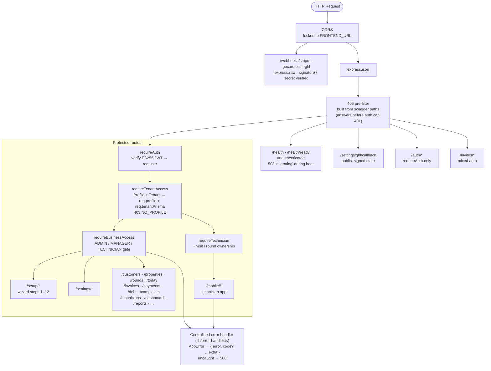
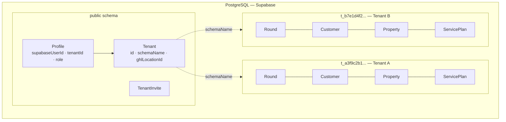
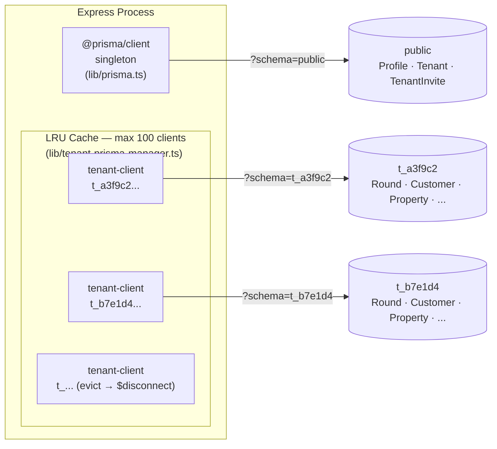
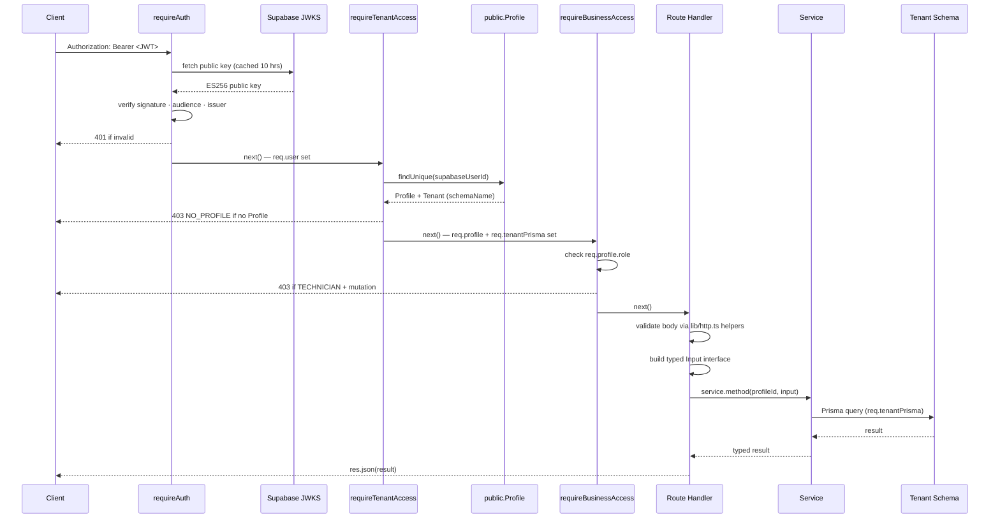
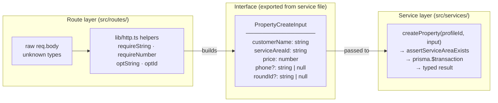
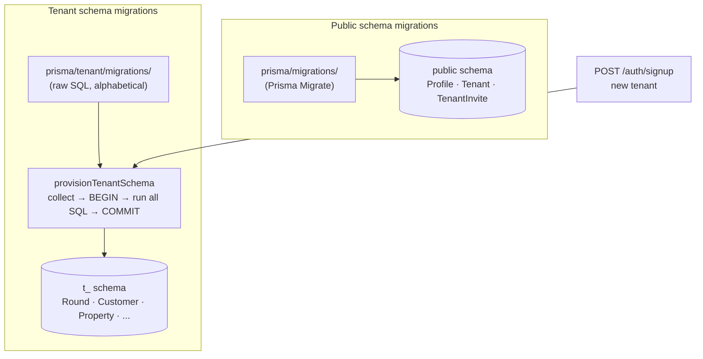
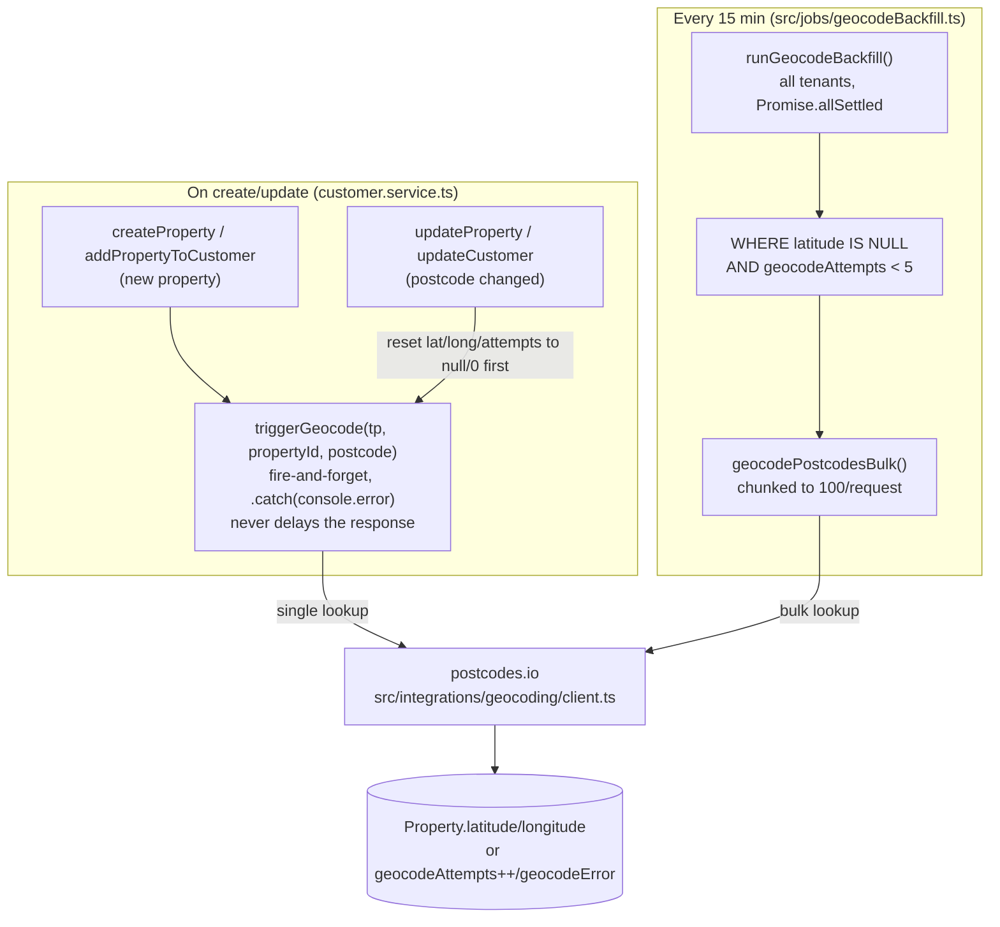

# RoundFlow Backend Architecture — Latest

> **This is the living architecture doc.** It supersedes `ARCHITECTURE.md` for anything that touches GHL —
> that file described a *planned* design before the integration was built; sections of it are now stale
> (file paths that don't exist, a token-storage location that moved, event types that were never implemented).
> Everything in this file has been checked against the current code (`src/`, `prisma/tenant/schema.prisma`)
> and the docs team handoff (`docs/GHL_AUTOMATION_OWNER_HANDOFF.md`) as of **2026-10-30**. Keep updating **this**
> file as the GHL/automation work progresses — not `ARCHITECTURE.md`.
>
> **2026-10-30 update (Phase 1 audit remediation):** startup and health (§6), mobile role guard (§7), error
> body (§9), the GHL backlog of §10.4–§10.7, which is now built, BACS/cheque reconciliation (§10.7a), the
> setup/settings split (§11), three new tenant migrations (§12), and the new domain services, jobs and
> quality gates (§15–§16). The remediation plan and contracts are in
> `docs/handoff/backend/2026-10-30-phase1-audit-remediation-plan.md` and
> `docs/handoff/frontend/2026-10-30-phase1-audit-frontend-handoff.md`.

## 1. Overview

RoundFlow is a multi-tenant SaaS backend for UK window-cleaning businesses. Each business (tenant) operates in complete isolation — they share the same Express/TypeScript process and the same PostgreSQL instance, but their operational data lives in a dedicated Postgres schema. The backend is deployed on Railway and communicates with a React frontend; it has no HTML rendering concerns.

**Phase 1 target:** GHL-connected clients only. RoundFlow is sold as a private integration to businesses already on Agentum's GoHighLevel agency — not listed on the GHL Marketplace yet. GHL connection is required in Phase 1; marketplace listing and standalone mode are Phase 2.

Note: the code already supports **both** a marketplace-style OAuth install flow and a direct Private-Integration-Token (PIT) connect flow (see §10.2) — the "not listed on the Marketplace yet" line is about business/listing status, not a code limitation.

**Standalone capability:** The core app (rounds, visits, payments, debt, technicians) works without a GHL connection. The only features that require GHL are SMS, WhatsApp, and email messaging. GoCardless payments work standalone.

---

## 2. Technology Stack

| Layer | Technology |
|---|---|
| Runtime | Node.js (TypeScript, compiled to `dist/`) |
| Framework | Express 4 |
| ORM | Prisma (two separate clients — see §5) |
| Database | PostgreSQL via Supabase (hosted) |
| Identity provider | Supabase Auth (ES256 JWTs, JWKS) |
| Staff invite email | Supabase Auth (`admin.auth.inviteUserByEmail`) — same infrastructure as OTP + password reset |
| Customer-facing email | GHL (same as SMS/WhatsApp — all customer comms route through the GHL outbox) |
| Deployment | Railway |
| API docs | Swagger UI (`/docs`) |

---

## 3. High-Level Structure



Startup and cron wiring live in `src/server/bootstrap.ts`; `src/index.ts` only calls it (see §6).

---

## 4. Multi-Tenancy: Schema-Per-Tenant

### The model

Every tenant gets their own Postgres schema named `t_<20-hex-chars>` (e.g. `t_a3f9c2b1...`). All operational tables — `Round`, `Customer`, `Property`, `ServicePlan`, `Visit`, `Technician`, `ServiceArea`, etc. — live inside that schema. Tenants cannot see or touch each other's data at the database level.

The `public` schema holds only three cross-tenant tables: `Profile`, `Tenant`, and `TenantInvite`. These are managed by `@prisma/client` (the public-schema Prisma client singleton).



### Provisioning

When a new business signs up via `POST /auth/signup`:

1. A `Tenant` row is created in `public.Tenant` with a randomly generated `schemaName`.
2. A `Profile` row is created in `public.Profile` linking the Supabase user ID to the tenant.
3. `provisionTenantSchema(schemaName)` is called — it opens a **direct pg connection** (non-pooled), creates the Postgres schema, then runs all tenant migration SQL files inside a single `BEGIN`/`COMMIT` block. If anything fails the transaction rolls back, leaving the schema empty and retryable.

The provisioning function is idempotent: if `BusinessSettings` (the last table in the migration sequence) already exists, it returns immediately without touching anything.

### Isolation guarantee

No tenant data ever touches the public schema. No public-schema query ever touches a tenant schema. The two Prisma clients (§5) enforce this boundary in code.

---

## 5. Two Prisma Clients

This is the most important architectural detail to understand.

### Client 1 — `@prisma/client` (public schema singleton)

```
src/lib/prisma.ts  →  import { PrismaClient } from "@prisma/client"
```

- Talks to the `public` schema only.
- Single global instance shared across the whole process.
- Used by: `requireTenantAccess` (loads Profile + Tenant), `requireAuth` indirectly, invite routes, auth routes.
- Models: `Profile`, `Tenant`, `TenantInvite`.

### Client 2 — `src/generated/tenant-client` (LRU pool)

```
src/lib/tenant-prisma-manager.ts  →  import { PrismaClient } from "../generated/tenant-client"
```

- Talks to a specific tenant schema, set via `?schema=t_<hex>` on the connection string.
- Not a singleton — one `PrismaClient` instance per active tenant schema, cached in an LRU cache (max 100).
- When a tenant client is evicted from the LRU, `$disconnect()` is called immediately to release its connection pool back to Postgres.
- `getTenantPrismaForSchema(schemaName)` returns the cached client or constructs a new one.
- Used by: all service classes (customer, setup, settings) and the GHL adapter/outbox worker.
- Models: everything operational — `Round`, `Customer`, `Property`, `ServicePlan`, `Visit`, `Technician`, `ServiceArea`, `BusinessSettings`, `MessageTemplate`, `IntegrationOutbox`, `WebhookEvent`, `RoundTechnician`, etc.

### Why two separate generated clients?

Prisma generates type-safe models from a schema file. Because the public schema and tenant schema have completely different tables, they need separate `schema.prisma` files and therefore separate generated clients. Mixing them in a single client would either break the schema isolation or require complex Prisma multi-schema workarounds.

```
prisma/schema.prisma               →  generates @prisma/client
prisma/tenant/schema.prisma        →  generates src/generated/tenant-client
```



---

## 6. Request Lifecycle

### Server startup (GAP-005, `src/server/bootstrap.ts`)

1. `app.listen` first. `GET /health` and `GET /health/ready` answer `503 { status: "migrating" }` from this point.
2. `migrateAllTenantSchemas()` applies pending tenant migrations (§12). A failure still exits the process with code 1.
3. When it finishes: `/health` is `200 { status: "ok", timestamp }` and `/health/ready` is `200 { status: "ready" }`.
4. `registerCronJobs()` starts the jobs. Each run is guarded, so one failure is logged and doesn't stop the schedule:

| Job | Schedule (UTC) | What it does |
|---|---|---|
| `visitGen` | 01:00 daily | Generates next-cycle visits (stamped with a technician, §15) and applies due pause/resume transitions |
| `outbox` | every 30 s | Drains the GHL outbox for GHL-connected tenants (§10.3) |
| `geocodeBackfill` | every 15 min | Geocodes properties still missing coordinates (§14) |
| `kpiThresholds` | 02:00 daily | Raises KPI threshold alerts, at most one per technician + metric + month |
| `idempotencyPurge` | 03:00 daily | Deletes mobile `IdempotencyRecord` rows past their 7-day TTL |
| `preCleanReminders` | every 15 min | Pre-clean reminders; **only registered when `PRECLEAN_REMINDERS_ENABLED=true`**, so it can't duplicate the GHL workflow |

The startup log also lists missing integration env vars (`listMissingIntegrationEnv()`).

**405 pre-filter:** before the routers, a middleware built from the swagger `paths` answers `405` for a method the spec doesn't list on a known path, so a wrong method never reaches auth and gets a misleading 401. Consequence: **a documented path must list every method the code serves**, and literal paths must precede templated ones (`/invoices/bulk` before `/invoices/{id}`). `src/__tests__/swagger.contract.test.ts` enforces both.

### An authenticated request

A typical authenticated request (e.g. `GET /customers`) flows through:



---

## 7. Auth & RBAC

### Identity (authentication)

Supabase Auth is the identity provider. It handles signup UI, login, OAuth (Google), password reset, and JWT issuance. The backend never stores passwords or manages sessions — it only verifies JWTs.

`requireAuth` fetches Supabase's JWKS endpoint (keys cached 10 hours) and verifies every Bearer token with `jsonwebtoken`. The verification checks:
- Signature (ES256)
- Algorithm (ES256 only — no HS256 downgrade)
- Audience (`"authenticated"`)
- Issuer (the exact Supabase project URL)

Tokens from other Supabase projects cannot be replayed against this API.

### Authorisation (RBAC)

The JWT carries no app role — the Supabase `role` claim is always `"authenticated"` and is ignored. App roles live in `public.Profile.role` and are read from the database on every request by `requireTenantAccess`.

Three roles:

| Role | Can do |
|---|---|
| ADMIN | Everything |
| MANAGER | Everything |
| TECHNICIAN | Read-only (all mutations → 403) |

Role changes take effect on the very next request — no token refresh required, no stale state.

**The `/mobile/*` router is the exception** (Phase 1, A8). It skips `requireBusinessAccess` and uses `requireTechnician` (`src/mobile/ownership.ts`): only TECHNICIAN profiles with a linked `Technician` row get in (`403 TECHNICIAN_ONLY` / `NO_TECHNICIAN`). Each visit action then checks ownership (`403 NOT_YOUR_VISIT`), and chat checks round membership (`403 NOT_YOUR_ROUND`). A signed-in user with no Profile yet gets `403 code: "NO_PROFILE"` from `requireTenantAccess`, which the app uses to show a "finish your invite" screen.


---

## 8. The Route → Interface → Service Pattern

This is how the layers are decoupled.

### The problem it solves

Routes know about HTTP (headers, body, status codes). Services know about the database. Neither should know about the other's concerns. The interface is the contract between them.



### How it works in practice

**Step 1 — Route validates and builds an Input interface:**

```typescript
// src/routes/properties.ts
const input: PropertyCreateInput = {
  customerName: requireString(body.customerName, "customerName"),
  addressLine:  requireString(body.addressLine, "addressLine"),
  serviceAreaId: requireString(body.serviceAreaId, "serviceAreaId"),
  price:        assertPositive(requireNumber(body.price, "price"), "price"),
  // ...
};
res.status(201).json(await svc(req).createProperty(actorIdOf(req), input));
```

**Step 2 — Interface is defined in the service file (exported):**

```typescript
// src/services/customer.service.ts
export interface PropertyCreateInput {
  customerName: string;
  addressLine:  string;
  serviceAreaId: string;      // required — every property must have a service area
  price:        number;
  phone?:       string | null;
  roundId?:     string | null;
  // ...
}
```

**Step 3 — Service method takes the interface, talks to the DB:**

```typescript
async createProperty(profileId: string, input: PropertyCreateInput): Promise<{ ... }> {
  await this.assertServiceAreaExists(input.serviceAreaId);
  return this.prisma.$transaction(async (tx) => {
    const customer = await tx.customer.create({ data: { name: input.customerName, ... } });
    const property = await tx.property.create({ data: { serviceAreaId: input.serviceAreaId, ... } });
    // ...
  });
}
```

### Why this matters

- **Validation happens exactly once**, at the HTTP boundary. The service receives clean, typed data and never has to handle raw `unknown` values.
- **The interface is the contract**. If you make `serviceAreaId` required in the interface, TypeScript will immediately flag every route that doesn't supply it — the compiler enforces the invariant.
- **Services are independently testable**. You can call a service method with a mock Prisma client without touching Express at all.
- **Optional vs required is explicit**. `?: string | null` means the caller may omit it. `string` means it must be there. This is enforced at compile time, not at runtime by surprise.

### The `lib/http.ts` helpers

All input coercion goes through a shared set of helpers:

| Helper | Use case |
|---|---|
| `requireString(v, field)` | Field is mandatory and must be a non-empty string |
| `requireNumber(v, field)` | Field is mandatory and must be a finite number |
| `optString(v, field)` | Optional string; `undefined` = omitted, `null` = clear |
| `optId(v, field)` | Optional FK id; empty string treated as null |
| `optReqString(v, field)` | Present if provided but must be non-empty |
| `asObject(body)` | Asserts body is a JSON object, not array or primitive |
| `asArray(body, key)` | Accepts raw array or `{ key: [...] }` wrapper |

Every helper throws `AppError(400, ...)` on failure, which the centralised error handler converts to a `{ error: "..." }` JSON response.

---

## 9. Error Handling

`AppError` is the single typed error class:

```typescript
class AppError extends Error {
  constructor(public statusCode: number, message: string, public code?: string) { ... }
}
```

Any service or route can `throw new AppError(404, "Round not found")`. The centralised handler (`src/lib/error-handler.ts`, mounted last in `bootstrap.ts`) responds with:

```json
{ "error": "<message>", "code": "<code, if set>", "...": "any extra own fields of the error" }
```

Extra own fields are forwarded generically. For example, `AllocationError.fields` (`INVALID_ALLOCATION`) and `NoMatchingRoundError.suggestions` / `proposedName` (`NO_MATCHING_ROUND`) reach the client without hand-written route handlers. `statusCode`, `name` and `stack` are never sent. The handler also maps:
- an invalid JSON body to `400 "Invalid JSON in request body."`
- a Prisma foreign-key violation (`P2003`) to `409`

Untyped errors (unexpected exceptions) become 500s and are logged.

**Integration failures are typed too**, so a provider's rejection isn't a 500. A Stripe Connect code exchange that Stripe rejects is `400 STRIPE_CONNECT_FAILED`, with Stripe's reason; a Stripe outage is `502 STRIPE_UNAVAILABLE`. GHL send failures are `502 GHL_SEND_FAILED`, and a missing connection is `409 GHL_NOT_CONNECTED` / `STRIPE_NOT_CONNECTED`.

This means service code never touches `res` — it throws, the route handler propagates via `next(err)`, and the handler decides the HTTP response.

---

## 10. GHL Integration — As Actually Built

> Automation owner handoff (what to configure *inside* GHL): `docs/GHL_AUTOMATION_OWNER_HANDOFF.md`.
> That doc describes the target end-state (5 custom fields, 5 workflows, 5 tags). This section describes
> what the backend actually does today, where it diverges from that handoff, and the decisions behind it.

### 10.1 What GHL is in RoundFlow

GHL (GoHighLevel) is a **utility**, not the platform. RoundFlow does not run inside GHL. GHL handles:
- **All outbound customer communications**: SMS, WhatsApp, and Email — reminders, payment chases, job completion notifications. Configured as GHL Workflows by the automation owner; fired by RoundFlow-written Contact tags (and, once built, custom fields — see §10.6) via the outbox worker.
- **Inbound lead capture**: a GHL Workflow, triggered when a contact is tagged `ready-for-roundflow`, POSTs the contact to RoundFlow's webhook (see §10.5). This is a GHL Workflow *action* (custom webhook), not a native app-level `ContactCreate` subscription.

**Staff / internal email** (invite links, onboarding) uses Supabase Auth (`admin.auth.inviteUserByEmail()`) — the same infrastructure that sends OTP and password reset emails. Resend has been removed from the stack entirely.

**One GHL sub-account per tenant** — each business (tenant) has its own GHL location. `Tenant.ghlLocationId` (public schema, `@unique`) is the join key used by the outbox worker to find GHL-connected tenants; the actual credentials live on the tenant's own `BusinessSettings` row (see §10.2 — this differs from what was originally planned).

### Ownership boundary

| Domain | System |
|---|---|
| Customers, Properties, Rounds, Visits, Payments, Debt, Technicians | **RoundFlow** (system of record — always) |
| SMS / WhatsApp / Email delivery, lead capture, marketing sequences | **GHL** |
| GoCardless Direct Debit mandates + charges | **RoundFlow backend** (GoCardless SDK — charge creation, mandate setup, webhook receiver) |
| Stripe card fallback link generation | RoundFlow generates, GHL delivers |

RoundFlow **never** treats GHL as a database. Every write happens in RoundFlow Postgres first; GHL is told about it afterward via the outbox.

### 10.2 Connection & credentials — real location (corrected)

The original design doc planned to store GHL credentials on the public-schema `Tenant` model. **That's not where they live.** They're on the tenant schema's `BusinessSettings` row instead — consistent with every other integration (Stripe, GoCardless), which also store their encrypted credentials there, not on `Tenant`.

`BusinessSettings` (tenant schema) carries:

```
ghlConnected                Boolean  @default(false)
ghlLocationId                String?
ghlAccessTokenEncrypted      String?   // AES-256-GCM
ghlRefreshTokenEncrypted     String?   // null for a PIT connection
ghlTokenExpiresAt            DateTime?
ghlWebhookSecretEncrypted    String?   // gates ?secret= on POST /webhooks/ghl
```

`Tenant` (public schema) carries only `ghlLocationId String? @unique` — used solely so the outbox worker can cheaply list GHL-connected tenants without opening every tenant schema.

**Two connect paths exist, both implemented** (`src/routes/settings.ts`):

| Path | Route | Mechanism |
|---|---|---|
| OAuth (marketplace-style) | `GET /settings/ghl/authorize` → `GET /settings/ghl/callback` | `buildGhlAuthUrl` / `exchangeGhlCode` (`src/integrations/ghl/oauth.ts`); stores access + refresh token, auto-refreshes with a 5-minute buffer (`getGhlToken` in `src/integrations/ghl/api.ts`) |
| Private Integration Token (PIT) | `POST /settings/ghl/connect-private` | Admin pastes a token + locationId directly; no refresh token, never expires from RoundFlow's side. The key is verified against GHL before it's stored (a rejection is a 400 with GHL's reason). |
| Status / test | `GET /settings/ghl/status` · `POST /settings/ghl/test` | `{ connected, method: oauth \| private, locationId, locationName, webhookUrl, connectedAt }` (`locationName` is fetched live; `connectedAt` isn't stored yet, so it's always null). The test call relays `409 GHL_NOT_CONNECTED` or `502 GHL_SEND_FAILED`. |
| Disconnect | `POST /settings/ghl/disconnect` | Clears all `ghl*` fields on `BusinessSettings` and `Tenant.ghlLocationId` |

**OAuth callback (Phase 1, A5):** `GET /settings/ghl/callback` is **public**. The tenant comes from a signed `state` (HMAC, 10-minute expiry, `src/lib/oauth-state.ts`), not a bearer token, because GHL's redirect can't carry one. `Accept: application/json` gets JSON; otherwise it 302s to `${FRONTEND_URL}/settings/integrations?ghl=connected|error`. `authorize` returns `{ url }` as JSON and takes an optional `redirectUri` on the web origin. All GHL settings routes work **before setup completes**, so the wizard can connect messaging (§11).

### 10.3 Architecture: Outbox Pattern (built, not just planned)

Route handlers and service methods do **not** call GHL directly. They write an `IntegrationOutbox` row (same tenant-schema transaction as the operational write); a background worker drains it.

```mermaid
flowchart TB
    subgraph RF["RoundFlow (Express backend)"]
        direction TB
        RH["Route Handler\ne.g. Complete Visit"]
        SVC["queueGhlEvent(tp, eventType, customerId)\nwrites IntegrationOutbox row"]
        WORKER["outboxWorker.ts\nrunOutboxWorker()\npolled by a scheduler, batch 20, max 5 attempts"]
        WH["POST /webhooks/ghl\n?tenantId=&secret=\nverified, 200'd immediately, processed async"]
        RH --> SVC --> WORKER
        WH -.->|"today: InboundMessage, Uninstall only\nContactCreate/Update + lead-handoff: not yet wired, see §10.5"| RF
    end

    subgraph GHL["GoHighLevel (per-tenant sub-account)"]
        CONTACT["GHL Contact\n(ghlContactId join key)"]
        WF["GHL Workflows\nSMS · WhatsApp · Email\nreminders + payment chase"]
        CONTACT --> WF
    end

    subgraph ADAPTER["src/integrations/ghl/"]
        direction LR
        API["api.ts\ncreate/updateGhlContact\nadd/removeGhlTags\nsendGhlMessage"]
        OAUTH["oauth.ts\nexchange/refresh token"]
        SYNC["sync.ts\nqueueGhlEvent\nsyncCustomerToGhl\napplyGhlTags"]
    end

    WORKER -->|"decrypt token, call adapter"| ADAPTER
    ADAPTER -->|"update contact, add/remove tags"| CONTACT
    WF -->|"lead-handoff webhook action"| WH
```

Real file layout (corrected — the original doc's diagram named files that were never built):
- `src/integrations/ghl/api.ts` — token refresh, `createGhlContact`/`updateGhlContact`, `addGhlTags`/`removeGhlTags`, `sendGhlMessage`. **No custom-field functions exist yet** — see §10.6.
- `src/integrations/ghl/oauth.ts` — OAuth URL building + code/refresh-token exchange.
- `src/integrations/ghl/sync.ts` — `queueGhlEvent` (writes the outbox row), `syncCustomerToGhl`, `syncMessageToGhl`, `applyGhlTags`.
- `src/jobs/outboxWorker.ts` — `runOutboxWorker()`, drains `pending` rows per GHL-connected tenant, batch 20, gives up after 5 attempts (marks `dead`).
- `src/routes/ghlWebhook.ts` — inbound receiver.

Schema (`prisma/tenant/schema.prisma`) — real shape, already in code:

```
model IntegrationOutbox {
  id          String   @id @default(cuid())
  eventType   String   // see the event table below
  payload     Json     // always includes { customerId }
  status      String   @default("pending") // pending | sent | failed | dead
  attempts    Int      @default(0)
  lastError   String?
  createdAt   DateTime @default(now())
  processedAt DateTime?
}

model WebhookEvent {           // inbound dedup — unique constraint rejects replays
  id         String   @id @default(cuid())
  source     String   // "stripe" | "gocardless" | "ghl"
  externalId String
  receivedAt DateTime @default(now())
  @@unique([source, externalId])
}
```

**Outbox event types** (`src/jobs/outboxWorker.ts`):

| `eventType` | Queued by | Worker does |
|---|---|---|
| `customer.synced` | customer create/update | create/update the GHL contact |
| `visit.completed` | web and mobile visit completion | tag `visit-completed`; write `last_clean_date`, `round_name`, `technician_name`, `balance_owed` |
| `visit.scheduled` | nightly visit generation | write `next_clean_date` |
| `payment.collected` | shared payment-outcome handler (Stripe, GoCardless, manual) | tag `payment-collected`, remove `debt-overdue` + `payment-failed`; write `balance_owed` |
| `payment.failed` | the same handler, on FAILED | tag `payment-failed`; write `balance_owed` |
| `debt.overdue` | debt routes | tag `debt-overdue`; write `balance_owed` |
| `complaint.logged` / `complaint.resolved` | complaint create / resolve | add / remove `has-open-complaint` |
| `message.send` | queued sends (e.g. pre-clean reminders) | send the message through GHL |
| `message.visit_completed` | visit completion (skipped when `Customer.messagesOptOut`) | send the "Visit completed" template |

The worker only lists **GHL-connected tenants** (`Tenant.ghlLocationId`). Rows for a tenant that hasn't connected GHL stay `pending` until it does.

**Direct sends (Phase 1, A5).** User-initiated messages don't wait for the outbox: the payment link, debt reminder, invoice send and `POST /messages/send` call GHL synchronously through `src/services/message.service.ts`. That way the user sees the result: `409 GHL_NOT_CONNECTED`, `400 NO_CONTACT_FOR_CHANNEL`, `502 GHL_SEND_FAILED`, or success. The channel is `AUTO` (SMS if the customer has a mobile, else email), `SMS`, `EMAIL` or `WHATSAPP`. GHL's message id is stored as `Message.externalId`, and an invoice flips to SENT only after GHL accepts the message.

### 10.4 Tags — what's actually emitted today vs. the handoff doc's spec

| Tag | Added by (code) | Removed by (code) | In automation handoff doc? |
|---|---|---|---|
| `visit-completed` | `visit.completed` outbox event (web and mobile completion) | never (removal is a GHL Workflow action, by design) | ✅ yes |
| `payment-collected` | `payment.collected` outbox event (the shared payment-outcome handler: GoCardless, Stripe and manual reconciliation) | never | ❌ **not in the handoff doc** — undocumented extra tag (§10.7) |
| `debt-overdue` | `debt.overdue` outbox event (`routes/debt.ts`) | `payment.collected` handler | ✅ yes |
| `has-open-complaint` | `complaint.logged` outbox event (`routes/complaints.ts`) | `complaint.resolved` outbox event (complaint resolve) | ✅ yes |
| `payment-failed` | `payment.failed` outbox event. GoCardless `failed`, Stripe `payment_intent.payment_failed` and a manual FAILED all go through the shared payment-outcome handler (`services/payment.service.ts`). | `payment.collected` handler (a later successful payment) | ✅ yes — Workflow 4 ("Payment Failed Chase") |

All five tags in the automation handoff are now emitted and cleared as specified.

### 10.5 Inbound webhook — `POST /webhooks/ghl`

Verified per-tenant via `?tenantId=&secret=` (secret compared with `timingSafeEqual`), deduped via `WebhookEvent`, acks `200` immediately and processes async (`src/routes/ghlWebhook.ts`).

**Event types handled today:**
- `InboundMessage` — creates a `Message` row, linked to a `Customer` by `ghlContactId` if found.
- `Uninstall` — disconnects the tenant (clears all `ghl*` `BusinessSettings` fields + `Tenant.ghlLocationId`).
- `ContactCreate` / `ContactUpdate` — **explicit, permanent no-op.** This is a deliberate decision, not a TODO:

> **Decision: RoundFlow is always master for Customer data.** Once a `Customer` row exists and is linked via `ghlContactId`, inbound GHL contact edits are never applied — RoundFlow's copy always wins. GHL can only ever *originate* a new customer (via the tagged lead-handoff flow below); it can never overwrite an existing one. This avoids a sync-loop (RoundFlow pushes a contact update → GHL fires `ContactUpdate` → RoundFlow would re-import its own write) and keeps a single source of truth for operational data (billing, status, holds) that GHL has no concept of.

**What's documented but not yet handled — the actual lead-handoff mechanism:** per `GHL_AUTOMATION_OWNER_HANDOFF.md` §3/§4, "Lead Handoff to RoundFlow" (Workflow 5) is **not** a native `ContactCreate` app webhook. It's a GHL Workflow, triggered by the `ready-for-roundflow` tag, whose *action* is a custom webhook POST to this same `/webhooks/ghl` URL with a flat, untyped payload:

```json
{
  "contactId": "abc123",
  "firstName": "John",
  "lastName": "Smith",
  "email": "john@example.com",
  "phone": "+447700123456",
  "address1": "123 High Street",
  "city": "London",
  "postalCode": "SW1A 1AA"
}
```

This payload has **no `type` field**. **It is now handled** (`processEvent()` in `src/routes/ghlWebhook.ts`, branch `!type && contactId`). It first looks up an existing `Customer` by `ghlContactId`, for idempotency, since tag events can re-fire. If none exists, it creates the `Customer` (name/phone/email, with `ghlContactId`) and a `Property` (`address1`→`addressLine`, `postalCode`→`postcode`) in one transaction, because address fields live on `Property`. Per the master-data decision above, this is **create-only**: it never updates an existing linked customer.

### 10.6 Custom fields — built

`GHL_AUTOMATION_OWNER_HANDOFF.md` §1 lists 5 GHL **Contact custom fields** the backend populates by key name. **This is built.** `src/integrations/ghl/api.ts` lists the location's custom fields (GHL API `Version: v3`), resolves each key to GHL's field id, caching it per location and accepting namespaced keys like `contact.last_clean_date`, and writes them with `{ id, key, fieldValue }`. `applyGhlCustomFields` in `sync.ts` is called from the outbox worker (§10.3). A key the automation owner hasn't created yet in GHL is skipped, not an error.

| Field key | Type | Set when | Used by workflow |
|---|---|---|---|
| `last_clean_date` | Date | Job completed | Workflow 2 (job complete notification) |
| `next_clean_date` | Date | Next visit scheduled | Workflow 1 (pre-clean reminder) — **entirely dependent on this field** |
| `balance_owed` | Number | Invoice raised / payment collected or failed | Workflows 2–4 (message bodies reference it) |
| `round_name` | Text | Job completed | Workflow 2 |
| `technician_name` | Text | Job completed | Workflow 2 |

`balance_owed` is **never** a stored column — per the original design, compute it on demand (`SUM(unpaid Invoice.amount) − SUM(confirmed Payment.amount)`) at the moment it's written into the outbox payload, same as everywhere else in this codebase treats money.

### 10.7 Known gaps — tracked here, closed via the implementation plan

The original backlog for "what the backend needs before the automation owner can build/test all 5 GHL workflows" is **closed** (2026-10-30):

1. ✅ **Custom-fields adapter** — §10.6.
2. ✅ **The 5 custom fields wired** — `visit.completed`, `visit.scheduled`, and the payment/debt events (§10.3).
3. ✅ **`payment.failed`** — emitted by the shared payment-outcome handler, cleared by `payment.collected`.
4. ✅ **`has-open-complaint` removal on resolve** — `complaint.resolved`.
5. ✅ **Lead-handoff webhook branch** — §10.5.

Still open:
- *(Decision)* whether `payment-collected` (emitted, not in the handoff doc) should be documented and kept, or retired now that `balance_owed` is written.
- Live verification against a GHL test sub-account. The regression suite's GAP-017/GAP-034 specs do this once GHL keys are supplied; they were skipped in the 2026-10-30 run.

### 10.7a Payment status transitions — the full picture (not just GHL)

Separate from GHL, but directly relevant to the `payment-failed` gap above — here's every way a `Payment.status` can actually change today, and the gaps in that mechanism itself:

| Method | How it reaches PAID | How it reaches FAILED | Manual override exists? |
|---|---|---|---|
| `GOCARDLESS` | `gocardlessWebhook.ts` on `payments` resource, `action: "paid"/"confirmed"` | Same webhook, `action: "failed"` | No |
| `STRIPE` | `stripeWebhook.ts` on `checkout.session.completed` | Same file, `payment_intent.payment_failed` | No |
| `CASH` | Created as `PAID` directly at visit completion (`routes/visits.ts`, `mobile/routes.ts`) — requires `cashConfirmed: true` in the request, or the completion call is rejected with a 400 | **No FAILED state exists for cash** — it's a binary confirm-at-source gate, not a retroactive status. If cash wasn't collected, the visit simply isn't completed with that method. | N/A by design |
| `BACS` / `CHEQUE` | Created as `PENDING` at visit completion. An admin reconciles it: `PATCH /payments/:id/status { status: "PAID" }`, or `POST /invoices/:id/mark-paid { method, reference?, paidAt?, amount? }`, which also works when no Payment row exists | `PATCH /payments/:id/status { status: "FAILED" }` | **Yes** (Phase 1, GAP-027 / A7). `Payment.reference` stores the bank reference or cheque number, including cheque numbers captured in the technician app. |

So: every method now has a path to PAID, and every non-cash method has a path to FAILED. Webhooks and `PATCH /payments/:id/status` go through the shared payment-outcome handler (`services/payment.service.ts`). `POST /invoices/:id/mark-paid` has its own transaction but the same side effects: it queues `payment.collected` and lifts a settled customer's payment hold. So GHL tags (§10.4) and the hold behave the same whichever way the payment resolved. **Cash has no failure concept** by design: it is confirmed at source instead.

### 10.8 Template / Snippet two-way sync — planned, not in the original handoff spec

Separate initiative, requested directly (not part of `GHL_AUTOMATION_OWNER_HANDOFF.md`): sync RoundFlow's `MessageTemplate` rows (SMS templates — `name`, `channel`, `subject`, `body`) with GHL **Snippets**.

**Decided so far:**
- Scope is SMS templates (`MessageTemplate`), mapped to GHL Snippets — not GHL's separate email-template builder.
- Outbound direction (RoundFlow → GHL) follows the same outbox pattern as customer sync: add `ghlSnippetId String?` to `MessageTemplate`, hook create/update/delete in `MessageTemplateService` to enqueue `template.synced`/`template.deleted` outbox rows, add `createGhlSnippet`/`updateGhlSnippet`/`deleteGhlSnippet` to `api.ts`.

**Not yet decided / not yet verified — do not build against assumptions here:**
- **GHL Snippets public API existence is unverified.** The scopes currently requested (`GHL_SCOPES` in `oauth.ts`) don't include anything snippet-related, and no official webhook event for snippet changes could be confirmed from GHL's docs. This needs a direct check in the GHL marketplace app's scope picker before any inbound (GHL → RoundFlow) sync is designed. If no public API/webhook exists, inbound sync may only be possible via polling, or may not be possible at all.
- **Conflict rule for templates is still open.** For Customers, the decision is "RoundFlow always wins" (§10.5). Templates are just content, not operational records, so the same rule may not be the right default — true bidirectional (last-write-wins) is also on the table. Needs an explicit decision before building conflict handling.

---

## 11. Setup Wizard and Post-Setup Split

The backend enforces a split between setup-time and runtime operations:

- **`/setup/*` writes** are only callable during setup (`setupCompleted = false`). An `assertSetupIncomplete` guard returns 403 once the wizard is complete. The step **GETs stay open**, so Settings can read back saved values.
- **`/settings/*` mutations** call `assertSetupComplete`, which returns 403 until setup is done; GETs are always open. **Exception:** the provider-connection routes (Stripe, GoCardless, GHL connect, disconnect, status and test) work **during setup**, so the wizard's Payments and Messages steps can connect providers.
- `/customers/*`, `/properties/*` and the other operational routes are runtime routes.

**Wizard progress (GAP-002).** `GET /setup/status` returns `steps[]` by backend number **and** `wizardSteps: [{ key, step, complete }]` in the web's display order. The web shows the steps in a different order from their backend numbers: Business(1) → Areas(7) → Round Settings(4) → Rounds(8) → Services(3) → Technicians(6) → Payments(2) → Messages(5) → Properties(9) → Activate(11). Steps unlock in **display order**. A step is "complete" once it has been saved at least once (`BusinessSettings.completedSteps`), not by counting rows. Step 10 (assign technicians) is `deferred` and doesn't block completion.

**Activation (GAP-016, X-2).** `GET /setup/step/11/preview` and `POST /setup/step/11` share one planner (`src/services/activation-plan.ts`), so the preview count is exactly what activation generates. Activation also sets each plan's `nextDueDate`; before this, recurrence stopped after the first window.

This prevents accidental re-configuration of a live tenant through the wizard endpoints and keeps onboarding and operations separate at the route level.

---

## 12. Migrations

Two migration trees, completely separate:

| Tree | Location | Managed by | Applies to |
|---|---|---|---|
| Public schema | `prisma/migrations/` | Prisma Migrate | `Profile`, `Tenant`, `TenantInvite` |
| Tenant schema | `prisma/tenant/migrations/` | `provisionTenantSchema` (replayed in order) | All operational tables |



Tenant migrations are replayed every time a new tenant schema is provisioned. They are **not** run via `prisma migrate` — they are collected alphabetically and executed as raw SQL inside a transaction by `provisionTenantSchema`. This means every new tenant always gets the full current schema from day one.

**Correction (2026-10-29) — existing tenant schemas ARE auto-migrated.** An
earlier version of this doc said otherwise and called it a "Phase 2 concern";
that's no longer true (`src/lib/tenant-provisioning.ts`). Every tenant schema
carries its own `"<schema>"."_migrations"` tracking table. On every server
startup, `migrateAllTenantSchemas()` (called from `src/server/bootstrap.ts`
**after** `app.listen`, while `/health` answers 503 `migrating` — see §6) lists every row in `public."Tenant"`, and for each one
diffs `prisma/tenant/migrations/*` against that tenant's `_migrations` table
and applies whatever is pending, each migration in its own transaction. A
tenant provisioned before this tracking existed gets baselined instead —
every currently-known migration is recorded as already-applied without
re-running it, since it was already applied during that tenant's original
provisioning. One tenant's migration failure is logged and skipped, not
fatal — it does not stop the rest of the fleet, or the app, from starting.
Net effect: dropping a new `migration.sql` folder into
`prisma/tenant/migrations/` is sufficient on its own — no separate "migrate
all tenants" command exists or is needed; the next deploy's startup applies
it everywhere.

### Current tenant migration log (updated — the original doc stopped at `20260915000000_technician_emergency`)

| Migration | Purpose |
|---|---|
| `20260721000001_init_tenant` | Full initial tenant schema — all operational models + enums. |
| `20260721000002_business_settings_unique_id` | Adds `BusinessSettings.uniqueId @unique @default("singleton")` — DB-enforced singleton. |
| `20260721000003_setup_steps_9_12` | `PropertyType` enum; `Property.propertyType`; `ServicePlan.cleaningFrequency`; `RoundTechnician` join table. |
| `20260726000000_message_template_subject` | Adds `MessageTemplate.subject String?` for email subject lines. |
| `20260728000000_service_area_single_default_index` | Partial unique index — one default `ServiceArea` per tenant. |
| `20260805000000_business_settings_last_closed_date` | Adds `BusinessSettings.lastClosedDate DateTime?`. |
| `20260805000001_technician_email_notes` | Adds `Technician.email String?` and `Technician.notes String?`. |
| `20260812000000_invoice_due_date` | Adds `Invoice.dueDate DateTime?`. |
| `20260812000001_customer_hold_next_clean` | Adds `Customer.holdNextClean Boolean @default(false)`. |
| `20260812000002_activity_log_actor` | Adds `ActivityLog.actorId String?`. |
| `20260825000000_cleaning_frequency_4_6_8_12` | Extends `CleaningFrequency` enum values. |
| `20260825000001_business_settings_pre_clean_reminder_timings` | Pre-clean reminder timing config on `BusinessSettings`. |
| `20260825000002_customer_landline` | Adds `Customer.landline String?`. |
| `20260915000000_technician_emergency` | `EmergencyStatus` enum + `TechnicianEmergency` model; emergency relations on `Technician` and `Round`. |
| `20260923000000_stripe_integration` | `StripeSessionType`/`StripeSessionStatus` enums; Stripe fields on `BusinessSettings`/`Invoice`; extends `PaymentStatus`/`InvoiceStatus`. |
| `20260923100000_gocardless_integration` | GoCardless credentials on `BusinessSettings`; `gocardlessCustomerId`/`gocardlessMandateId`/`gocardlessMandateStatus` on `Customer`. |
| `20260930000000_visit_started_arrived_at` | Adds `Visit.startedAt`/`Visit.arrivedAt` (mobile technician app timing). |
| `20261002000000_chat_message` | New `ChatMessage` model (round-level technician chat). |
| `20261002000001_debt_gating_config` | Adds `BusinessSettings.debtHoldMaxInvoices`/`debtHoldMaxAmount`. |
| `20261006000000_ghl_oauth` | Adds `ghlConnected`/`ghlLocationId`/`ghlAccessTokenEncrypted`/`ghlRefreshTokenEncrypted`/`ghlTokenExpiresAt` to `BusinessSettings` — **this is where GHL credentials actually live** (see §10.2). |
| `20261006000001_stripe_connect` | Adds `BusinessSettings.stripeConnectAccountId`. |
| `20261006000002_integration_outbox` | New `IntegrationOutbox` model. |
| `20261006000003_ghl_webhook_secret` | Adds `BusinessSettings.ghlWebhookSecretEncrypted`. |
| `20261013000000_mobile_issue_types` | Extends `IssueType` enum for technician-app access issues. |
| `20261013000001_mobile_gaps` | `Visit.originalPrice`/`priceAdjustmentReason`; `BusinessSettings.termsUrl`/`privacyUrl`; mobile "report a problem" support. |
| `20261013000002_mobile_notifications` | `ChatMessage.photoUrls`; new `Device` model (push token registrations). |
| `20261016161807_add_perf_indexes` | Adds indexes on `Complaint.status`, `Customer(status, createdAt)`, `Invoice(status, dueDate)`, `Payment.status`, `Visit.date`, etc. |
| `20261022000000_payments_webhook_fix` | Drops the never-usable per-tenant `stripeWebhookSecretEncrypted` (Stripe signs with its own platform-wide Connect secret, not a tenant-invented one); related GoCardless webhook-secret fix. |
| `20261022010000_bulk_import_idempotency` | New `BulkImportAttempt` model — idempotency for `POST /setup/step/9/bulk`. |
| `20261022020000_debt_hold_reason` | Adds `Customer.holdReason`/`holdSince`. |
| `20261022030000_complaint_resolution_fields` | Adds `Complaint.resolvedAt`/`resolvedBy`/`notes`. |
| `20261029000000_property_geocoding` | Adds `Property.latitude`/`longitude`/`geocodedAt`/`geocodeAttempts`/`geocodeError` — see §14. |
| `20261030000000_phase1_audit_remediation` | Phase 1 audit (§15): `VisitStatus.CANCELLED` + `Visit.cancelReason`; `PaymentTiming.COLLECT_DAILY_BATCH`; `Property.assignedTechnicianId`; `Visit.technicianOverride`; `Payment.reference`; BusinessSettings address, VAT rate, reminder, clean method, payment defaults and `completedSteps`; new `TechnicianIncident`, `KpiThreshold`, `KpiAlert`, `TechnicianAvailability`, `IdempotencyRecord`. |
| `20261030010000_phase1_followups` | `Customer.messagesOptOut`, `Message.externalId` (GHL message id), `Round.defaultServiceId`. |
| `20261030020000_access_issue_photos` | `PhotoType.ACCESS_ISSUE` + nullable `Photo.issueId` (photos attached to an access-issue report from the technician app). |

The three 2026-10-30 migrations are additive (new enum values, nullable columns, new tables). They are paired with idempotent, per-tenant backfill scripts that support `--dry-run`: `scripts/backfill-visit-technicians.ts`, `backfill-next-due-date.ts` and `backfill-completed-steps.ts`, with their logic in `src/jobs/backfills.ts`. Run them after the deploy has migrated the tenants, dry-run first.

---

## 13. Status Summary (read this before planning new GHL/automation work)

- ✅ **Built and working:**
  - **Platform:** multi-tenancy, auth/RBAC (incl. the technician-only `/mobile` guard), migrate-after-listen startup.
  - **GHL:** outbox, OAuth + PIT connection with status/test, outbound contact sync, all 5 tags, the 5 custom fields, direct message sends, inbound `InboundMessage`/`Uninstall`/lead-handoff.
  - **Payments:** GoCardless webhook, Stripe Connect, BACS/cheque reconciliation.
  - **Phase 1 domain work (§15):** technician stamping and split, recurrence, pause, payment hold, KPIs, idempotent mobile writes.
  - **Other:** property geocoding (§14).
- 🧪 **Verified 2026-10-30:** unit/route tests with 100% per-file and diff-coverage gates, the swagger contract test, and an end-to-end regression run against a local stack (§16). GHL and GoCardless live sandboxes are not yet exercised.
- 🚧 **Open:** the `payment-collected` tag decision (§10.7); a customer-level hold release (holds are per invoice); an endpoint for `Round.defaultServiceId`; storing GHL `connectedAt`; `state` validation on the Stripe callback; moving tenant migrations to a release step.
- 🆕 **New, decisions still open:** MessageTemplate ↔ GHL Snippet two-way sync (§10.8). Scope is decided (SMS templates); the GHL API capability and the conflict rule are still unverified/undecided.

---

## 14. Property Geocoding (Latitude/Longitude)

> Backend/frontend handoffs for this work: `docs/handoff/backend/2026-10-29-property-geocoding-handoff.md` /
> `docs/handoff/frontend/2026-10-29-property-geocoding-handoff.md`.

### 14.1 Why

`docs/Handoffs/ROUND_PLANNER_HANDOFF.md` §8 and
`docs/Handoffs/FRONTEND_WIRING_AUDIT_RESPONSE_2026-10-22.md` Part C item 1 both
flagged the same gap: `Property` had no coordinates at all, so the Round
Planner's Map view and the Dashboard's (frontend-placeholder, see §SRS)
"today's stops" map were scoped around the frontend geocoding addresses
itself. Both docs explicitly deferred fixing this as its own piece of backend
work. This section is that work.

### 14.2 Provider choice

Coordinates are derived **from `postcode` alone**, via
[postcodes.io](https://postcodes.io) — free, unauthenticated, UK-only. Chosen
over a paid maps API (Google/Mapbox) specifically to avoid a new vendor key
the frontend audit doc worried about ("confirmation the frontend will
actually have a maps API key configured") — RoundFlow is UK-only today, and
`addressLine` is a free-text line with no structure to geocode against
anyway. Precision is postcode-level (not point-level), which is adequate for
pin placement and route/map views; it is **not** adequate for turn-by-turn
navigation accuracy.

Because geocoding is postcode-keyed, an `addressLine`-only edit (e.g. a unit
number) never touches coordinates — only an actual postcode change
invalidates them.

### 14.3 Schema

```prisma
model Property {
  ...
  latitude        Float?
  longitude       Float?
  geocodedAt      DateTime?
  geocodeAttempts Int       @default(0)
  geocodeError    String?
}
```

All five are nullable/defaulted — no new required input anywhere, no frontend
form change. `latitude`/`longitude` are `null` until the first successful
geocode.

### 14.4 Architecture — write-then-backfill, same shape as the GHL outbox

Unlike GHL (§10.3), there's no persisted queue table — the "pending" set is
just `WHERE latitude IS NULL AND geocodeAttempts < 5` on `Property` itself,
which plays the same role as `IntegrationOutbox.status = 'pending'`.



- `src/integrations/geocoding/client.ts` — `geocodePostcode` (single,
  used by the inline trigger) and `geocodePostcodesBulk` (chunked to 100,
  used by the backfill job). A 404 ("no match") resolves to `null`, not a
  thrown error; any other non-2xx or network failure throws.
- `src/jobs/geocodeBackfill.ts` — `runGeocodeBackfill()`, cron-scheduled
  `*/15 * * * *` in `src/index.ts` next to `runOutboxWorker`/
  `runVisitGeneration`. Per tenant: pull up to 500 pending properties, bulk
  lookup, write back coordinates or bump `geocodeAttempts`/`geocodeError`.
- `customer.service.ts`'s `triggerGeocode()` helper is called with
  `this.prisma` (never a transaction client) **after** the triggering
  `$transaction` has committed — an HTTP call never runs inside a DB
  transaction here.

**Dead-letter, without a status enum.** Unlike the outbox's explicit
`status: "dead"`, a property that fails 5 times simply stops matching the
`geocodeAttempts < 5` filter — it's left alone (with its last `geocodeError`
recorded) rather than retried forever. There is currently no endpoint to
reset/force a retry; that would mean clearing `geocodeAttempts` back to 0 on
that property.

### 14.5 Where it's exposed

Every response that already carried a property's `addressLine`/`postcode`
and feeds a map, planner, or technician-navigation view now also carries
`latitude`/`longitude` (`number | null`): `PATCH /properties/:id`,
`GET /customers`, `GET /customers/:id`, `GET /rounds/:id/planner/occurrences/:date`
(+ the batched multi-round variant), `GET /rounds/:id/today`, `POST /visits`,
and the mobile technician endpoints (`GET /mobile/rounds/today`,
`/mobile/visits/today`, `/mobile/completions`, `GET /mobile/visits/:id`).
Reporting/invoicing/PDF/complaint-detail address text (`reports.service.ts`,
`debt.service.ts`, `invoice.service.ts`, `complaint.service.ts`,
`src/integrations/pdf/render.ts`) deliberately was **not** touched — display
text only, no map/coordinate use. The Dashboard's GPS map
(`src/routes/dashboard.ts`) is still a frontend-only placeholder with no
backend endpoint — out of scope here, same as §SRS already noted.

### 14.6 Testing

`src/integrations/geocoding/client.ts` and `src/jobs/geocodeBackfill.ts` are
brand-new whole files with no pre-existing untested code, so — like the
`AUDIT_REMEDIATION_FILES` set — they're gated at 100% line/branch/function/
statement coverage in `vitest.config.ts` (`GEOCODING_FILES`). The callers
(`customer.service.ts`, `round.service.ts`, `visit.service.ts`, the mobile
services) mix this change into large, previously-untested files and are
deliberately not whole-file-gated, for the same reason
`AUDIT_REMEDIATION_FILES` excludes `round.service.ts`/`customer.service.ts` —
but every new branch this change introduces in them (geocode
success/failure/skip, postcode-changed/unchanged) is covered by a test.

---

## 15. Phase 1 Audit Remediation: Domain Services, Jobs and Helpers (2026-10-30)

Added by the Phase 1 audit remediation (plan: `docs/handoff/backend/2026-10-30-phase1-audit-remediation-plan.md`;
contracts: `docs/handoff/frontend/2026-10-30-phase1-audit-frontend-handoff.md`). Routes stay thin; this logic lives in
small, separately tested modules. Where a legacy service (`round.service.ts`, `customer.service.ts`,
`setup.service.ts`) needs it, it calls these rather than growing.

### 15.1 Visit scheduling and technician assignment

| Module | Responsibility |
|---|---|
| `src/lib/schedule.ts` | The only place date maths lives (UTC-safe): `frequencyWeeks`, `snapToWeekday`, `nextOccurrenceOfDay`, `initialNextDueDate`, `nextDueAfter`, `enumerateActivationVisits` (end date **exclusive**, which fixes the preview-vs-generated count mismatch). |
| `src/services/visit-assignment.ts` | `resolveTechnicianForVisit` (the property's assigned technician if still on the round and available, else the only available round technician, else `null`), `autoSplit` (deterministic split by postcode, street and house number; whole streets stay together), `technicianIdsUnavailableOn`, and `restampFutureVisits`. Restamping leaves visits with `Visit.technicianOverride = true` alone, so a manager's manual reassignment is never overwritten. |
| `src/services/activation-plan.ts` | One planner shared by `GET /setup/step/11/preview` and `POST /setup/step/11`. The preview count can't drift from what activation generates. |
| `src/services/service-plan-lifecycle.ts` | `pausePlan` and `resumePlan`, the single source of truth for pause and resume, called by the routes **and** the nightly job. Pausing cancels SCHEDULED visits in the window (`status CANCELLED`, `cancelReason "PAUSED"`). A pause starting in the future keeps the plan ACTIVE with the dates stored; the nightly job flips it. Cancelled visits are never restored on resume. |

**Fixes two defects the audit did not report.** Generated visits previously never got a `technicianId`, so the technician
app showed no jobs. Setup service plans never got a `nextDueDate`, so recurrence stopped after the first window. Visit
generation (`jobs/visitGeneration.ts`), `POST /rounds/:id/generate-visits` and `activateSystem` now all stamp the
technician and `paymentHold`, and set `nextDueDate`.

`VisitStatus.CANCELLED` exists now. Every reader of visit lists (planner, today, debt, reports, mobile) excludes it by
default; Visit History (`GET /customers/:id/visits`) includes it with `cancelReason`.

### 15.2 Money: holds, status, completion, messaging

| Module | Responsibility |
|---|---|
| `src/services/payment-hold.ts` | `holdNextVisits`, `releaseHeldVisits`, `releaseHoldIfSettled`. Flagging a hold now sets `Visit.paymentHold` on the customer's next SCHEDULED visit per active property (it previously only set a customer flag). Paying the last open invoice releases it automatically when `debtHoldEnabled` is on. |
| `src/services/customer-payment-status.ts` | Derives `NONE`, `PAID`, `UNPAID`, `OVERDUE`, `ON_HOLD` or `FAILED` from invoices and payments, with a fixed precedence. `amountDue` is the sum of unpaid SENT invoices. |
| `src/services/visit-completion.ts` | One transactional completion path shared by `PATCH /visits/:id/complete` and `PATCH /mobile/visits/:id/complete`. Payment input is validated **before** any write; then the status, Payment, cheque activity log, note and outbox rows are written in a single `$transaction`. A failed validation leaves the visit untouched, so a retry works. |
| `src/services/message-templates.ts` | Template lookup and `{{var}}` rendering (unknown variables render empty), with built-in fallback bodies. |
| `src/services/message.service.ts` | `send` with channel `SMS`, `EMAIL` or `WHATSAPP` (default SMS if the customer has a mobile, else EMAIL). The `Message` row is written only **after** GHL accepts, and stores `externalId`. Payment links, reminders and invoice sends all use it. |

**The static `pay.roundflow.app` payment-link fallback is gone.** With no Stripe connection the API answers
`409 STRIPE_NOT_CONNECTED`. Payment links are real Stripe Checkout sessions on the tenant's connected account
(`integrations/stripe/checkout.ts`), created only after the contact and channel checks pass.

**Invoice numbers** are allocated inside a `$transaction` that first takes
`pg_advisory_xact_lock(hashtext(current_schema() || ':invoice-number'))`, a per-tenant lock released on commit. Numbers
are the highest existing suffix plus one, not a row count, so a deletion never re-issues a number. The unique index on
`invoiceNumber` is the backstop.

### 15.3 Technician KPIs and operations

| Module | Responsibility |
|---|---|
| `src/services/technician-kpi.service.ts` | Period parsing and the KPI maths: `timeOnJobMinutes` (sum of `completedAt - startedAt`), `revenuePerHour`, and strike, damage and upsell counts. `null` only means "no data in the period". |
| `src/services/technician-incident.service.ts` | CRUD for `TechnicianIncident` (`STRIKE`, `DAMAGE`, `UPSELL`). Upheld complaints also count as strikes. |
| `src/services/kpi-threshold.service.ts` | `GET/PUT /settings/kpi-thresholds` (replace-all). Metric and operator pairs are unique. |
| `src/services/technician-availability.service.ts` | Availability windows and `replace` (moves a technician's SCHEDULED visits in a window to a replacement, with `technicianOverride = true`, in one transaction). An open-ended window is stored as 2099-12-31 because the column is required. |
| `src/services/photo-gallery.service.ts` | Paginated photo galleries for properties and technicians, using signed read URLs. |

### 15.4 Storage, security and helper modules

| Module | Responsibility |
|---|---|
| `src/lib/signed-read-url.ts` | Batch signed **read** URLs (1 h TTL) for the private `visit-photos` bucket. The only read-URL helper (a duplicate was merged into it). Returns `null` per item if Storage fails; requests still succeed. |
| `src/mobile/media-urls.ts` | Signs only paths under the caller's own tenant prefix; anything else returns `null`. Used for `avatarSignedUrl`, chat `photoSignedUrls` and visit `photos[].signedUrl`. |
| `src/lib/settings-dto.ts` | `toBusinessSettingsDto` strips every `*Encrypted` field and secret before BusinessSettings leaves the API, and converts `vatRate` to a number. Used on every `/settings/*` and `/setup/step/1`, `/2`, `/4` response. (Previously the encrypted token ciphertexts were returned.) |
| `src/lib/oauth-state.ts` | HMAC-SHA256 signed, 10-minute `state` for the GHL OAuth round trip. Carries the tenant and the validated `redirectUri`. The GHL callback is public and resolves the tenant from this state. |
| `src/integrations/ghl/connection.ts` | `fetchGhlLocation`, webhook and redirect URL builders, and the allowed-origin check for a custom `redirectUri` (must be on a `FRONTEND_URL` origin). |
| `src/lib/customer-match.ts` | Existing-customer matching for setup: mobile normalised to digits with `+44`, `0044` and `44` treated as `0`, and case-insensitive email. |
| `src/lib/row-error.ts`, `src/lib/settings-validators.ts` | Per-row bulk-import errors `{ row, field, error }`, and validators for the new settings fields. |
| `src/lib/env-check.ts` | `listMissingIntegrationEnv()`, logged at startup as a warning. |
| `src/lib/error-handler.ts` | The central error handler. Forwards extra `AppError` fields generically (`fields`, `suggestions`, `proposedName`), so routes no longer hand-roll them. |

### 15.5 Mobile API hardening (`/mobile/*`)

- **Role and ownership.** Every `/mobile` route requires role `TECHNICIAN` and a linked Technician row (`403 TECHNICIAN_ONLY` or `NO_TECHNICIAN`). Every visit action checks `visit.technicianId === me`, else `403 NOT_YOUR_VISIT` (`src/mobile/ownership.ts`). Chat is limited to the technician's own rounds (`NOT_YOUR_ROUND`).
- **Idempotency** (`src/mobile/idempotency.ts`). Visit writes accept an optional `X-Idempotency-Key` header (1 to 200 characters). The first 2xx response is stored in `IdempotencyRecord`; a repeat from the same technician on the same method and path replays it with response header `Idempotent-Replay: true`. A key used by another technician is `403 IDEMPOTENCY_KEY_CONFLICT`; the same technician reusing it on a different route is `409 IDEMPOTENCY_KEY_REUSED`. Records are purged after 7 days. This exists because the technician app queues actions offline and replays them. Known limit: two *simultaneous* duplicates both execute.
- **Payments on completion.** `payment: { method: CASH | CHEQUE | NONE, amount?, chequeNumber? }`. CASH creates a PAID Payment; CHEQUE creates a PENDING one (cleared later by `POST /invoices/:id/mark-paid`) with the number in `Payment.reference`. `cashConfirmed: true` is a deprecated alias for CASH.
- **Photos.** Types `BEFORE`, `AFTER` and `ACCESS_ISSUE` (linked by `Photo.issueId`). Each path must start with `<tenantId>/visits/<visitId>/`.
- **Upsells** (`POST /mobile/visits/:id/upsells`, `src/mobile/services/upsell.service.ts`) are stored as `TechnicianIncident` rows of type `UPSELL`.

### 15.6 Background jobs

All registered in `src/server/bootstrap.ts` (`registerCronJobs`); each run is wrapped so one failing tenant is logged and the others continue.

| Job | Schedule (UTC) | What it does |
|---|---|---|
| `visitGen` (`jobs/visitGeneration.ts`) | 01:00 daily | Applies pause and resume transitions through `service-plan-lifecycle`, then generates next-cycle visits (technician and hold stamped). Skips tenants with `autoCreateNextVisit = false`. |
| `outbox` (`jobs/outboxWorker.ts`) | every 30 s | Drains the GHL outbox. Now also handles `message.send` (pre-clean reminders) and `message.visit_completed`. Opted-out customers (`Customer.messagesOptOut`) are skipped. Drains only GHL-connected tenants; other tenants' rows stay pending. |
| `geocodeBackfill` | every 15 min | Unchanged (section 14). |
| `kpiThresholds` (`jobs/kpiThresholds.ts`) | 02:00 daily | Evaluates the month's KPIs against thresholds; creates de-duplicated `KpiAlert` rows (unique per technician, metric and `YYYY-MM`) and notifies admins. Surfaces as `kpiAlerts` on `GET /dashboard/alerts`. |
| `idempotencyPurge` (`jobs/idempotencyPurge.ts`) | 03:00 daily | Deletes idempotency records older than 7 days. |
| `preCleanReminders` (`jobs/preCleanReminders.ts`) | every 15 min, **only when `PRECLEAN_REMINDERS_ENABLED=true`** | Queues the "Pre-clean reminder" message at the tenant's configured local time (`reminderMode` and `reminderTime`, default Europe/London, BST-safe). Opt-in so it doesn't duplicate the existing GHL workflow. |

### 15.7 Backfills (run once per environment, `--dry-run` first)

`src/jobs/backfills.ts` holds the logic; `scripts/backfill-*.ts` are thin CLIs. All are idempotent and run per tenant.

| Script | Purpose |
|---|---|
| `scripts/backfill-visit-technicians.ts` | Stamp technicians on existing future visits (`restampFutureVisits` per active round). |
| `scripts/backfill-next-due-date.ts` | Set `nextDueDate` on ACTIVE plans where it is null. A computed date in the past falls back to the next round day, so the nightly job doesn't create one past visit per night. |
| `scripts/backfill-completed-steps.ts` | Rebuild `BusinessSettings.completedSteps` from the old row-count rules, so tenants part-way through setup don't see their progress reset. |

---

## 16. Quality Gates and Contract Enforcement

Three gates run in CI and locally. They exist so this class of problem is caught by a test instead of by an audit.

1. **Per-file 100% coverage** (`vitest.config.ts`). Lists of whole files held at 100% line, branch, function and statement coverage, enforced per file: `PAYMENT_DOMAIN_FILES`, `AUDIT_REMEDIATION_FILES`, `GEOCODING_FILES`, `INVITE_FILES` and `PHASE1_AUDIT_FILES` (every new module in section 15, plus `server/bootstrap.ts`, `jobs/outboxWorker.ts` and `swagger.ts`). Run with `npm run test:coverage`. Large legacy files that only gained a few lines are deliberately not gated whole; the diff gate below covers their changed lines.
2. **Diff coverage** (`scripts/diff-coverage.mjs`). `npm run test:diff-coverage` fails if any **added or changed line** in `src/` is uncovered. Locally it diffs against `HEAD` plus untracked files; with `CI` set it diffs against `origin/main...HEAD` (or `DIFF_BASE`). It checks lines, and only warns on uncovered branches.
3. **Swagger contract test** (`src/__tests__/swagger.contract.test.ts`). Walks the real app's registered routes and asserts parity with `openApiDocument.paths` in both directions, and simulates the 405 pre-filter to prove it blocks no route the code serves.

**Why gate 3 matters.** `src/server/bootstrap.ts` builds a 405 pre-filter from the swagger paths: a request whose path matches a documented path but whose method isn't listed is answered `405` **before** it reaches the router. Two consequences:

- A documented path must list **every** method the code serves for it.
- Matching takes the first hit among paths of the same depth, so literal paths must be ordered **before** templated ones. `/invoices/bulk` must precede `/invoices/{id}`, or `POST /invoices/bulk` is rejected with a 405. This bug was found and fixed during the remediation.

Also: openapi-typescript marks any schema field that has a `default` as *required* in the generated frontend and app types, so optional request fields must not carry a swagger `default` (describe it in the text instead).

**End-to-end regression suite.** `roundflow-e2e/` (a sibling folder, not part of this package) runs one Playwright spec per audit gap against a local Docker Postgres, a locally started backend (port 3100) and web app (port 5173). The integration gaps use real Stripe test-mode, GoCardless sandbox and GHL sandbox credentials. It creates a fresh tenant per run and deletes the test users afterwards. Its first runs found a real defect: `GET /settings/stripe/callback` returned 500 when Stripe rejected a code. It is now `400 STRIPE_CONNECT_FAILED` or `502 STRIPE_UNAVAILABLE` (defect D-11).
