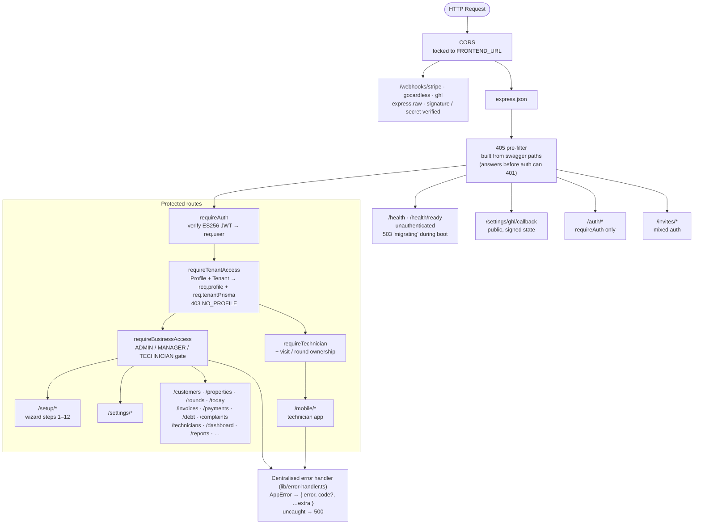
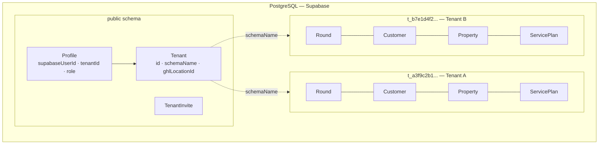
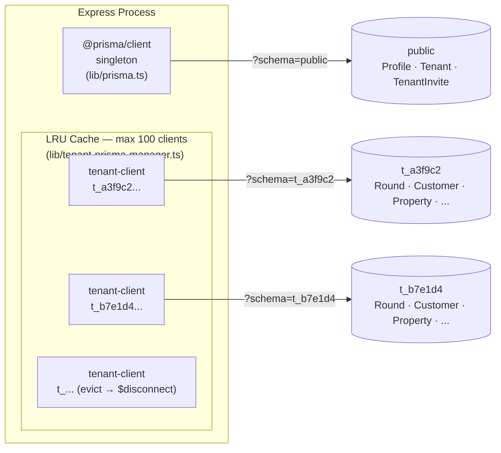
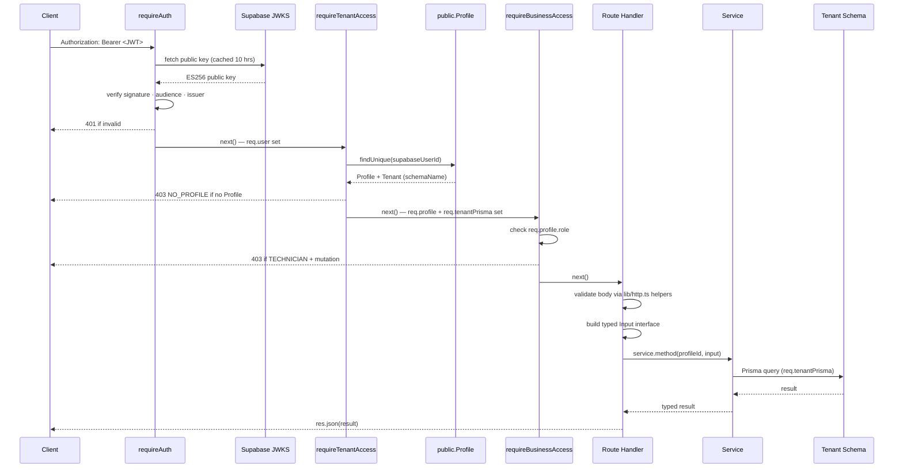
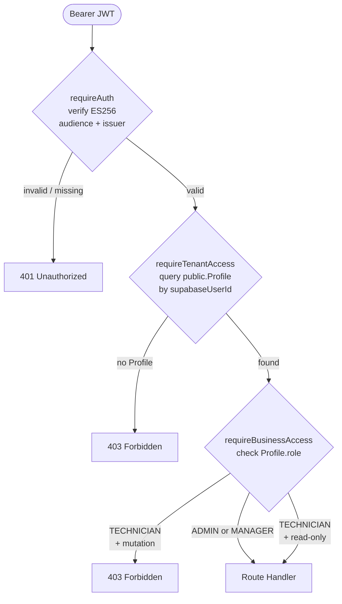
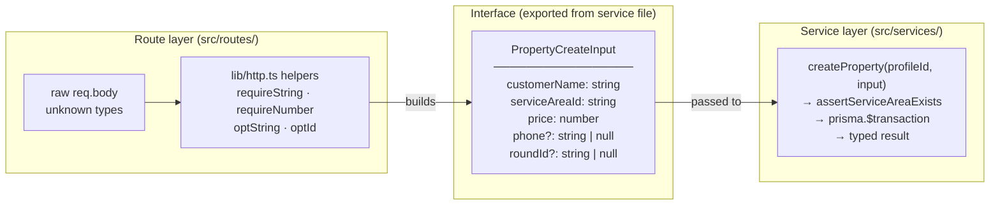
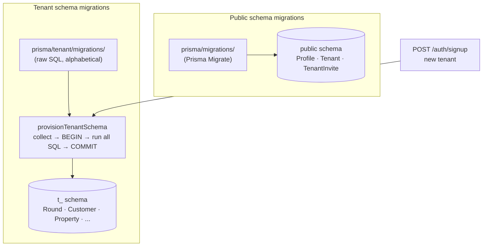
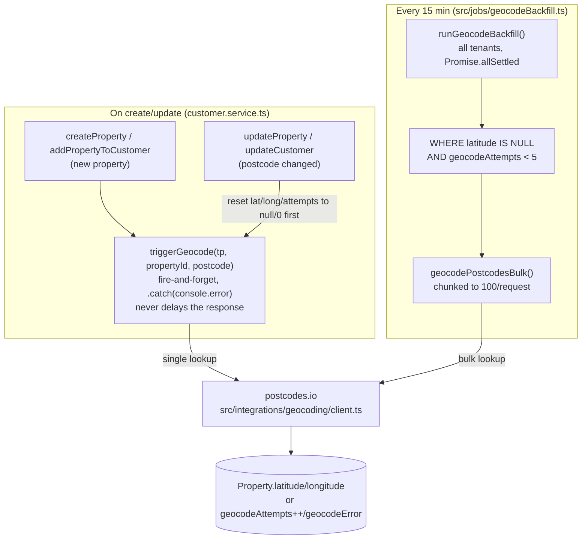

# RoundFlow Backend Architecture — Latest

> **This is the living architecture doc.** It supersedes `ARCHITECTURE.md` for anything that touches GHL —
> that file described a *planned* design before the integration was built; sections of it are now stale
> (file paths that don't exist, a token-storage location that moved, event types that were never implemented).
> Everything in this file has been checked against the current code (`src/`, `prisma/tenant/schema.prisma`)
> and the docs team handoff (`docs/GHL_AUTOMATION_OWNER_HANDOFF.md`) as of **2026-10-30**. Keep updating **this**
> file as the GHL/automation work progresses — not `ARCHITECTURE.md`.
>
> **2026-10-30 update (Phase 1 audit remediation):** startup and health (§6), mobile role guard (§7), error
> body (§9), the GHL backlog of §10.4–§10.7, which is now built, BACS/cheque reconciliation (§10.7a), the
> setup/settings split (§11), three new tenant migrations (§12), and the new domain services, jobs and
> quality gates (§15–§16). The remediation plan and contracts are in
> `docs/handoff/backend/2026-10-30-phase1-audit-remediation-plan.md` and
> `docs/handoff/frontend/2026-10-30-phase1-audit-frontend-handoff.md`.
>
> **2026-11-03 update (QA bug batch and chat):** reminders as a list, no automatic debt hold on new visits, round
> postcode sectors, accepted payment methods, catalogue-priced imports, editable property services, auto-invoice on
> completion, single-visit assignment, polling-based office chat, and the decisions behind them (§17).
>
> **2026-11-06 update (Wave 1: hardening, assignment and notifications):** process-level error handlers, webhook
> crash guard, 404 for unknown routes, gated API docs (§6, §9), the notification producers, the admin
> `/notifications` API and push preferences, the assignment result of `PUT /rounds/:id/technicians` (§18), and one
> new tenant migration (§12). Handoffs: `docs/handoff/backend/2026-11-06-wave1-backend.md` and
> `docs/handoff/frontend/2026-11-06-wave1-frontend-contract.md`.
>
> **2026-11-10 update (Flo AI):** an admin-only, read-only, streaming AI assistant over the tenant's own data: the
> `/flo/*` routes, the scope gate and guardrails, the ten lookup tools, the streamed answer pipeline, two new tenant
> tables and the `FLO_FILES` coverage gate (§22, §12, §16). Handoffs:
> `docs/handoff/backend/2026-11-10-flo-ai-backend.md` and `docs/handoff/frontend/2026-11-10-flo-ai-frontend-contract.md`.

## 1. Overview

RoundFlow is a multi-tenant SaaS backend for UK window-cleaning businesses. Each business (tenant) operates in complete isolation — they share the same Express/TypeScript process and the same PostgreSQL instance, but their operational data lives in a dedicated Postgres schema. The backend is deployed on AWS EC2 (region eu-west-1 or us-east-1: confirm which, then update this line) and communicates with a React frontend; it has no HTML rendering concerns.

**Phase 1 target:** GHL-connected clients only. RoundFlow is sold as a private integration to businesses already on Agentum's GoHighLevel agency — not listed on the GHL Marketplace yet. GHL connection is required in Phase 1; marketplace listing and standalone mode are Phase 2.

Note: the code already supports **both** a marketplace-style OAuth install flow and a direct Private-Integration-Token (PIT) connect flow (see §10.2) — the "not listed on the Marketplace yet" line is about business/listing status, not a code limitation.

**Standalone capability:** The core app (rounds, visits, payments, debt, technicians) works without a GHL connection. The only features that require GHL are SMS, WhatsApp, and email messaging. GoCardless payments work standalone.

---

## 2. Technology Stack

| Layer | Technology |
|---|---|
| Runtime | Node.js (TypeScript, compiled to `dist/`) |
| Framework | Express 4 |
| ORM | Prisma (two separate clients — see §5) |
| Database | PostgreSQL via Supabase (hosted) |
| Identity provider | Supabase Auth (ES256 JWTs, JWKS) |
| Staff invite email | Supabase Auth (`admin.auth.inviteUserByEmail`) — same infrastructure as OTP + password reset |
| Customer-facing email | GHL (same as SMS/WhatsApp — all customer comms route through the GHL outbox) |
| Deployment | AWS EC2 (region to confirm: eu-west-1 or us-east-1) |
| API docs | Swagger UI (`/docs`) |

---

## 3. High-Level Structure



Startup and cron wiring live in `src/server/bootstrap.ts`; `src/index.ts` only calls it (see §6).

Flo AI (§22) adds `/flo/*` to the protected routes (ADMIN only, a streaming `POST /flo/chat`), with its code in `src/routes/flo.ts`, `src/services/flo/` (orchestrator, scope gate, tools, answer builder), `src/integrations/anthropic/client.ts` and the nightly `src/jobs/floPurge.ts`.

---

## 4. Multi-Tenancy: Schema-Per-Tenant

### The model

Every tenant gets their own Postgres schema named `t_<20-hex-chars>` (e.g. `t_a3f9c2b1...`). All operational tables — `Round`, `Customer`, `Property`, `ServicePlan`, `Visit`, `Technician`, `ServiceArea`, etc. — live inside that schema. Tenants cannot see or touch each other's data at the database level.

The `public` schema holds only three cross-tenant tables: `Profile`, `Tenant`, and `TenantInvite`. These are managed by `@prisma/client` (the public-schema Prisma client singleton).



### Provisioning

When a new business signs up via `POST /auth/signup`:

1. A `Tenant` row is created in `public.Tenant` with a randomly generated `schemaName`.
2. A `Profile` row is created in `public.Profile` linking the Supabase user ID to the tenant.
3. `provisionTenantSchema(schemaName)` is called — it opens a **direct pg connection** (non-pooled), creates the Postgres schema, then runs all tenant migration SQL files inside a single `BEGIN`/`COMMIT` block. If anything fails the transaction rolls back, leaving the schema empty and retryable.

The provisioning function is idempotent: if `BusinessSettings` (the last table in the migration sequence) already exists, it returns immediately without touching anything.

### Isolation guarantee

No tenant data ever touches the public schema. No public-schema query ever touches a tenant schema. The two Prisma clients (§5) enforce this boundary in code.

---

## 5. Two Prisma Clients

This is the most important architectural detail to understand.

### Client 1 — `@prisma/client` (public schema singleton)

```
src/lib/prisma.ts  →  import { PrismaClient } from "@prisma/client"
```

- Talks to the `public` schema only.
- Single global instance shared across the whole process.
- Used by: `requireTenantAccess` (loads Profile + Tenant), `requireAuth` indirectly, invite routes, auth routes.
- Models: `Profile`, `Tenant`, `TenantInvite`.

### Client 2 — `src/generated/tenant-client` (LRU pool)

```
src/lib/tenant-prisma-manager.ts  →  import { PrismaClient } from "../generated/tenant-client"
```

- Talks to a specific tenant schema, set via `?schema=t_<hex>` on the connection string.
- Not a singleton — one `PrismaClient` instance per active tenant schema, cached in an LRU cache (max 100).
- When a tenant client is evicted from the LRU, `$disconnect()` is called immediately to release its connection pool back to Postgres.
- `getTenantPrismaForSchema(schemaName)` returns the cached client or constructs a new one.
- Used by: all service classes (customer, setup, settings) and the GHL adapter/outbox worker.
- Models: everything operational — `Round`, `Customer`, `Property`, `ServicePlan`, `Visit`, `Technician`, `ServiceArea`, `BusinessSettings`, `MessageTemplate`, `IntegrationOutbox`, `WebhookEvent`, `RoundTechnician`, etc.

### Why two separate generated clients?

Prisma generates type-safe models from a schema file. Because the public schema and tenant schema have completely different tables, they need separate `schema.prisma` files and therefore separate generated clients. Mixing them in a single client would either break the schema isolation or require complex Prisma multi-schema workarounds.

```
prisma/schema.prisma               →  generates @prisma/client
prisma/tenant/schema.prisma        →  generates src/generated/tenant-client
```



---

## 6. Request Lifecycle

### Server startup (GAP-005, `src/server/bootstrap.ts`)

1. `app.listen` first. `GET /health` and `GET /health/ready` answer `503 { status: "migrating" }` from this point.
2. `migrateAllTenantSchemas()` applies pending tenant migrations (§12). A failure still exits the process with code 1.
3. When it finishes: `/health` is `200 { status: "ok", timestamp }` and `/health/ready` is `200 { status: "ready" }`.
4. `registerCronJobs()` starts the jobs. Each run is guarded, so one failure is logged and doesn't stop the schedule:

| Job | Schedule (UTC) | What it does |
|---|---|---|
| `visitGen` | 01:00 daily | Generates next-cycle visits (stamped with a technician, §15) and applies due pause/resume transitions |
| `outbox` | every 30 s | Drains the GHL outbox for GHL-connected tenants (§10.3) |
| `geocodeBackfill` | every 15 min | Geocodes properties still missing coordinates (§14) |
| `kpiThresholds` | 02:00 daily | Raises KPI threshold alerts, at most one per technician + metric + month |
| `idempotencyPurge` | 03:00 daily | Deletes mobile `IdempotencyRecord` rows past their 7-day TTL |
| `preCleanReminders` | every 15 min | Pre-clean reminders; **only registered when `PRECLEAN_REMINDERS_ENABLED=true`**, so it can't duplicate the GHL workflow |

The startup log also lists missing integration env vars (`listMissingIntegrationEnv()`). `src/index.ts` also calls `installProcessErrorHandlers()` (Wave 1): an `unhandledRejection` is logged and the process keeps running; an `uncaughtException` is logged and the process exits with code 1 so the supervisor restarts it.

**405 pre-filter:** before the routers, a middleware built from the swagger `paths` answers `405` for a method the spec doesn't list on a known path, so a wrong method never reaches auth and gets a misleading 401. Consequence: **a documented path must list every method the code serves**, and literal paths must precede templated ones (`/invoices/bulk` before `/invoices/{id}`). `src/__tests__/swagger.contract.test.ts` enforces both.

**Unknown routes are `404 {error:"Not Found"}`** (Wave 1, BE-26). Only a documented path with an unsupported method gets `405` + `Allow`. **`/docs` and `/openapi.json`** are mounted only outside production, or in production when `EXPOSE_API_DOCS=true` (`shouldExposeApiDocs()`); otherwise they are 404 (BE-25).

### An authenticated request

A typical authenticated request (e.g. `GET /customers`) flows through:



---

## 7. Auth & RBAC

### Identity (authentication)

Supabase Auth is the identity provider. It handles signup UI, login, OAuth (Google), password reset, and JWT issuance. The backend never stores passwords or manages sessions — it only verifies JWTs.

`requireAuth` fetches Supabase's JWKS endpoint (keys cached 10 hours) and verifies every Bearer token with `jsonwebtoken`. The verification checks:
- Signature (ES256)
- Algorithm (ES256 only — no HS256 downgrade)
- Audience (`"authenticated"`)
- Issuer (the exact Supabase project URL)

Tokens from other Supabase projects cannot be replayed against this API.

### Authorisation (RBAC)

The JWT carries no app role — the Supabase `role` claim is always `"authenticated"` and is ignored. App roles live in `public.Profile.role` and are read from the database on every request by `requireTenantAccess`.

Three roles:

| Role | Can do |
|---|---|
| ADMIN | Everything |
| MANAGER | Everything |
| TECHNICIAN | Read-only (all mutations → 403) |

Role changes take effect on the very next request — no token refresh required, no stale state.

**The `/mobile/*` router is the exception** (Phase 1, A8). It skips `requireBusinessAccess` and uses `requireTechnician` (`src/mobile/ownership.ts`): only TECHNICIAN profiles with a linked `Technician` row get in (`403 TECHNICIAN_ONLY` / `NO_TECHNICIAN`). Each visit action then checks ownership (`403 NOT_YOUR_VISIT`), and chat checks round membership (`403 NOT_YOUR_ROUND`). A signed-in user with no Profile yet gets `403 code: "NO_PROFILE"` from `requireTenantAccess`, which the app uses to show a "finish your invite" screen.



---

## 8. The Route → Interface → Service Pattern

This is how the layers are decoupled.

### The problem it solves

Routes know about HTTP (headers, body, status codes). Services know about the database. Neither should know about the other's concerns. The interface is the contract between them.



### How it works in practice

**Step 1 — Route validates and builds an Input interface:**

```typescript
// src/routes/properties.ts
const input: PropertyCreateInput = {
  customerName: requireString(body.customerName, "customerName"),
  addressLine:  requireString(body.addressLine, "addressLine"),
  serviceAreaId: requireString(body.serviceAreaId, "serviceAreaId"),
  price:        assertPositive(requireNumber(body.price, "price"), "price"),
  // ...
};
res.status(201).json(await svc(req).createProperty(actorIdOf(req), input));
```

**Step 2 — Interface is defined in the service file (exported):**

```typescript
// src/services/customer.service.ts
export interface PropertyCreateInput {
  customerName: string;
  addressLine:  string;
  serviceAreaId: string;      // required — every property must have a service area
  price:        number;
  phone?:       string | null;
  roundId?:     string | null;
  // ...
}
```

**Step 3 — Service method takes the interface, talks to the DB:**

```typescript
async createProperty(profileId: string, input: PropertyCreateInput): Promise<{ ... }> {
  await this.assertServiceAreaExists(input.serviceAreaId);
  return this.prisma.$transaction(async (tx) => {
    const customer = await tx.customer.create({ data: { name: input.customerName, ... } });
    const property = await tx.property.create({ data: { serviceAreaId: input.serviceAreaId, ... } });
    // ...
  });
}
```

### Why this matters

- **Validation happens exactly once**, at the HTTP boundary. The service receives clean, typed data and never has to handle raw `unknown` values.
- **The interface is the contract**. If you make `serviceAreaId` required in the interface, TypeScript will immediately flag every route that doesn't supply it — the compiler enforces the invariant.
- **Services are independently testable**. You can call a service method with a mock Prisma client without touching Express at all.
- **Optional vs required is explicit**. `?: string | null` means the caller may omit it. `string` means it must be there. This is enforced at compile time, not at runtime by surprise.

### The `lib/http.ts` helpers

All input coercion goes through a shared set of helpers:

| Helper | Use case |
|---|---|
| `requireString(v, field)` | Field is mandatory and must be a non-empty string |
| `requireNumber(v, field)` | Field is mandatory and must be a finite number |
| `optString(v, field)` | Optional string; `undefined` = omitted, `null` = clear |
| `optId(v, field)` | Optional FK id; empty string treated as null |
| `optReqString(v, field)` | Present if provided but must be non-empty |
| `asObject(body)` | Asserts body is a JSON object, not array or primitive |
| `asArray(body, key)` | Accepts raw array or `{ key: [...] }` wrapper |

Every helper throws `AppError(400, ...)` on failure, which the centralised error handler converts to a `{ error: "..." }` JSON response.

---

## 9. Error Handling

`AppError` is the single typed error class:

```typescript
class AppError extends Error {
  constructor(public statusCode: number, message: string, public code?: string) { ... }
}
```

Any service or route can `throw new AppError(404, "Round not found")`. The centralised handler (`src/lib/error-handler.ts`, mounted last in `bootstrap.ts`) responds with:

```json
{ "error": "<message>", "code": "<code, if set>", "...": "any extra own fields of the error" }
```

Extra own fields are forwarded generically. For example, `AllocationError.fields` (`INVALID_ALLOCATION`) and `NoMatchingRoundError.suggestions` / `proposedName` (`NO_MATCHING_ROUND`) reach the client without hand-written route handlers. `statusCode`, `name` and `stack` are never sent. The handler also maps:
- an invalid JSON body to `400 "Invalid JSON in request body."`
- a Prisma foreign-key violation (`P2003`) to `409`

Untyped errors (unexpected exceptions) become 500s and are logged.

**Integration failures are typed too**, so a provider's rejection isn't a 500. A Stripe Connect code exchange that Stripe rejects is `400 STRIPE_CONNECT_FAILED`, with Stripe's reason; a Stripe outage is `502 STRIPE_UNAVAILABLE`. GHL send failures are `502 GHL_SEND_FAILED`, and a missing connection is `409 GHL_NOT_CONNECTED` / `STRIPE_NOT_CONNECTED`.

**Webhook routes** (`/webhooks/stripe`, `/webhooks/gocardless`, `/webhooks/ghl`) are not behind `h()`, so each handler is wrapped by `guardWebhook()` (`src/lib/webhook-guard.ts`, Wave 1): a throw (database, decrypt) is logged and answered `503 DATABASE_UNAVAILABLE` with `Retry-After` when the database is unreachable, otherwise `500`, so the provider retries and the process never sees an unhandled rejection. Work done after the early `200` ack keeps its own `.catch` logging.

This means service code never touches `res` — it throws, the route handler propagates via `next(err)`, and the handler decides the HTTP response.

---

## 10. GHL Integration — As Actually Built

> Automation owner handoff (what to configure *inside* GHL): `docs/GHL_AUTOMATION_OWNER_HANDOFF.md`.
> That doc describes the target end-state (5 custom fields, 5 workflows, 5 tags). This section describes
> what the backend actually does today, where it diverges from that handoff, and the decisions behind it.

### 10.1 What GHL is in RoundFlow

GHL (GoHighLevel) is a **utility**, not the platform. RoundFlow does not run inside GHL. GHL handles:
- **All outbound customer communications**: SMS, WhatsApp, and Email — reminders, payment chases, job completion notifications. Configured as GHL Workflows by the automation owner; fired by RoundFlow-written Contact tags (and, once built, custom fields — see §10.6) via the outbox worker.
- **Inbound lead capture**: a GHL Workflow, triggered when a contact is tagged `ready-for-roundflow`, POSTs the contact to RoundFlow's webhook (see §10.5). This is a GHL Workflow *action* (custom webhook), not a native app-level `ContactCreate` subscription.

**Staff / internal email** (invite links, onboarding) uses Supabase Auth (`admin.auth.inviteUserByEmail()`) — the same infrastructure that sends OTP and password reset emails. Resend has been removed from the stack entirely.

**One GHL sub-account per tenant** — each business (tenant) has its own GHL location. `Tenant.ghlLocationId` (public schema, `@unique`) is the join key used by the outbox worker to find GHL-connected tenants; the actual credentials live on the tenant's own `BusinessSettings` row (see §10.2 — this differs from what was originally planned).

### Ownership boundary

| Domain | System |
|---|---|
| Customers, Properties, Rounds, Visits, Payments, Debt, Technicians | **RoundFlow** (system of record — always) |
| SMS / WhatsApp / Email delivery, lead capture, marketing sequences | **GHL** |
| GoCardless Direct Debit mandates + charges | **RoundFlow backend** (GoCardless SDK — charge creation, mandate setup, webhook receiver) |
| Stripe card fallback link generation | RoundFlow generates, GHL delivers |

RoundFlow **never** treats GHL as a database. Every write happens in RoundFlow Postgres first; GHL is told about it afterward via the outbox.

### 10.2 Connection & credentials — real location (corrected)

The original design doc planned to store GHL credentials on the public-schema `Tenant` model. **That's not where they live.** They're on the tenant schema's `BusinessSettings` row instead — consistent with every other integration (Stripe, GoCardless), which also store their encrypted credentials there, not on `Tenant`.

`BusinessSettings` (tenant schema) carries:

```
ghlConnected                Boolean  @default(false)
ghlLocationId                String?
ghlAccessTokenEncrypted      String?   // AES-256-GCM
ghlRefreshTokenEncrypted     String?   // null for a PIT connection
ghlTokenExpiresAt            DateTime?
ghlWebhookSecretEncrypted    String?   // gates ?secret= on POST /webhooks/ghl
```

`Tenant` (public schema) carries only `ghlLocationId String? @unique` — used solely so the outbox worker can cheaply list GHL-connected tenants without opening every tenant schema.

**Two connect paths exist, both implemented** (`src/routes/settings.ts`):

| Path | Route | Mechanism |
|---|---|---|
| OAuth (marketplace-style) | `GET /settings/ghl/authorize` → `GET /settings/ghl/callback` | `buildGhlAuthUrl` / `exchangeGhlCode` (`src/integrations/ghl/oauth.ts`); stores access + refresh token, auto-refreshes with a 5-minute buffer (`getGhlToken` in `src/integrations/ghl/api.ts`) |
| Private Integration Token (PIT) | `POST /settings/ghl/connect-private` | Admin pastes a token + locationId directly; no refresh token, never expires from RoundFlow's side. The key is verified against GHL before it's stored (a rejection is a 400 with GHL's reason). |
| Status / test | `GET /settings/ghl/status` · `POST /settings/ghl/test` | `{ connected, method: oauth \| private, locationId, locationName, webhookUrl, connectedAt }` (`locationName` is fetched live; `connectedAt` isn't stored yet, so it's always null). The test call relays `409 GHL_NOT_CONNECTED` or `502 GHL_SEND_FAILED`. |
| Disconnect | `POST /settings/ghl/disconnect` | Clears all `ghl*` fields on `BusinessSettings` and `Tenant.ghlLocationId` |

**OAuth callback (Phase 1, A5):** `GET /settings/ghl/callback` is **public**. The tenant comes from a signed `state` (HMAC, 10-minute expiry, `src/lib/oauth-state.ts`), not a bearer token, because GHL's redirect can't carry one. `Accept: application/json` gets JSON; otherwise it 302s to `${FRONTEND_URL}/settings/integrations?ghl=connected|error`. `authorize` returns `{ url }` as JSON and takes an optional `redirectUri` on the web origin. All GHL settings routes work **before setup completes**, so the wizard can connect messaging (§11).

### 10.3 Architecture: Outbox Pattern (built, not just planned)

Route handlers and service methods do **not** call GHL directly. They write an `IntegrationOutbox` row (same tenant-schema transaction as the operational write); a background worker drains it.

```mermaid
flowchart TB
    subgraph RF["RoundFlow (Express backend)"]
        direction TB
        RH["Route Handler\ne.g. Complete Visit"]
        SVC["queueGhlEvent(tp, eventType, customerId)\nwrites IntegrationOutbox row"]
        WORKER["outboxWorker.ts\nrunOutboxWorker()\npolled by a scheduler, batch 20, max 5 attempts"]
        WH["POST /webhooks/ghl\n?tenantId=&secret=\nverified, 200'd immediately, processed async"]
        RH --> SVC --> WORKER
        WH -.->|"today: InboundMessage, Uninstall only\nContactCreate/Update + lead-handoff: not yet wired, see §10.5"| RF
    end

    subgraph GHL["GoHighLevel (per-tenant sub-account)"]
        CONTACT["GHL Contact\n(ghlContactId join key)"]
        WF["GHL Workflows\nSMS · WhatsApp · Email\nreminders + payment chase"]
        CONTACT --> WF
    end

    subgraph ADAPTER["src/integrations/ghl/"]
        direction LR
        API["api.ts\ncreate/updateGhlContact\nadd/removeGhlTags\nsendGhlMessage"]
        OAUTH["oauth.ts\nexchange/refresh token"]
        SYNC["sync.ts\nqueueGhlEvent\nsyncCustomerToGhl\napplyGhlTags"]
    end

    WORKER -->|"decrypt token, call adapter"| ADAPTER
    ADAPTER -->|"update contact, add/remove tags"| CONTACT
    WF -->|"lead-handoff webhook action"| WH
```

Real file layout (corrected — the original doc's diagram named files that were never built):
- `src/integrations/ghl/api.ts` — token refresh, `createGhlContact`/`updateGhlContact`, `addGhlTags`/`removeGhlTags`, `sendGhlMessage`. **No custom-field functions exist yet** — see §10.6.
- `src/integrations/ghl/oauth.ts` — OAuth URL building + code/refresh-token exchange.
- `src/integrations/ghl/sync.ts` — `queueGhlEvent` (writes the outbox row), `syncCustomerToGhl`, `syncMessageToGhl`, `applyGhlTags`.
- `src/jobs/outboxWorker.ts` — `runOutboxWorker()`, drains `pending` rows per GHL-connected tenant, batch 20, gives up after 5 attempts (marks `dead`).
- `src/routes/ghlWebhook.ts` — inbound receiver.

Schema (`prisma/tenant/schema.prisma`) — real shape, already in code:

```
model IntegrationOutbox {
  id          String   @id @default(cuid())
  eventType   String   // see the event table below
  payload     Json     // always includes { customerId }
  status      String   @default("pending") // pending | sent | failed | dead
  attempts    Int      @default(0)
  lastError   String?
  createdAt   DateTime @default(now())
  processedAt DateTime?
}

model WebhookEvent {           // inbound dedup — unique constraint rejects replays
  id         String   @id @default(cuid())
  source     String   // "stripe" | "gocardless" | "ghl"
  externalId String
  receivedAt DateTime @default(now())
  @@unique([source, externalId])
}
```

**Outbox event types** (`src/jobs/outboxWorker.ts`):

| `eventType` | Queued by | Worker does |
|---|---|---|
| `customer.synced` | customer create/update | create/update the GHL contact |
| `visit.completed` | web and mobile visit completion | tag `visit-completed`; write `last_clean_date`, `round_name`, `technician_name`, `balance_owed` |
| `visit.scheduled` | nightly visit generation | write `next_clean_date` |
| `payment.collected` | shared payment-outcome handler (Stripe, GoCardless, manual) | tag `payment-collected`, remove `debt-overdue` + `payment-failed`; write `balance_owed` |
| `payment.failed` | the same handler, on FAILED | tag `payment-failed`; write `balance_owed` |
| `debt.overdue` | debt routes | tag `debt-overdue`; write `balance_owed` |
| `complaint.logged` / `complaint.resolved` | complaint create / resolve | add / remove `has-open-complaint` |
| `message.send` | queued sends (e.g. pre-clean reminders) | send the message through GHL |
| `message.visit_completed` | visit completion (skipped when `Customer.messagesOptOut`) | send the "Visit completed" template |

The worker only lists **GHL-connected tenants** (`Tenant.ghlLocationId`). Rows for a tenant that hasn't connected GHL stay `pending` until it does.

**Direct sends (Phase 1, A5).** User-initiated messages don't wait for the outbox: the payment link, debt reminder, invoice send and `POST /messages/send` call GHL synchronously through `src/services/message.service.ts`. That way the user sees the result: `409 GHL_NOT_CONNECTED`, `400 NO_CONTACT_FOR_CHANNEL`, `502 GHL_SEND_FAILED`, or success. The channel is `AUTO` (SMS if the customer has a mobile, else email), `SMS`, `EMAIL` or `WHATSAPP`. GHL's message id is stored as `Message.externalId`, and an invoice flips to SENT only after GHL accepts the message.

### 10.4 Tags — what's actually emitted today vs. the handoff doc's spec

| Tag | Added by (code) | Removed by (code) | In automation handoff doc? |
|---|---|---|---|
| `visit-completed` | `visit.completed` outbox event (web and mobile completion) | never (removal is a GHL Workflow action, by design) | ✅ yes |
| `payment-collected` | `payment.collected` outbox event (the shared payment-outcome handler: GoCardless, Stripe and manual reconciliation) | never | ❌ **not in the handoff doc** — undocumented extra tag (§10.7) |
| `debt-overdue` | `debt.overdue` outbox event (`routes/debt.ts`) | `payment.collected` handler | ✅ yes |
| `has-open-complaint` | `complaint.logged` outbox event (`routes/complaints.ts`) | `complaint.resolved` outbox event (complaint resolve) | ✅ yes |
| `payment-failed` | `payment.failed` outbox event. GoCardless `failed`, Stripe `payment_intent.payment_failed` and a manual FAILED all go through the shared payment-outcome handler (`services/payment.service.ts`). | `payment.collected` handler (a later successful payment) | ✅ yes — Workflow 4 ("Payment Failed Chase") |

All five tags in the automation handoff are now emitted and cleared as specified.

### 10.5 Inbound webhook — `POST /webhooks/ghl`

Verified per-tenant via `?tenantId=&secret=` (secret compared with `timingSafeEqual`), deduped via `WebhookEvent`, acks `200` immediately and processes async (`src/routes/ghlWebhook.ts`).

**Event types handled today:**
- `InboundMessage` — creates a `Message` row, linked to a `Customer` by `ghlContactId` if found.
- `Uninstall` — disconnects the tenant (clears all `ghl*` `BusinessSettings` fields + `Tenant.ghlLocationId`).
- `ContactCreate` / `ContactUpdate` — **explicit, permanent no-op.** This is a deliberate decision, not a TODO:

> **Decision: RoundFlow is always master for Customer data.** Once a `Customer` row exists and is linked via `ghlContactId`, inbound GHL contact edits are never applied — RoundFlow's copy always wins. GHL can only ever *originate* a new customer (via the tagged lead-handoff flow below); it can never overwrite an existing one. This avoids a sync-loop (RoundFlow pushes a contact update → GHL fires `ContactUpdate` → RoundFlow would re-import its own write) and keeps a single source of truth for operational data (billing, status, holds) that GHL has no concept of.

**What's documented but not yet handled — the actual lead-handoff mechanism:** per `GHL_AUTOMATION_OWNER_HANDOFF.md` §3/§4, "Lead Handoff to RoundFlow" (Workflow 5) is **not** a native `ContactCreate` app webhook. It's a GHL Workflow, triggered by the `ready-for-roundflow` tag, whose *action* is a custom webhook POST to this same `/webhooks/ghl` URL with a flat, untyped payload:

```json
{
  "contactId": "abc123",
  "firstName": "John",
  "lastName": "Smith",
  "email": "john@example.com",
  "phone": "+447700123456",
  "address1": "123 High Street",
  "city": "London",
  "postalCode": "SW1A 1AA"
}
```

This payload has **no `type` field**. **It is now handled** (`processEvent()` in `src/routes/ghlWebhook.ts`, branch `!type && contactId`). It first looks up an existing `Customer` by `ghlContactId`, for idempotency, since tag events can re-fire. If none exists, it creates the `Customer` (name/phone/email, with `ghlContactId`) and a `Property` (`address1`→`addressLine`, `postalCode`→`postcode`) in one transaction, because address fields live on `Property`. Per the master-data decision above, this is **create-only**: it never updates an existing linked customer.

### 10.6 Custom fields — built

`GHL_AUTOMATION_OWNER_HANDOFF.md` §1 lists 5 GHL **Contact custom fields** the backend populates by key name. **This is built.** `src/integrations/ghl/api.ts` lists the location's custom fields (GHL API `Version: v3`), resolves each key to GHL's field id, caching it per location and accepting namespaced keys like `contact.last_clean_date`, and writes them with `{ id, key, fieldValue }`. `applyGhlCustomFields` in `sync.ts` is called from the outbox worker (§10.3). A key the automation owner hasn't created yet in GHL is skipped, not an error.

| Field key | Type | Set when | Used by workflow |
|---|---|---|---|
| `last_clean_date` | Date | Job completed | Workflow 2 (job complete notification) |
| `next_clean_date` | Date | Next visit scheduled | Workflow 1 (pre-clean reminder) — **entirely dependent on this field** |
| `balance_owed` | Number | Invoice raised / payment collected or failed | Workflows 2–4 (message bodies reference it) |
| `round_name` | Text | Job completed | Workflow 2 |
| `technician_name` | Text | Job completed | Workflow 2 |

`balance_owed` is **never** a stored column — per the original design, compute it on demand (`SUM(unpaid Invoice.amount) − SUM(confirmed Payment.amount)`) at the moment it's written into the outbox payload, same as everywhere else in this codebase treats money.

### 10.7 Known gaps — tracked here, closed via the implementation plan

The original backlog for "what the backend needs before the automation owner can build/test all 5 GHL workflows" is **closed** (2026-10-30):

1. ✅ **Custom-fields adapter** — §10.6.
2. ✅ **The 5 custom fields wired** — `visit.completed`, `visit.scheduled`, and the payment/debt events (§10.3).
3. ✅ **`payment.failed`** — emitted by the shared payment-outcome handler, cleared by `payment.collected`.
4. ✅ **`has-open-complaint` removal on resolve** — `complaint.resolved`.
5. ✅ **Lead-handoff webhook branch** — §10.5.

Still open:
- *(Decision)* whether `payment-collected` (emitted, not in the handoff doc) should be documented and kept, or retired now that `balance_owed` is written.
- Live verification against a GHL test sub-account. The regression suite's GAP-017/GAP-034 specs do this once GHL keys are supplied; they were skipped in the 2026-10-30 run.

### 10.7a Payment status transitions — the full picture (not just GHL)

Separate from GHL, but directly relevant to the `payment-failed` gap above — here's every way a `Payment.status` can actually change today, and the gaps in that mechanism itself:

| Method | How it reaches PAID | How it reaches FAILED | Manual override exists? |
|---|---|---|---|
| `GOCARDLESS` | `gocardlessWebhook.ts` on `payments` resource, `action: "paid"/"confirmed"` | Same webhook, `action: "failed"` | No |
| `STRIPE` | `stripeWebhook.ts` on `checkout.session.completed` | Same file, `payment_intent.payment_failed` | No |
| `CASH` | Created as `PAID` directly at visit completion (`routes/visits.ts`, `mobile/routes.ts`) — requires `cashConfirmed: true` in the request, or the completion call is rejected with a 400 | **No FAILED state exists for cash** — it's a binary confirm-at-source gate, not a retroactive status. If cash wasn't collected, the visit simply isn't completed with that method. | N/A by design |
| `BACS` / `CHEQUE` | Created as `PENDING` at visit completion. An admin reconciles it: `PATCH /payments/:id/status { status: "PAID" }`, or `POST /invoices/:id/mark-paid { method, reference?, paidAt?, amount? }`, which also works when no Payment row exists | `PATCH /payments/:id/status { status: "FAILED" }` | **Yes** (Phase 1, GAP-027 / A7). `Payment.reference` stores the bank reference or cheque number, including cheque numbers captured in the technician app. |

So: every method now has a path to PAID, and every non-cash method has a path to FAILED. Webhooks and `PATCH /payments/:id/status` go through the shared payment-outcome handler (`services/payment.service.ts`). `POST /invoices/:id/mark-paid` has its own transaction but the same side effects: it queues `payment.collected` and lifts a settled customer's payment hold. So GHL tags (§10.4) and the hold behave the same whichever way the payment resolved. **Cash has no failure concept** by design: it is confirmed at source instead.

### 10.8 Template / Snippet two-way sync — planned, not in the original handoff spec

Separate initiative, requested directly (not part of `GHL_AUTOMATION_OWNER_HANDOFF.md`): sync RoundFlow's `MessageTemplate` rows (SMS templates — `name`, `channel`, `subject`, `body`) with GHL **Snippets**.

**Decided so far:**
- Scope is SMS templates (`MessageTemplate`), mapped to GHL Snippets — not GHL's separate email-template builder.
- Outbound direction (RoundFlow → GHL) follows the same outbox pattern as customer sync: add `ghlSnippetId String?` to `MessageTemplate`, hook create/update/delete in `MessageTemplateService` to enqueue `template.synced`/`template.deleted` outbox rows, add `createGhlSnippet`/`updateGhlSnippet`/`deleteGhlSnippet` to `api.ts`.

**Not yet decided / not yet verified — do not build against assumptions here:**
- **GHL Snippets public API existence is unverified.** The scopes currently requested (`GHL_SCOPES` in `oauth.ts`) don't include anything snippet-related, and no official webhook event for snippet changes could be confirmed from GHL's docs. This needs a direct check in the GHL marketplace app's scope picker before any inbound (GHL → RoundFlow) sync is designed. If no public API/webhook exists, inbound sync may only be possible via polling, or may not be possible at all.
- **Conflict rule for templates is still open.** For Customers, the decision is "RoundFlow always wins" (§10.5). Templates are just content, not operational records, so the same rule may not be the right default — true bidirectional (last-write-wins) is also on the table. Needs an explicit decision before building conflict handling.

---

## 11. Setup Wizard and Post-Setup Split

The backend enforces a split between setup-time and runtime operations:

- **`/setup/*` writes** are only callable during setup (`setupCompleted = false`). An `assertSetupIncomplete` guard returns 403 once the wizard is complete. The step **GETs stay open**, so Settings can read back saved values.
- **`/settings/*` mutations** call `assertSetupComplete`, which returns 403 until setup is done; GETs are always open. **Exception:** the provider-connection routes (Stripe, GoCardless, GHL connect, disconnect, status and test) work **during setup**, so the wizard's Payments and Messages steps can connect providers.
- `/customers/*`, `/properties/*` and the other operational routes are runtime routes.

**Wizard progress (GAP-002).** `GET /setup/status` returns `steps[]` by backend number **and** `wizardSteps: [{ key, step, complete }]` in the web's display order. The web shows the steps in a different order from their backend numbers: Business(1) → Areas(7) → Round Settings(4) → Rounds(8) → Services(3) → Technicians(6) → Payments(2) → Messages(5) → Properties(9) → Activate(11). Steps unlock in **display order**. A step is "complete" once it has been saved at least once (`BusinessSettings.completedSteps`), not by counting rows. Step 10 (assign technicians) is `deferred` and doesn't block completion.

**Activation (GAP-016, X-2).** `GET /setup/step/11/preview` and `POST /setup/step/11` share one planner (`src/services/activation-plan.ts`), so the preview count is exactly what activation generates. Activation also sets each plan's `nextDueDate`; before this, recurrence stopped after the first window.

This prevents accidental re-configuration of a live tenant through the wizard endpoints and keeps onboarding and operations separate at the route level.

---

## 12. Migrations

Two migration trees, completely separate:

| Tree | Location | Managed by | Applies to |
|---|---|---|---|
| Public schema | `prisma/migrations/` | Prisma Migrate | `Profile`, `Tenant`, `TenantInvite` |
| Tenant schema | `prisma/tenant/migrations/` | `provisionTenantSchema` (replayed in order) | All operational tables |



Tenant migrations are replayed every time a new tenant schema is provisioned. They are **not** run via `prisma migrate` — they are collected alphabetically and executed as raw SQL inside a transaction by `provisionTenantSchema`. This means every new tenant always gets the full current schema from day one.

**Correction (2026-10-29) — existing tenant schemas ARE auto-migrated.** An
earlier version of this doc said otherwise and called it a "Phase 2 concern";
that's no longer true (`src/lib/tenant-provisioning.ts`). Every tenant schema
carries its own `"<schema>"."_migrations"` tracking table. On every server
startup, `migrateAllTenantSchemas()` (called from `src/server/bootstrap.ts`
**after** `app.listen`, while `/health` answers 503 `migrating` — see §6) lists every row in `public."Tenant"`, and for each one
diffs `prisma/tenant/migrations/*` against that tenant's `_migrations` table
and applies whatever is pending, each migration in its own transaction. A
tenant provisioned before this tracking existed gets baselined instead —
every currently-known migration is recorded as already-applied without
re-running it, since it was already applied during that tenant's original
provisioning. One tenant's migration failure is logged and skipped, not
fatal — it does not stop the rest of the fleet, or the app, from starting.
Net effect: dropping a new `migration.sql` folder into
`prisma/tenant/migrations/` is sufficient on its own — no separate "migrate
all tenants" command exists or is needed; the next deploy's startup applies
it everywhere.

### Current tenant migration log (updated — the original doc stopped at `20260915000000_technician_emergency`)

| Migration | Purpose |
|---|---|
| `20260721000001_init_tenant` | Full initial tenant schema — all operational models + enums. |
| `20260721000002_business_settings_unique_id` | Adds `BusinessSettings.uniqueId @unique @default("singleton")` — DB-enforced singleton. |
| `20260721000003_setup_steps_9_12` | `PropertyType` enum; `Property.propertyType`; `ServicePlan.cleaningFrequency`; `RoundTechnician` join table. |
| `20260726000000_message_template_subject` | Adds `MessageTemplate.subject String?` for email subject lines. |
| `20260728000000_service_area_single_default_index` | Partial unique index — one default `ServiceArea` per tenant. |
| `20260805000000_business_settings_last_closed_date` | Adds `BusinessSettings.lastClosedDate DateTime?`. |
| `20260805000001_technician_email_notes` | Adds `Technician.email String?` and `Technician.notes String?`. |
| `20260812000000_invoice_due_date` | Adds `Invoice.dueDate DateTime?`. |
| `20260812000001_customer_hold_next_clean` | Adds `Customer.holdNextClean Boolean @default(false)`. |
| `20260812000002_activity_log_actor` | Adds `ActivityLog.actorId String?`. |
| `20260825000000_cleaning_frequency_4_6_8_12` | Extends `CleaningFrequency` enum values. |
| `20260825000001_business_settings_pre_clean_reminder_timings` | Pre-clean reminder timing config on `BusinessSettings`. |
| `20260825000002_customer_landline` | Adds `Customer.landline String?`. |
| `20260915000000_technician_emergency` | `EmergencyStatus` enum + `TechnicianEmergency` model; emergency relations on `Technician` and `Round`. |
| `20260923000000_stripe_integration` | `StripeSessionType`/`StripeSessionStatus` enums; Stripe fields on `BusinessSettings`/`Invoice`; extends `PaymentStatus`/`InvoiceStatus`. |
| `20260923100000_gocardless_integration` | GoCardless credentials on `BusinessSettings`; `gocardlessCustomerId`/`gocardlessMandateId`/`gocardlessMandateStatus` on `Customer`. |
| `20260930000000_visit_started_arrived_at` | Adds `Visit.startedAt`/`Visit.arrivedAt` (mobile technician app timing). |
| `20261002000000_chat_message` | New `ChatMessage` model (round-level technician chat). |
| `20261002000001_debt_gating_config` | Adds `BusinessSettings.debtHoldMaxInvoices`/`debtHoldMaxAmount`. |
| `20261006000000_ghl_oauth` | Adds `ghlConnected`/`ghlLocationId`/`ghlAccessTokenEncrypted`/`ghlRefreshTokenEncrypted`/`ghlTokenExpiresAt` to `BusinessSettings` — **this is where GHL credentials actually live** (see §10.2). |
| `20261006000001_stripe_connect` | Adds `BusinessSettings.stripeConnectAccountId`. |
| `20261006000002_integration_outbox` | New `IntegrationOutbox` model. |
| `20261006000003_ghl_webhook_secret` | Adds `BusinessSettings.ghlWebhookSecretEncrypted`. |
| `20261013000000_mobile_issue_types` | Extends `IssueType` enum for technician-app access issues. |
| `20261013000001_mobile_gaps` | `Visit.originalPrice`/`priceAdjustmentReason`; `BusinessSettings.termsUrl`/`privacyUrl`; mobile "report a problem" support. |
| `20261013000002_mobile_notifications` | `ChatMessage.photoUrls`; new `Device` model (push token registrations). |
| `20261016161807_add_perf_indexes` | Adds indexes on `Complaint.status`, `Customer(status, createdAt)`, `Invoice(status, dueDate)`, `Payment.status`, `Visit.date`, etc. |
| `20261022000000_payments_webhook_fix` | Drops the never-usable per-tenant `stripeWebhookSecretEncrypted` (Stripe signs with its own platform-wide Connect secret, not a tenant-invented one); related GoCardless webhook-secret fix. |
| `20261022010000_bulk_import_idempotency` | New `BulkImportAttempt` model — idempotency for `POST /setup/step/9/bulk`. |
| `20261022020000_debt_hold_reason` | Adds `Customer.holdReason`/`holdSince`. |
| `20261022030000_complaint_resolution_fields` | Adds `Complaint.resolvedAt`/`resolvedBy`/`notes`. |
| `20261029000000_property_geocoding` | Adds `Property.latitude`/`longitude`/`geocodedAt`/`geocodeAttempts`/`geocodeError` — see §14. |
| `20261030000000_phase1_audit_remediation` | Phase 1 audit (§15): `VisitStatus.CANCELLED` + `Visit.cancelReason`; `PaymentTiming.COLLECT_DAILY_BATCH`; `Property.assignedTechnicianId`; `Visit.technicianOverride`; `Payment.reference`; BusinessSettings address, VAT rate, reminder, clean method, payment defaults and `completedSteps`; new `TechnicianIncident`, `KpiThreshold`, `KpiAlert`, `TechnicianAvailability`, `IdempotencyRecord`. |
| `20261030010000_phase1_followups` | `Customer.messagesOptOut`, `Message.externalId` (GHL message id), `Round.defaultServiceId`. |
| `20261030020000_access_issue_photos` | `PhotoType.ACCESS_ISSUE` + nullable `Photo.issueId` (photos attached to an access-issue report from the technician app). |
| `20261103000000_qa_bugfix_batch` | QA bug batch (§17), additive only. `BusinessSettings.preCleanReminders` (JSONB list) and `acceptedPaymentMethods`; `Round.postcodeSectors`; `Visit.reminderSentTypes`; `ActivityLog.entityId`/`details`; chat: `ChatMessage.senderRole`/`clientMsgId` (unique per round and sender) and a `ChatRead` table; `Message.readAt` (inbound messages older than 30 days are backfilled as read). Applied by hand to long-lived tenants; see the `dist/` caveat in §17.6. |
| `20261106000000_notification_data_category` | Wave 1 (§18): nullable `Notification.data` (JSONB deep-link payload) and `Notification.category`. Additive. |
| `20261106100000_property_geocode_precision` | Wave 2A (§19.1): nullable `Property.geocodePrecision`, `geocodePlaceId`, `geocodeAddressHash`. Additive. |
| `20261106100100_visit_carryover` | Wave 2A (§19.2): `Visit.carriedOverFromDate` (DATE, nullable) and `Visit.carryoverCount` (INT, default 0). Additive. |
| `20261106100200_invoice_footer_payment_terms` | Wave 2A (§19.3): nullable `BusinessSettings.invoiceFooter` and `paymentTerms`. Additive. |
| `20261106100300_outbox_dedupe_batch` | Wave 2A (§19.4): nullable `IntegrationOutbox.dedupeKey` (unique) and `batchId` (indexed). Additive. |
| `20261107100000_payment_status_unique_ids` | Wave 2B-1 (§20.3): `PaymentStatus` gains `PROCESSING`, `REFUNDED`, `DISPUTED` (`ADD VALUE IF NOT EXISTS`); unique indexes `Payment_stripeId_key` and `Payment_gocardlessId_key`, each created only when the tenant has no duplicates (otherwise a NOTICE and the index is skipped). Not applied by the agent. |
| `20261107100100_webhook_event_status` | Wave 2B-1 (§20.2): `WebhookEvent.status` (default `DONE`, so old rows count as processed), `attempts`, `lastError`, `payload` (JSONB), `updatedAt`, index `(status, updatedAt)`. Additive. |
| `20261107100200_idempotency_inflight` | Wave 2B-1 (§20.5): `IdempotencyRecord.technicianId`, `responseStatus` and `responseBody` become nullable; adds `actorId` and `state` (default `DONE`). Additive and relaxing. |
| `20261107100300_customer_ghl_contact_unique` | Wave 2B-1 (§20.7): unique index `Customer_ghlContactId_key`, created only when no duplicates exist (otherwise a NOTICE and the index is skipped). |
| `20261108100000_visit_collected_via` | Wave 2B-2 (§21.8): nullable `Visit.collectedVia` (PaymentMethod chosen by the technician at completion). |
| `20261108110000_email_identity_delivery` | Wave 2B-2 (§21): `EmailDomainStatus` and `MessageDeliveryStatus` enums; `BusinessSettings.email*` identity/limits/pause, `logoPath`, `logoAltText`, `brandColour`; `Message.deliveryStatus/deliveryUpdatedAt/deliveryError` + index on `externalId`; `Customer.emailInvalidAt`; one-off cleanup parking GHL-only outbox rows of tenants without GHL as `dropped`. |

| `20261110100000_flo_ai` | Flo AI (§22): new tables `FloConversation` (per admin profile) and `FloMessage` (role, mode, model, text, answer JSON, tool-call audit, token counts, duration, status `OK/ERROR/DECLINED/ABORTED`, decline reason, error code) with indexes on `(profileId, updatedAt)` and `(conversationId, createdAt)`. Additive and idempotent. |

The three 2026-10-30 migrations are additive (new enum values, nullable columns, new tables). They are paired with idempotent, per-tenant backfill scripts that support `--dry-run`: `scripts/backfill-visit-technicians.ts`, `backfill-next-due-date.ts` and `backfill-completed-steps.ts`, with their logic in `src/jobs/backfills.ts`. Run them after the deploy has migrated the tenants, dry-run first.

---

## 13. Status Summary (read this before planning new GHL/automation work)

- ✅ **Built and working:**
  - **Platform:** multi-tenancy, auth/RBAC (incl. the technician-only `/mobile` guard), migrate-after-listen startup.
  - **GHL:** outbox, OAuth + PIT connection with status/test, outbound contact sync, all 5 tags, the 5 custom fields, direct message sends, inbound `InboundMessage`/`Uninstall`/lead-handoff.
  - **Payments:** GoCardless webhook, Stripe Connect, BACS/cheque reconciliation.
  - **Phase 1 domain work (§15):** technician stamping and split, recurrence, pause, payment hold, KPIs, idempotent mobile writes.
  - **Other:** property geocoding (§14).
- 🧪 **Verified 2026-10-30:** unit/route tests with 100% per-file and diff-coverage gates, the swagger contract test, and an end-to-end regression run against a local stack (§16). GHL and GoCardless live sandboxes are not yet exercised.
- 🚧 **Open:** the `payment-collected` tag decision (§10.7); a customer-level hold release (holds are per invoice); an endpoint for `Round.defaultServiceId`; storing GHL `connectedAt`; `state` validation on the Stripe callback; moving tenant migrations to a release step.
- 🆕 **New, decisions still open:** MessageTemplate ↔ GHL Snippet two-way sync (§10.8). Scope is decided (SMS templates); the GHL API capability and the conflict rule are still unverified/undecided.

---

## 14. Property Geocoding (Latitude/Longitude)

> Backend/frontend handoffs for this work: `docs/handoff/backend/2026-10-29-property-geocoding-handoff.md` /
> `docs/handoff/frontend/2026-10-29-property-geocoding-handoff.md`.

### 14.1 Why

`docs/Handoffs/ROUND_PLANNER_HANDOFF.md` §8 and
`docs/Handoffs/FRONTEND_WIRING_AUDIT_RESPONSE_2026-10-22.md` Part C item 1 both
flagged the same gap: `Property` had no coordinates at all, so the Round
Planner's Map view and the Dashboard's (frontend-placeholder, see §SRS)
"today's stops" map were scoped around the frontend geocoding addresses
itself. Both docs explicitly deferred fixing this as its own piece of backend
work. This section is that work.

### 14.2 Provider choice

Coordinates are derived **from `postcode` alone**, via
[postcodes.io](https://postcodes.io) — free, unauthenticated, UK-only. Chosen
over a paid maps API (Google/Mapbox) specifically to avoid a new vendor key
the frontend audit doc worried about ("confirmation the frontend will
actually have a maps API key configured") — RoundFlow is UK-only today, and
`addressLine` is a free-text line with no structure to geocode against
anyway. Precision is postcode-level (not point-level), which is adequate for
pin placement and route/map views; it is **not** adequate for turn-by-turn
navigation accuracy.

Because geocoding is postcode-keyed, an `addressLine`-only edit (e.g. a unit
number) never touches coordinates — only an actual postcode change
invalidates them.

### 14.3 Schema

```prisma
model Property {
  ...
  latitude        Float?
  longitude       Float?
  geocodedAt      DateTime?
  geocodeAttempts Int       @default(0)
  geocodeError    String?
}
```

All five are nullable/defaulted — no new required input anywhere, no frontend
form change. `latitude`/`longitude` are `null` until the first successful
geocode.

### 14.4 Architecture — write-then-backfill, same shape as the GHL outbox

Unlike GHL (§10.3), there's no persisted queue table — the "pending" set is
just `WHERE latitude IS NULL AND geocodeAttempts < 5` on `Property` itself,
which plays the same role as `IntegrationOutbox.status = 'pending'`.



- `src/integrations/geocoding/client.ts` — `geocodePostcode` (single,
  used by the inline trigger) and `geocodePostcodesBulk` (chunked to 100,
  used by the backfill job). A 404 ("no match") resolves to `null`, not a
  thrown error; any other non-2xx or network failure throws.
- `src/jobs/geocodeBackfill.ts` — `runGeocodeBackfill()`, cron-scheduled
  `*/15 * * * *` in `src/index.ts` next to `runOutboxWorker`/
  `runVisitGeneration`. Per tenant: pull up to 500 pending properties, bulk
  lookup, write back coordinates or bump `geocodeAttempts`/`geocodeError`.
- `customer.service.ts`'s `triggerGeocode()` helper is called with
  `this.prisma` (never a transaction client) **after** the triggering
  `$transaction` has committed — an HTTP call never runs inside a DB
  transaction here.

**Dead-letter, without a status enum.** Unlike the outbox's explicit
`status: "dead"`, a property that fails 5 times simply stops matching the
`geocodeAttempts < 5` filter — it's left alone (with its last `geocodeError`
recorded) rather than retried forever. There is currently no endpoint to
reset/force a retry; that would mean clearing `geocodeAttempts` back to 0 on
that property.

### 14.5 Where it's exposed

Every response that already carried a property's `addressLine`/`postcode`
and feeds a map, planner, or technician-navigation view now also carries
`latitude`/`longitude` (`number | null`): `PATCH /properties/:id`,
`GET /customers`, `GET /customers/:id`, `GET /rounds/:id/planner/occurrences/:date`
(+ the batched multi-round variant), `GET /rounds/:id/today`, `POST /visits`,
and the mobile technician endpoints (`GET /mobile/rounds/today`,
`/mobile/visits/today`, `/mobile/completions`, `GET /mobile/visits/:id`).
Reporting/invoicing/PDF/complaint-detail address text (`reports.service.ts`,
`debt.service.ts`, `invoice.service.ts`, `complaint.service.ts`,
`src/integrations/pdf/render.ts`) deliberately was **not** touched — display
text only, no map/coordinate use. The Dashboard's GPS map
(`src/routes/dashboard.ts`) is still a frontend-only placeholder with no
backend endpoint — out of scope here, same as §SRS already noted.

### 14.6 Testing

`src/integrations/geocoding/client.ts` and `src/jobs/geocodeBackfill.ts` are
brand-new whole files with no pre-existing untested code, so — like the
`AUDIT_REMEDIATION_FILES` set — they're gated at 100% line/branch/function/
statement coverage in `vitest.config.ts` (`GEOCODING_FILES`). The callers
(`customer.service.ts`, `round.service.ts`, `visit.service.ts`, the mobile
services) mix this change into large, previously-untested files and are
deliberately not whole-file-gated, for the same reason
`AUDIT_REMEDIATION_FILES` excludes `round.service.ts`/`customer.service.ts` —
but every new branch this change introduces in them (geocode
success/failure/skip, postcode-changed/unchanged) is covered by a test.

---

## 15. Phase 1 Audit Remediation: Domain Services, Jobs and Helpers (2026-10-30)

Added by the Phase 1 audit remediation (plan: `docs/handoff/backend/2026-10-30-phase1-audit-remediation-plan.md`;
contracts: `docs/handoff/frontend/2026-10-30-phase1-audit-frontend-handoff.md`). Routes stay thin; this logic lives in
small, separately tested modules. Where a legacy service (`round.service.ts`, `customer.service.ts`,
`setup.service.ts`) needs it, it calls these rather than growing.

### 15.1 Visit scheduling and technician assignment

| Module | Responsibility |
|---|---|
| `src/lib/schedule.ts` | The only place date maths lives (UTC-safe): `frequencyWeeks`, `snapToWeekday`, `nextOccurrenceOfDay`, `initialNextDueDate`, `nextDueAfter`, `enumerateActivationVisits` (end date **exclusive**, which fixes the preview-vs-generated count mismatch). |
| `src/services/visit-assignment.ts` | `resolveTechnicianForVisit` (the property's assigned technician if still on the round and available, else the only available round technician, else `null`), `autoSplit` (deterministic split by postcode, street and house number; whole streets stay together), `technicianIdsUnavailableOn`, and `restampFutureVisits`. Restamping leaves visits with `Visit.technicianOverride = true` alone, so a manager's manual reassignment is never overwritten. |
| `src/services/activation-plan.ts` | One planner shared by `GET /setup/step/11/preview` and `POST /setup/step/11`. The preview count can't drift from what activation generates. |
| `src/services/service-plan-lifecycle.ts` | `pausePlan` and `resumePlan`, the single source of truth for pause and resume, called by the routes **and** the nightly job. Pausing cancels SCHEDULED visits in the window (`status CANCELLED`, `cancelReason "PAUSED"`). A pause starting in the future keeps the plan ACTIVE with the dates stored; the nightly job flips it. Cancelled visits are never restored on resume. |

**Fixes two defects the audit did not report.** Generated visits previously never got a `technicianId`, so the technician
app showed no jobs. Setup service plans never got a `nextDueDate`, so recurrence stopped after the first window. Visit
generation (`jobs/visitGeneration.ts`), `POST /rounds/:id/generate-visits` and `activateSystem` now all stamp the
technician and `paymentHold`, and set `nextDueDate`.

`VisitStatus.CANCELLED` exists now. Every reader of visit lists (planner, today, debt, reports, mobile) excludes it by
default; Visit History (`GET /customers/:id/visits`) includes it with `cancelReason`.

### 15.2 Money: holds, status, completion, messaging

| Module | Responsibility |
|---|---|
| `src/services/payment-hold.ts` | `holdNextVisits`, `releaseHeldVisits`, `releaseHoldIfSettled`. Flagging a hold now sets `Visit.paymentHold` on the customer's next SCHEDULED visit per active property (it previously only set a customer flag). Paying the last open invoice releases it automatically when `debtHoldEnabled` is on. |
| `src/services/customer-payment-status.ts` | Derives `NONE`, `PAID`, `UNPAID`, `OVERDUE`, `ON_HOLD` or `FAILED` from invoices and payments, with a fixed precedence. `amountDue` is the sum of unpaid SENT invoices. |
| `src/services/visit-completion.ts` | One transactional completion path shared by `PATCH /visits/:id/complete` and `PATCH /mobile/visits/:id/complete`. Payment input is validated **before** any write; then the status, Payment, cheque activity log, note and outbox rows are written in a single `$transaction`. A failed validation leaves the visit untouched, so a retry works. |
| `src/services/message-templates.ts` | Template lookup and `{{var}}` rendering (unknown variables render empty), with built-in fallback bodies. |
| `src/services/message.service.ts` | `send` with channel `SMS`, `EMAIL` or `WHATSAPP` (default SMS if the customer has a mobile, else EMAIL). The `Message` row is written only **after** GHL accepts, and stores `externalId`. Payment links, reminders and invoice sends all use it. |

**The static `pay.roundflow.app` payment-link fallback is gone.** With no Stripe connection the API answers
`409 STRIPE_NOT_CONNECTED`. Payment links are real Stripe Checkout sessions on the tenant's connected account
(`integrations/stripe/checkout.ts`), created only after the contact and channel checks pass.

**Invoice numbers** are allocated inside a `$transaction` that first takes
`pg_advisory_xact_lock(hashtext(current_schema() || ':invoice-number'))`, a per-tenant lock released on commit. Numbers
are the highest existing suffix plus one, not a row count, so a deletion never re-issues a number. The unique index on
`invoiceNumber` is the backstop.

### 15.3 Technician KPIs and operations

| Module | Responsibility |
|---|---|
| `src/services/technician-kpi.service.ts` | Period parsing and the KPI maths: `timeOnJobMinutes` (sum of `completedAt - startedAt`), `revenuePerHour`, and strike, damage and upsell counts. `null` only means "no data in the period". |
| `src/services/technician-incident.service.ts` | CRUD for `TechnicianIncident` (`STRIKE`, `DAMAGE`, `UPSELL`). Upheld complaints also count as strikes. |
| `src/services/kpi-threshold.service.ts` | `GET/PUT /settings/kpi-thresholds` (replace-all). Metric and operator pairs are unique. |
| `src/services/technician-availability.service.ts` | Availability windows and `replace` (moves a technician's SCHEDULED visits in a window to a replacement, with `technicianOverride = true`, in one transaction). An open-ended window is stored as 2099-12-31 because the column is required. |
| `src/services/photo-gallery.service.ts` | Paginated photo galleries for properties and technicians, using signed read URLs. |

### 15.4 Storage, security and helper modules

| Module | Responsibility |
|---|---|
| `src/lib/signed-read-url.ts` | Batch signed **read** URLs (1 h TTL) for the private `visit-photos` bucket. The only read-URL helper (a duplicate was merged into it). Returns `null` per item if Storage fails; requests still succeed. |
| `src/mobile/media-urls.ts` | Signs only paths under the caller's own tenant prefix; anything else returns `null`. Used for `avatarSignedUrl`, chat `photoSignedUrls` and visit `photos[].signedUrl`. |
| `src/lib/settings-dto.ts` | `toBusinessSettingsDto` strips every `*Encrypted` field and secret before BusinessSettings leaves the API, and converts `vatRate` to a number. Used on every `/settings/*` and `/setup/step/1`, `/2`, `/4` response. (Previously the encrypted token ciphertexts were returned.) |
| `src/lib/oauth-state.ts` | HMAC-SHA256 signed, 10-minute `state` for the GHL OAuth round trip. Carries the tenant and the validated `redirectUri`. The GHL callback is public and resolves the tenant from this state. |
| `src/integrations/ghl/connection.ts` | `fetchGhlLocation`, webhook and redirect URL builders, and the allowed-origin check for a custom `redirectUri` (must be on a `FRONTEND_URL` origin). |
| `src/lib/customer-match.ts` | Existing-customer matching for setup: mobile normalised to digits with `+44`, `0044` and `44` treated as `0`, and case-insensitive email. |
| `src/lib/row-error.ts`, `src/lib/settings-validators.ts` | Per-row bulk-import errors `{ row, field, error }`, and validators for the new settings fields. |
| `src/lib/env-check.ts` | `listMissingIntegrationEnv()`, logged at startup as a warning. |
| `src/lib/error-handler.ts` | The central error handler. Forwards extra `AppError` fields generically (`fields`, `suggestions`, `proposedName`), so routes no longer hand-roll them. |

### 15.5 Mobile API hardening (`/mobile/*`)

- **Role and ownership.** Every `/mobile` route requires role `TECHNICIAN` and a linked Technician row (`403 TECHNICIAN_ONLY` or `NO_TECHNICIAN`). Every visit action checks `visit.technicianId === me`, else `403 NOT_YOUR_VISIT` (`src/mobile/ownership.ts`). Chat is limited to the technician's own rounds (`NOT_YOUR_ROUND`).
- **Idempotency** (`src/mobile/idempotency.ts`). Visit writes accept an optional `X-Idempotency-Key` header (1 to 200 characters). The first 2xx response is stored in `IdempotencyRecord`; a repeat from the same technician on the same method and path replays it with response header `Idempotent-Replay: true`. A key used by another technician is `403 IDEMPOTENCY_KEY_CONFLICT`; the same technician reusing it on a different route is `409 IDEMPOTENCY_KEY_REUSED`. Records are purged after 7 days. This exists because the technician app queues actions offline and replays them. Known limit: two *simultaneous* duplicates both execute.
- **Payments on completion.** `payment: { method: CASH | CHEQUE | NONE, amount?, chequeNumber? }`. CASH creates a PAID Payment; CHEQUE creates a PENDING one (cleared later by `POST /invoices/:id/mark-paid`) with the number in `Payment.reference`. `cashConfirmed: true` is a deprecated alias for CASH.
- **Photos.** Types `BEFORE`, `AFTER` and `ACCESS_ISSUE` (linked by `Photo.issueId`). Each path must start with `<tenantId>/visits/<visitId>/`.
- **Upsells** (`POST /mobile/visits/:id/upsells`, `src/mobile/services/upsell.service.ts`) are stored as `TechnicianIncident` rows of type `UPSELL`.

### 15.6 Background jobs

All registered in `src/server/bootstrap.ts` (`registerCronJobs`); each run is wrapped so one failing tenant is logged and the others continue.

| Job | Schedule (UTC) | What it does |
|---|---|---|
| `visitGen` (`jobs/visitGeneration.ts`) | 01:00 daily | Applies pause and resume transitions through `service-plan-lifecycle`, then generates next-cycle visits (technician and hold stamped). Skips tenants with `autoCreateNextVisit = false`. |
| `outbox` (`jobs/outboxWorker.ts`) | every 30 s | Drains the GHL outbox. Now also handles `message.send` (pre-clean reminders) and `message.visit_completed`. Opted-out customers (`Customer.messagesOptOut`) are skipped. Drains only GHL-connected tenants; other tenants' rows stay pending. |
| `geocodeBackfill` | every 15 min | Unchanged (section 14). |
| `kpiThresholds` (`jobs/kpiThresholds.ts`) | 02:00 daily | Evaluates the month's KPIs against thresholds; creates de-duplicated `KpiAlert` rows (unique per technician, metric and `YYYY-MM`) and notifies admins. Surfaces as `kpiAlerts` on `GET /dashboard/alerts`. |
| `idempotencyPurge` (`jobs/idempotencyPurge.ts`) | 03:00 daily | Deletes idempotency records older than 7 days. |
| `preCleanReminders` (`jobs/preCleanReminders.ts`) | every 15 min, **only when `PRECLEAN_REMINDERS_ENABLED=true`** | Queues the "Pre-clean reminder" message at the tenant's configured local time (`reminderMode` and `reminderTime`, default Europe/London, BST-safe). Opt-in so it doesn't duplicate the existing GHL workflow. |

### 15.7 Backfills (run once per environment, `--dry-run` first)

`src/jobs/backfills.ts` holds the logic; `scripts/backfill-*.ts` are thin CLIs. All are idempotent and run per tenant.

| Script | Purpose |
|---|---|
| `scripts/backfill-visit-technicians.ts` | Stamp technicians on existing future visits (`restampFutureVisits` per active round). |
| `scripts/backfill-next-due-date.ts` | Set `nextDueDate` on ACTIVE plans where it is null. A computed date in the past falls back to the next round day, so the nightly job doesn't create one past visit per night. |
| `scripts/backfill-completed-steps.ts` | Rebuild `BusinessSettings.completedSteps` from the old row-count rules, so tenants part-way through setup don't see their progress reset. |

---

## 16. Quality Gates and Contract Enforcement

Three gates run in CI and locally. They exist so this class of problem is caught by a test instead of by an audit.

1. **Per-file 100% coverage** (`vitest.config.ts`). Lists of whole files held at 100% line, branch, function and statement coverage, enforced per file: `PAYMENT_DOMAIN_FILES`, `AUDIT_REMEDIATION_FILES`, `GEOCODING_FILES`, `INVITE_FILES` and `PHASE1_AUDIT_FILES` (every new module in section 15, plus `server/bootstrap.ts`, `jobs/outboxWorker.ts` and `swagger.ts`). Run with `npm run test:coverage`. Large legacy files that only gained a few lines are deliberately not gated whole; the diff gate below covers their changed lines.
2. **Diff coverage** (`scripts/diff-coverage.mjs`). `npm run test:diff-coverage` fails if any **added or changed line** in `src/` is uncovered. Locally it diffs against `HEAD` plus untracked files; with `CI` set it diffs against `origin/main...HEAD` (or `DIFF_BASE`). It checks lines, and only warns on uncovered branches.
3. **Swagger contract test** (`src/__tests__/swagger.contract.test.ts`). Walks the real app's registered routes and asserts parity with `openApiDocument.paths` in both directions, and simulates the 405 pre-filter to prove it blocks no route the code serves.

**Why gate 3 matters.** `src/server/bootstrap.ts` builds a 405 pre-filter from the swagger paths: a request whose path matches a documented path but whose method isn't listed is answered `405` **before** it reaches the router. Two consequences:

- A documented path must list **every** method the code serves for it.
- Matching takes the first hit among paths of the same depth, so literal paths must be ordered **before** templated ones. `/invoices/bulk` must precede `/invoices/{id}`, or `POST /invoices/bulk` is rejected with a 405. This bug was found and fixed during the remediation.

Also: openapi-typescript marks any schema field that has a `default` as *required* in the generated frontend and app types, so optional request fields must not carry a swagger `default` (describe it in the text instead).

**Flo AI gate (2026-11-10).** `FLO_FILES` in `vitest.config.ts` lists every Flo file (`services/flo/*`, `services/flo/tools/*`, `integrations/anthropic/client.ts`, `routes/flo.ts`, `jobs/floPurge.ts`) at 100% line, branch, function and statement coverage per file. `bootstrap.ts`, `swagger.ts`, `permissions.ts` and `rate-limit.ts` stay at 100% with the Flo changes. Guardrail fixtures (`services/flo/__tests__/guardrails.fixtures.ts`: 75 red-team prompts, 43 golden questions, 3 capability questions) run through the real pipeline in unit tests. A live-API eval with pass thresholds (all red-team prompts declined with no tool call, at least 95% of golden questions answered correctly) is planned but **not yet written or run**.

**End-to-end regression suite.** `roundflow-e2e/` (a sibling folder, not part of this package) runs one Playwright spec per audit gap against a local Docker Postgres, a locally started backend (port 3100) and web app (port 5173). The integration gaps use real Stripe test-mode, GoCardless sandbox and GHL sandbox credentials. It creates a fresh tenant per run and deletes the test users afterwards. Its first runs found a real defect: `GET /settings/stripe/callback` returned 500 when Stripe rejected a code. It is now `400 STRIPE_CONNECT_FAILED` or `502 STRIPE_UNAVAILABLE` (defect D-11).

---

## 17. QA Bug Batch, Chat and Decision Log (2026-11-03)

Source material: the Agentum AI QA bug report "Setup Wizard & Customer Fixes" (BUG-01 to BUG-08), the client verdict
summary (`roundflow-e2e/docs/client-verdict-summary.md`) and a follow-up on the office/technician chat. Endpoint
shapes and error codes are in `docs/BACKEND_CHANGES_2026-11-03.md`; this section records **what was decided and why**.
Every decision below is in force. "Open" marks the ones still waiting on the client.

### 17.1 Rulings that were put to the client (all taken as the recommended default)

| # | Decision | Why | Consequence |
|---|---|---|---|
| D1 | **An invoice is created automatically when a visit is completed** (verdict A1). Idempotent, so it never duplicates the office's "Create invoices for today". Skipped for held visits and held customers. A cash visit that already has a PAID payment gets a PAID invoice (A2). | The agreement says an invoice always exists on completion. Without it nothing is billable, nothing reaches the debt board and nothing is sent. | The manual bulk-invoice step still works and reports `ALREADY_INVOICED`. |
| D2 | **Generated visits stay pre-assigned** to the round's usual technician (B1, unchanged). | An earlier fix relied on it: visits with no technician never appeared in the technician app. | The usual technician is a default, not a suggestion. The office can unassign (D3). |
| D3 | **Single-visit assign and unassign**: `PATCH /visits/:id/assign` (B2), SCHEDULED visits only. Unassigning sets the manual-override flag, so later automatic assignment will not re-assign it. | The only tool before was moving a whole day's visits. | The override flag means "the office decided", including when the decision is "nobody". |
| D4 | **A property that changes round takes its future SCHEDULED visits with it** (B3), set to unassigned, and `nextDueDate` is recomputed. Visit **dates are kept**; only round and technician change. Applies to `updateProperty` and `updateCustomer`. Started and completed visits are never moved. | The agreement says upcoming visits follow the property. The frequency-change path already did this; the round change now shares its approach. | Re-dating to the new round's weekday is not done; the office can still move a day. |
| D5 | **A deactivated technician is blocked and released** (C1): every `/mobile/*` call returns 403 `TECHNICIAN_INACTIVE`, and their future SCHEDULED visits are unassigned and `Property.assignedTechnicianId` is cleared. `resolveTechnicianForVisit` ignores inactive technicians. | Security (a deactivated technician could still read jobs) and operations (their visits would otherwise silently go unworked). | Released visits show as needing assignment. |
| D6 | **"Today" follows the tenant `timezone` setting**, default `Europe/London` (EMU-6). | A UK business sees the wrong date between midnight and 1am in summer if it follows UTC or the phone. | Jobs, "Last clean" and the app's date headings use the same helper. |
| D7 | **Deferred, not built**: weather hold with reschedule, "disputed" debt state, reordering stops in a round, CSV import after setup, scheduled bulk messages, invoice by email, complaints raised from the technician app, office SMS to a technician (separate from chat, §17.4). | Not needed for Phase 1; each needs its own design. | The web labels were made honest (weather hold is "Notify customers"). |
| D8 | **Deleting a customer's last property also cancels the customer**, and deleted customers drop out of the customer list. **Deleting a property with an unpaid invoice is still allowed. Open.** | Verdict B5 and E2E-030: the property was cancelled but the customer stayed listed. The unpaid-invoice rule is a business call. | The web confirm modal warns about an unpaid balance. |
| D9 | **Adding a service to a property creates only the next scheduled visit** for the new service. Later visits come from the nightly generator. | Avoids backfilling a whole window of visits on a one-click edit. | See §17.3, BUG-08. |
| D10 | The migration **marks inbound messages older than 30 days as read**. | Otherwise the new inbox opens with the entire history unread. | Unread counts start from recent messages only. |
| D11 | **Visits already held by the old rule are not reset.** `scripts/list-generated-held-visits.ts` lists them (read-only) for the PM. | A reset is a customer-facing change and needs a human's confirmation. | Nothing is released automatically. |

### 17.2 Decisions on the setup and settings bugs

- **BUG-02: an unpaid balance never holds a visit automatically.** Generation (`jobs/visitGeneration.ts`) and activation (`activation-plan.ts`) no longer copy `Customer.holdNextClean` into `Visit.paymentHold`. Holding stays a manual admin action (debt board, "Pause service", "Mark payment hold"). The per-plan debt-hold rule, if kept, is off by default and applies only to a customer the admin switches it on for. The wizard and Settings text that claimed an automatic hold was removed.
- **BUG-01: pre-clean reminders are a list.** `BusinessSettings.preCleanReminders` is a JSON list of `{type: EVENING_BEFORE | MORNING_OF, time}`; an empty list means no reminders. The scheduler (`jobs/preCleanReminders.ts`) sends one message per entry per visit and records what was sent in `Visit.reminderSentTypes`, so the same reminder is never sent twice. The old `reminderMode`/`reminderTime` are still accepted and kept in sync (existing clients keep working); `Visit.reminderSentAt` is still written. The job itself stays opt-in per deployment (`PRECLEAN_REMINDERS_ENABLED`).
- **BUG-04: round postcode sectors are stored** on `Round.postcodeSectors`, accepted on create and PATCH and on setup step 8, returned by every round read, and checked against the round's service area when it is written.
- **BUG-05: accepted payment methods.** `BusinessSettings.acceptedPaymentMethods` (list) plus `defaultPaymentMethod`, which must be in the list. A provider need not be connected to accept it: GoCardless and Stripe are selectable before connecting (connecting is a Settings step). New customers, properties and imports default to `defaultPaymentMethod` (also closes verdict A7). The migration backfills the list from the existing default only.
- **BUG-06: import prices come from the catalogue.** With `serviceIds` the server ignores any client-sent price and creates each plan at that service's own `defaultPrice`; the customer total is the sum. The even-split logic (`splitPrice`) that turned £130 into three plans of £43.33 is removed. Unknown or inactive services are rejected (also verdict C5).
- **BUG-07: one payment-method vocabulary.** `STRIPE` and `CHEQUE` were already valid in the enum and validators and are covered by round-trip tests. The defect was a hard-coded list in the web's edit modal.

### 17.3 BUG-08: editing a customer's services after setup

`PUT /properties/:id/services` replaces the set of services for a property in one transaction: new services get plans at catalogue price and inherit frequency, payment method, clean method, round and next-due date from the primary plan; removed services' plans are cancelled; **only SCHEDULED visits** of those plans are cancelled or updated; completed visits and sent invoices are never touched; an empty list is a 400; unknown or inactive services are rejected. Every change writes an `ActivityLog` row (`entityId` and `details` hold the old and new service sets, actor and time), readable at `GET /properties/:id/services/history`. Rationale: services live on the plan, there was no write path for them, and the audit trail was a stated requirement.

### 17.4 Chat between the office and technicians: polling only

- **One thread per round.** This is the model the app already used; a round's technicians and the office share it. No per-technician threads in this batch.
- **Polling, not push-streaming.** The app polls every 15 s while in the foreground (30 s for the unread badge), the web every ~10 s, both with a `since` cursor. No websocket and no SSE; revisit only if polling cost or latency becomes a problem.
- **Office side is new and admin-only.** `src/routes/chat.ts`: threads with unread counts, messages (`since`/`before`/`limit`), send, mark read, unread count. A technician token gets 403 on all of it.
- **Idempotent sends.** Both sides send a client-generated `clientMsgId`; a repeated id returns the existing row (200) instead of a duplicate. This is what lets the app queue chat offline and retry safely.
- **Shape:** `ChatMessage.senderRole` (TECHNICIAN or OFFICE), `isMine` computed server-side, 2000-character cap, photo paths must start with the tenant's `chat/` prefix, read state per profile and round in `ChatRead`. An office send creates an in-app notification for the round's technicians and a push where devices are registered; a notification failure never fails the send.
- **Inbound customer replies (GHL)** were stored but never shown. `GET /messages/inbox` and `POST /messages/inbox/read` expose them, using `Message.readAt` as the unread marker.
- **Not chat:** an office SMS to a technician (E2E-086's original idea) is deferred (D7); chat replaces it.

### 17.5 Small corrections made on the way

- **Pause and resume** (`service-plan-lifecycle.ts`): cancelled plans can no longer be paused; pause dates are stored as dates, not date-times (the nightly job used to start and end a day late); end-after-start is checked in the service as well as the route.
- **Mobile money:** cash now defaults to the VAT-inclusive total and job detail returns `grossTotal`, `vatAmount`, `vatRate` (A3); `lastCompleted` is written on completion (A6); a debt collected in the app sets `paidAt` and releases the hold (A8); closing the day stores a skip reason (B6).
- **Integrity:** a round from a different service area is rejected with `ROUND_SERVICE_AREA_MISMATCH` on create and update (B4); message-template create, update and replace reject unknown `{{placeholders}}` (C5).
- **Technician safety:** job detail returns the property's `accessNotes` and `riskNotes` (C2); an access issue sets `Issue.propertyId` and writes a dated property note with the technician's name (C3).
- **Customer list** shows PAUSED when the customer's plan is paused (E2E-028). **`POST /debt/bulk`** applies remind, hold or bad-debt to many debts with per-id results. **`GET /rounds/:id/properties`** returns `total` and pages past 100.

### 17.6 GHL connection model (decided with the client, not yet fully hardened)

- **Each tenant connects with a Private Integration Token and its Location ID** (`POST /settings/ghl/connect-private`), not through a marketplace OAuth app. The OAuth code (§10.2) exists but is unused. The connect call only reads the location from GHL to validate the pair, then stores the token encrypted and stamps `Tenant.ghlLocationId` (unique).
- **Workflow 5 (lead handoff) identifies the tenant from `tenantId` and `secret` in the webhook URL, not from the location ID.** The location ID is stored at connect time and used for outbound calls; the workflow does not need it. The URL is built from `PUBLIC_API_URL` and must be edited by hand in GHL (host swapped when tunnelling). Each new client's workflow needs its own `tenantId` and `secret` pasted in; cloning a workflow copies the old ones.
- **Sending requires a stored token.** A tenant with GHL disconnected cannot send anything, whatever else is queued. Events queued in `IntegrationOutbox` while disconnected will be sent if the tenant is reconnected, so clear the outbox before reconnecting a tenant that has been used for testing.
- **Known and open** (full list and tasks in `docs/GHL_OAUTH_AND_WORKFLOWS_PLAN.md`): the secret sits in the URL query string and `GET /settings/ghl/status` returns it to any role; reconnecting regenerates it; a failed token refresh silently shows "Not connected"; the `locations/customFields` scope is not requested; a second tenant claiming an already-claimed location fails after partly writing; no `connectedAt` or last-webhook record.

### 17.7 Engineering and operations decisions

- **One migration for the batch**, `20261103000000_qa_bugfix_batch`, additive only (§12). **Operational caveat:** `lib/tenant-provisioning.ts` reads migrations from `dist/prisma-tenant/migrations` when that folder exists, otherwise from `prisma/tenant/migrations`. A stale `dist/` therefore hides new migrations: rebuild (`npm run build`) or copy the folder. A migration whose content changes after a tenant has applied it is **not** re-applied to that tenant (applied versions are tracked by name); long-lived tenants need the SQL run by hand (it is written to be re-runnable).
- **Test stack.** The local end-to-end stack (`roundflow-e2e`, `npm run stack:up`) is the development environment: its own Postgres, backend on 3100 using `.generated/backend.env`, web on 5173. It never reads `roundflow-backend/.env`. The seeded manual tenant has GHL disconnected on purpose.
- **Order of work for this batch:** backend first, then a report-only test round against the unchanged web and app, then frontend and app updates against the new contracts, then e2e and emulator re-tests.
- **Coverage deviation to resolve.** This batch was built to a target of about 90% on changed code. The repository's own gates (§16: per-file 100% on the listed domain files, and diff coverage on every added or changed line) are stricter, so `npm run test:diff-coverage` is expected to flag gaps until they are closed. The reported figure for the 38 changed files was 90.4% statements / 88.6% branches, measured before the last two test files were added.
- **Frontend and app choices recorded for cross-repo reference:** one shared payment-method list (order GoCardless, Stripe, Bank transfer, Cash, Cheque); "Remember me" defaults on; Cancel property and Cancel customer sit in the property-detail header with an unpaid-balance warning; the app queue caps a run at 90 s and shows "waiting to sync" after 10 s; chat messages and chat photos go through the app's offline queue (photos requested, implementation status to be confirmed); a technician's future work (calendar or week view) is **not yet built** and needs a mobile endpoint that lists visits by date range.


### 17.8 Technician schedule (future and past work)

`GET /mobile/schedule?from&to&page&pageSize` lists the **signed-in technician's own** visits over a date range (the query is always filtered by the technician id from the token; there is no way to ask for another technician's). Dates are tenant-local calendar days (`BusinessSettings.timezone`, default Europe/London, the same helper as "today"). Defaults: `from` = today, `to` = from + 13 days; maximum span 62 days inclusive (`400 RANGE_TOO_LARGE`; `400 INVALID_DATE_RANGE` for malformed dates or `from` > `to`). CANCELLED visits are excluded; COMPLETED and SKIPPED are included so past days can be shown. Rows are paged (default 100, max 200) and carry the Today-list fields plus `date`, `paymentHold`, `vatAmount` and `grossTotal`. The response also holds a per-day `summary` (`count`, `completedCount`) for the **whole** range, so the calendar can be drawn without paging. A separate summary endpoint was not added: one call serves both.


### 17.9 Test round 1 follow-ups (decisions D12 to D18)

| # | Decision | Why | Consequence |
|---|---|---|---|
| D12 | **Message-template placeholders accept both spellings.** snake_case aliases (`{{customer_name}}`, `{{visit_date}}` ...) are normalised to the canonical camelCase token on save; rendering also tolerates aliases already stored; unknown tokens are still a 400 `UNKNOWN_PLACEHOLDER`. Alias table in BACKEND_CHANGES section 18. | The web wizard's own default templates and variable chips used snake_case, so wizard Step 8 could not be saved after the C5 validation. User-approved default. | One stored form going forward. Old rows keep working; `scripts/list-snake-case-templates.ts` lists them (read-only). Nothing is rewritten automatically. |
| D13 | **`GET /properties/:id`** returns one property with customer summary, plans, round, technician, payment status, pause state (`NONE`/`PAUSED`/`SCHEDULED`) and next visit; `GET /customers/:id` also returns `properties[]`. | The web found properties by scanning `GET /customers`, which has one row per customer, so a second property was "not found". | The web opens any property by id. |
| D14 | **A customer is never invisible.** `POST /customers` accepts an optional `property` (customer + property + plan in one transaction); `GET /customers` lists customers with no property as rows with `hasNoProperty: true` and null property fields. | A customer created on its own did not appear in the list or search and had no way to reach its record. | List row fields `propertyId`, `addressLine`, `postcode` are now nullable; the web must handle `hasNoProperty`. |
| D15 | **A pause cannot start in the past** (before today in the tenant time zone): 400 `PAUSE_START_IN_PAST`. Today and later are accepted. A scheduled pause is cancelled by the existing resume endpoints. | A past-dated pause immediately produced an already-expired PAUSED plan. | No new endpoint; the web shows Resume/cancel when `pause.state` is `PAUSED` or `SCHEDULED`. The nightly job, which re-applies stored windows, is not subject to the check. |
| D16 | **Mobile round position uses one definition everywhere:** the technician's own visits in the round on the visit's day, ordered by creation time then id. | The detail screen counted every technician's visits ordered differently from the Today list, so "stop 13 of 19" disagreed with the list and changed when a visit started. | List, schedule and detail agree and are stable. |
| D17 | **Property notes returned to the app carry `source` (`TECHNICIAN`/`OFFICE`) and `mine`.** Notes added from the app now store the author profile. Access notes remain only `Property.accessNotes`. | The technician's own "note for office" was shown under ACCESS NOTES because the app treated every non-risk note as one. | The app renders `source: TECHNICIAN` notes in a separate list. Notes written before this change have no author and count as OFFICE. |
| D18 | **Database connectivity failures answer `503 DATABASE_UNAVAILABLE`** (`Retry-After: 5`) instead of a bare 500: Prisma P1001, P1002, P1017, pool timeout P2024 and client initialisation errors. | A brief Postgres outage surfaced as a raw "Internal Server Error" in the app. | Clients can treat 503 as retryable and show friendly copy. Other unexpected errors remain 500. |

---

## 18. Wave 1: Assignment Result and Notifications (2026-11-06)

### 18.1 Round assignment (FLOW-01/02/04)

`RoundService.setTechnicians()` (`PUT /rounds/:id/technicians`) still writes `RoundTechnician`, the property allocation and the restamp in one transaction, now using the tenant-local "today". After the commit, for an ACTIVE round with at least one technician, it calls `generateForRound()` (the nightly job's per-round generator) so the due visits exist at once; they are stamped from the committed allocation. The result adds `visitsGenerated`, `overriddenVisits` (future SCHEDULED visits with `technicianOverride`) and `nextVisitDate` (earliest SCHEDULED visit from today, recomputed after generation). `dryRun` rolls back as before and never generates or notifies.

### 18.2 The notifier (`src/services/notify.ts`)

Every event that should reach a person goes through `notifyEvent(tp, { type, title, body?, data?, to, dedupe? })`:

- **Recipients:** `technicianIds` (active, invite-accepted technicians only), `profileIds`, `admins: true` (all ADMIN and MANAGER profiles of the tenant owning `tp`; the tenant is found with `getSchemaNameForClient(tp)`, a client-to-schema map kept next to the LRU cache in `tenant-prisma-manager.ts`), minus `excludeProfileIds`. Recipients are deduped.
- **Dedupe:** `dedupe: { windowMs, keys }` skips a recipient with an unread notification of the same type inside the window whose `data` matches on `keys` (used for technician chat: one per admin per round per 5 minutes while unread).
- **Best effort:** it never throws into the caller; a failure is logged as `[notify] <TYPE> failed` and the business action stands.
- **Delivery:** `NotificationService.create()` stores the `Notification` row (`type`, `title`, `body`, `data`, `category` = `type`) and sends the Expo push best effort, with `data` in the payload. If the profile has `preferences.notifications.categories.<TYPE> === false` the push is skipped and the row is still stored (`src/lib/notification-prefs.ts`; missing or malformed preferences mean on).
- **Types:** `SCHEDULE`, `ROUND_UPDATE`, `CHAT`, `PAYMENT`, `COMPLAINT`, `ACCESS_ISSUE`, `DAY_CLOSED`, `INVITE`, `KPI_ALERT`. `data` keys: `visitId`, `roundId`, `customerId`, `invoiceId`, `propertyId`, `date`.

Producers (technician-facing): round technician assign, remove and change, reassign, single-visit assign, reschedule, cancel (pause and frequency change), weather hold, complaint revisit, debt hold placed and released. Producers (office-facing, to ADMIN and MANAGER): technician chat message, access issue, skipped visit, technician day closed, payment failed, invoice paid (Stripe webhook, GoCardless outcome, manual mark-paid), complaint logged, invite accepted. The full table with call sites is in the backend handoff. Cash debt collected in the app now raises the office "invoice paid" notification and KPI alerts now reach ADMIN and MANAGER (§19.5). Not produced: email bounces (Phase 1B).

### 18.3 The office feed

`/notifications` (`src/routes/notifications.ts`; ADMIN and MANAGER) exposes the caller's own `Notification` rows: `GET /notifications?cursor=`, `GET /notifications/unread-count`, `POST /notifications/:id/read`, `POST /notifications/read-all` (`{ ok: true }`). It shares `NotificationService` with `/mobile/notifications`, which now also returns `data`.

### 18.4 Test safety net

`src/test/env.setup.ts` points `DATABASE_URL`/`DIRECT_URL` at a dead local address for every unit test, so an unmocked Prisma client fails fast instead of reaching the shared dev database.

---

## 19. Wave 2A: Geocoding, Working Days and Carryover, Invoice Details, Bulk Send (2026-11-06)

Handoffs: `docs/handoff/backend/2026-11-06-wave2a-backend.md` and `docs/handoff/frontend/2026-11-06-wave2a-frontend-contract.md`.

### 19.1 Google geocoding (ACT-10, supersedes the provider choice in section 14.2)

`src/integrations/geocoding/client.ts` geocodes the **full address** (line, optional town, postcode, country GB, `region=gb`) with the Google Geocoding API using the server key `GOOGLE_MAPS_GEOCODING_API_KEY` (a separate key from the browser Maps key). Each call has an `AbortSignal` timeout and one retry on 5xx or network error, and `geocodeAddress()` **never throws**: it returns `{ result, error }`. The Google `location_type` is stored as `Property.geocodePrecision` (`ROOFTOP`, `RANGE_INTERPOLATED`, `GEOMETRIC_CENTER`, `APPROXIMATE`); `partial_match` and unknown types are stored as `APPROXIMATE`. postcodes.io remains only as the last resort and is stored as `POSTCODE_FALLBACK`; with no key set the old behaviour is kept and startup logs a warning (`RECOMMENDED_ENV_VARS` in `src/lib/env-check.ts`). `GEOCODE_DAILY_LIMIT` (default 2000) is an in-memory per-process, per-UTC-day guard; over it, lookups fall back to postcodes.io.

`src/services/property-geocoding.ts` writes the result with `geocodeAddressHash`. A property is geocoded again **only when the hash of its address inputs changes** (create, address or postcode edit; case and spacing are ignored) and never on read; an address change first resets the coordinates (`GEOCODE_RESET`). The DTOs (property detail and list, customer detail, round planner stops, today panel stops, visit detail, mobile visit row and job detail) carry `geocodePrecision` and `locationApproximate` (true for `POSTCODE_FALLBACK`, `APPROXIMATE` and legacy rows that have coordinates but no precision).

`src/jobs/geocodeBackfill.ts` (cron, every 15 minutes, and `scripts/backfill-geocode.ts --dry-run --limit=N`) re-geocodes properties whose precision is null, `POSTCODE_FALLBACK` or `APPROXIMATE`, or that have no address hash, in batches of 50, at most 200 properties per run across tenants, stopping when the daily quota is spent. `geocodeAttempts < 5` stops an address that stays approximate from being re-billed forever. Without the key it only fills properties that have no coordinates.

### 19.2 Working days and job carryover (ACT-02 to ACT-04)

`src/lib/working-days.ts` is the one place that reads `BusinessSettings.defaultWorkingDays` (`MON`..`SUN`, Mon-Fri when empty): `nextWorkingDay`, `snapToWorkingDay`, `isWorkingDay`, `carryoverOptions`, `resolveCarryoverTarget`. A Date at UTC midnight is a date-only value; any other Date is an instant resolved to the tenant-local day. `lib/schedule.snapToWeekday`, visit generation (nightly and on-demand), plan resume and weather hold all use it. Bank holidays are not modelled.

`src/services/carryover.service.ts` is shared by `POST /visits/carryover` and `POST /today/close` (`push_to_tomorrow`, optional `target`). On a **Friday the options are always Saturday and Monday** (Sunday never; Monday is the default unless only Saturday is a working day); other days offer the next working day. Carried visits go back to `SCHEDULED`, `startedAt`/`arrivedAt` are cleared, reminder markers reset, queued pre-clean outbox rows cancelled, `carriedOverFromDate` and `carryoverCount` recorded, a `VISITS_CARRIED_OVER` activity row is written and the technicians get a `SCHEDULE` notification. A target in the past is 400 and an already-closed target is 409. Technicians unavailable or deactivated on the target day are reported as `conflicts`, not blocked. Customer messages are opt-in (`notifyCustomers`), best effort, and skip opted-out customers. The nightly generator does not duplicate a carried visit: it skips a plan that already has an open visit dated today or later. Round planner stops, today panel stops, the Today's Work KPI and round rows, and the mobile visit row expose `carriedOver` (and `carriedOverFromDate`).

### 19.3 Tenant details on the invoice (GHL-10)

`invoiceBusiness(settings)` in `invoice.service.ts` builds the supplier block (name, address, phone, VAT number, company number, bank details, payment terms, footer) for both the preview and the saved invoice, and `paymentReference` is the invoice number. `invoiceHtml` prints it with every tenant value escaped, `lang="en"`, a `<title>`, `th scope="col"` and a `.muted` colour of `#595959` (7:1). Payment terms read "Payment due within N days" (`invoiceDueDays`) unless `paymentTerms` is set. `invoiceFooter` and `paymentTerms` are edited through `PATCH /settings/payment`. Logo and brand colour are Wave 2B.

### 19.4 Bulk invoice send (ACT-01)

`src/services/invoice-send-batch.service.ts`. `POST /invoices/bulk-send/preview` reports counts per channel and per skip reason; `POST /invoices/bulk-send` queues one `invoice.send` row per sendable invoice on the `IntegrationOutbox` (202 `{ batchId, queued, skipped }`, max 500); `GET /invoices/bulk-send/:batchId` returns per-invoice results. The channel decision is isolated in `resolveInvoiceChannel()` (today: SMS when there is a mobile, else email, both through GHL) so the Wave 2B channel router plugs in there. **Idempotency:** each row carries a unique `dedupeKey` (`invoice.send:<invoiceId>`, with an hourly bucket for deliberate resends); a duplicate insert is skipped as `ALREADY_QUEUED`, and a finished attempt is re-armed. **Atomic claim:** the worker leases a row by moving `runAfter` ten minutes ahead in a conditional `updateMany` (count must be 1), so a second worker or a duplicate row cannot send the same row twice and a crashed row comes back later. The invoice flips to `SENT` only inside `sendInvoice()` after GHL accepts. Terminal errors (`NO_CONTACT_FOR_CHANNEL`, `INVOICE_NOT_SENDABLE`, `INVOICE_ALREADY_SENT`) fail the row at once; others retry with back-off to five attempts, then `dead`. `GET /invoices?status=OVERDUE` (SENT and past due) joins the existing status filter and rows carry `overdue`.

### 19.5 Notification follow-ups

The KPI threshold job now uses `notifyAdmins` (ADMIN and MANAGER). `POST /mobile/visits/:id/debt-payment` with `CASH` raises `notifyInvoicePaid` for each invoice it settles (a pending cheque does not). `sendEmail: true` on `POST /invoices` still returns `400 EMAIL_NOT_AVAILABLE` until Wave 2B.

## 20. Wave 2B-1: Money Correctness and Security Hardening (2026-11-07)

Handoffs: `docs/handoff/backend/2026-11-06-wave2b1-backend.md` and `docs/handoff/frontend/2026-11-06-wave2b1-frontend-contract.md`. Scope decision from the remediation plan: no new bank-transfer reconciliation or payment-link work; only webhook and state-machine hardening.

### 20.1 Authorisation (BE-01)

`src/lib/permissions.ts` is the one place that lists the ADMIN-only actions: `ADMIN_ONLY_ROUTES` (provider connect/disconnect for Stripe, GoCardless and GHL, `PATCH /settings/payment`, `DELETE /settings/technicians/:id`, the integration dead-letter routes), `ADMIN_ONLY_BUSINESS_PROFILE_FIELDS` (bank and VAT fields of `PATCH /settings/business-profile`) and `assertCanInviteRole` (a MANAGER cannot invite an ADMIN; no other endpoint changes a role). `src/middleware/requireAdmin.ts` provides `requireAdmin()` and `enforceAdminOnlyRoutes()` (mounted on the settings and integrations routers). A refused call is `403 { code: "ADMIN_ONLY" }`. Everything else behind `requireBusinessAccess()` stays ADMIN or MANAGER. `src/__tests__/role-matrix.test.ts` drives the real app for every OpenAPI operation x ADMIN / MANAGER / TECHNICIAN / anonymous against the explicit table `role-matrix.data.ts`; an operation with no entry fails the test, and the ADMIN class must equal `ADMIN_ONLY_ROUTES`. The setup wizard (`/setup/step/*`) is unchanged (it is locked after setup completes).

### 20.2 Webhook reliability (BE-03)

Design: process-then-ack with a durable status (`src/services/webhook-events.service.ts`). After the signature check the dedup row is inserted (`WebhookEvent.status = RECEIVED`, payload stored); the handler runs; success marks the row `DONE` and drops the payload; a failure marks it `FAILED` (attempts, lastError) and the HTTP answer is 500 so the provider redelivers. A redelivery of a `DONE` event is acknowledged and skipped; a redelivery of a `FAILED` or `RECEIVED` event runs the handler again. A recording failure other than the unique violation is also a 5xx (nothing was recorded). The retry sweep `src/jobs/webhookRetry.ts` (cron every 2 minutes) re-runs `FAILED` rows and abandoned `RECEIVED` rows older than a minute with back-off 1 min, 5 min, 30 min, 2 h, 6 h up to 8 attempts, using the stored payload. Handlers are exported from the webhook route files (`handleStripeEvent`, `handleGocardlessEvent`, `handleGhlEvent`) and are idempotent. GHL events without an id (the lead handoff) cannot be deduplicated by id: they run inline, a failure is a 500, and a unique violation on `Customer.ghlContactId` is treated as a replay (BE-27).

### 20.3 Payment state machine, refunds, disputes, direct debit (BE-07, BE-08, ACT-06, ACT-07)

`src/services/payment-state.ts`: PENDING, NOT_DUE and OVERDUE go to PROCESSING, PAID, FAILED or CANCELLED; PROCESSING goes to PAID, FAILED or CANCELLED; FAILED goes to PAID (retry) or PROCESSING; PAID is terminal except REFUNDED and DISPUTED; DISPUTED goes to PAID (won) or REFUNDED; CANCELLED and REFUNDED are terminal. `createPaymentService(tp).transition(id, target, { strict?, note?, invoiceId? })` reads the payment, validates the transition, applies a conditional `updateMany({ id, status: <what was read> })`, moves the invoice and writes the audit row in ONE transaction, then fires the GHL tag, hold release and notifications after commit. An illegal transition is ignored for webhooks (a late FAILED never overwrites PAID) and is a 409 `INVALID_PAYMENT_TRANSITION` for manual actions (`PATCH /payments/:id/status`). `markPaid` claims the invoice with a conditional update inside its transaction (409 `INVOICE_ALREADY_PAID` or `INVOICE_VOID` when it loses), keeps an already-PAID payment as is and refuses a DISPUTED or REFUNDED one (409 `PAYMENT_NOT_SETTLEABLE`). `Payment.stripeId` and `gocardlessId` are unique.

The invoice follows the payment: PAID settles it (DRAFT or SENT only; a VOID invoice is never revived); DISPUTED reopens it (PAID to SENT); REFUNDED voids it. GoCardless mapping: `confirmed` is PROCESSING (collecting, not paid), `paid_out` PAID, `failed` FAILED, `cancelled` CANCELLED, `charged_back` DISPUTED, `chargeback_cancelled` PAID, `refunded` and settled `refunds` events REFUNDED. Stripe: `charge.refunded` (full: REFUNDED; partial: activity log plus an office notification, no state change), `charge.dispute.created` (DISPUTED), `charge.dispute.closed` (won: PAID; lost: logged and notified, stays DISPUTED). Each change writes an `ActivityLog` row and notifies ADMIN and MANAGER profiles (`notifyPaymentEvent`). ACT-07: `NOT_COLLECTING_INVOICE` (`src/services/direct-debit.ts`) excludes invoices whose GoCardless payment is PENDING or PROCESSING from the debt board, the debt KPIs, the debt gate and the hold auto-release. The nightly `overdueSweep` job (04:00 UTC) sets `Payment.status = OVERDUE` for unsettled NOT_DUE or PENDING non-direct-debit payments whose SENT invoice is past its due date and sends no reminders; the invoice itself stays SENT (its "overdue" flag stays derived). Deferred: credit notes, part payments, a dunning cadence and a failed-payment retry policy.

### 20.4 Hardening (BE-09, BE-13 partial, BE-18, BE-19)

`createApp` order: request id (`X-Request-Id`, echoed in the `requestId` field of error bodies), `helmet` (no CSP on `/docs`), CORS, rate limits, body parsing. Rate limits (`src/lib/rate-limit.ts`, in memory per process, env-configurable): 600 per minute global (not `/health`), 10 per hour on `POST /auth/signup`, 20 per minute on the public invite lookup and accept, 300 per minute per webhook source; the answer is 429 `RATE_LIMITED` with `Retry-After`. `trust proxy` follows `TRUST_PROXY` (default 1 in production). Every outbound `fetch` carries `signal: outboundSignal()` (default 15 s, PDF 60 s, `OUTBOUND_TIMEOUT_MS`), and the Stripe SDK client has a 20 s timeout and one network retry; the GoCardless SDK client has no timeout option and is left as is. Graceful shutdown (`src/server/shutdown.ts`): on SIGTERM or SIGINT stop accepting, stop the cron tasks, wait for in-flight cron runs and requests, disconnect the tenant pools and the public client, exit, with a 25 s hard timeout. An oversized JSON body is 413 `PAYLOAD_TOO_LARGE` (limit `JSON_BODY_LIMIT`, default 100 kb). The central error handler adds `requestId` everywhere and `ValidationError` (`src/lib/app-error.ts`) carries `fields: [{ path, code, message }]`; existing validators are not migrated. `GET /health/ready` pings the database (3 s) and reports `failedTenantMigrations` (a count) from `migrateAllTenantSchemas()`. `src/lib/schema-name.ts` validates `/^t_[0-9a-f]{20}$/` at every sink (tenant connection URL, `search_path`, `CREATE` and `DROP SCHEMA`, the migrations table).

### 20.5 Idempotency (BE-17)

`src/lib/idempotency.ts`: the key row is inserted FIRST with `state = IN_PROGRESS` (the primary key is the lock), so concurrent same-key requests run once. The same key and route after completion replays the stored 2xx (`Idempotent-Replay: true`); a concurrent duplicate gets 409 `IDEMPOTENCY_IN_PROGRESS` with `Retry-After: 1`; an `IN_PROGRESS` row older than 2 minutes is taken over; another owner is 403 `IDEMPOTENCY_KEY_CONFLICT`; another route is 409 `IDEMPOTENCY_KEY_REUSED`; a non-2xx response or a response not sent through `res.json` releases the key. The mobile middleware keeps `X-Idempotency-Key`. Admin writes accept an optional `Idempotency-Key` (stored as `admin:<profileId>:<key>`) on `POST /invoices`, `POST /customers`, `POST /payments/stripe/checkout` and every `POST /messages/*`. Stripe Checkout creation sends an `idempotencyKey` (the caller's key, else invoice + amount + attempt number) and `POST /payments/stripe/checkout` no longer reuses a PENDING session whose `expiresAt` has passed.

### 20.6 Outbox (BE-12)

Retries back off through `runAfter`: 30 s, 2 min, 10 min, 1 h, 6 h (`src/lib/outbox-backoff.ts`); the row is `dead` on the 6th failure. An unknown event type is `dead` with a `lastError` (it used to be marked `sent`). A row going `dead` (GHL events and `invoice.send`) notifies ADMIN and MANAGER profiles (`INTEGRATION` notification, deduplicated for an hour). `GET /integrations/outbox?status=dead|failed&page` and `POST /integrations/outbox/:id/replay` (ADMIN only) list and re-queue rows; payloads are never returned.

### 20.7 Smaller items

Push payloads carry `data.type` and an Android `channelId` (`schedule` for SCHEDULE, ROUND_UPDATE and DAY_CLOSED; `chat`; `payments`; everything else `alerts`). The supplier VAT number prints on an invoice only when `vatRegistered` is true and a number is stored. Carryover onto a day where the technician is unavailable or deactivated stays flag-only (decided). `Customer.ghlContactId` is unique (guarded migration) and the lead handoff catches the unique violation. New environment variables are documented in `.env.example` and `src/lib/env-check.ts`.

## 21. Wave 2B-2: GHL Optional and Native Tenant Email (2026-11-06)

GoHighLevel is now an optional add-on for SMS/WhatsApp. Email is sent by RoundFlow itself through Amazon SES, per tenant.

### 21.1 Mailer (`src/lib/mailer/`)

`config.ts` (env `SES_*`, `EMAIL_DISABLED`), `ses.ts` (SES v2 `SesMailer` behind the `MailProvider` interface: Simple or Raw MIME content with attachments, 15 s timeout, one retry on throttling/5xx, logs without recipient PII, `tenantId` and `messageId` SES message tags; identity create/get/delete), `template.ts` (accessible branded HTML with `lang`, title, preheader, logo with alt text, contrast-safe button, plain-text part, tenant footer, opt-out note for non-transactional mail), `contrast.ts` (WCAG ratio, automatic text colour, safe accent colour, brand colour check), `sender.ts` (validation against header injection, free-mail and reserved domains, tier 1/2 sender resolution), `sns.ts` (SNS signature verification). Supabase Auth emails (`lib/email.ts`) are untouched.

### 21.2 Sender identity (two tiers)

Tier 1: `"<name>" <SES_FROM_DOMAIN_ADDRESS>` with Reply-To = `emailReplyTo` or the business email. Tier 2: `<localPart|accounts>@<tenant domain>` only while `emailDomainStatus = VERIFIED`; otherwise tier 1. `services/email.service.ts#sendTenantEmail` checks availability (SES configured, `emailEnabled`, not paused, daily cap, default 1000), resolves the sender, signs the logo (90 days), renders and sends.

### 21.3 Channel router (`services/message.service.ts`)

`pickChannel` (one send: explicit channel must be usable, AUTO prefers SMS via GHL, optional `preferred`), `bestChannel` (automated flows: opt-out first, then best usable channel, else a skip reason `CUSTOMER_OPTED_OUT` / `NO_AVAILABLE_CHANNEL`), `capabilities()` -> `channels { email, sms, whatsapp, calls }` (also on `GET /settings/business-profile` and `GET /settings/email`). Errors are `409 CHANNEL_UNAVAILABLE` with `reason` (`GHL_NOT_CONNECTED` for SMS/WhatsApp only, `EMAIL_NOT_CONFIGURED`, `EMAIL_TURNED_OFF`, `EMAIL_PAUSED`, `EMAIL_DAILY_LIMIT`, `EMAIL_ADDRESS_INVALID`, `NO_AVAILABLE_CHANNEL`). EMAIL messages are recorded with `deliveryStatus SENT` and the SES message id in `externalId`. Converted flows: broadcast/round messages, weather hold, carryover notice, debt remind (single and bulk, respects opt-out), hold notice, payment link, pre-clean reminders and visit-completed messages (outbox `sendBest`), complaint replies, invoice bulk send. GHL CRM events are queued only when connected and are dropped (status `dropped`) by the worker otherwise; the worker now drains every tenant.

### 21.4 Invoice email

`InvoiceService.sendInvoice` prefers EMAIL, subject from the "Invoice Ready" template subject, inline summary (amount, due date, payment reference, bank details), PDF attached when Gotenberg renders it (`pdfAttached` flag in the response, email still sent without it). The invoice becomes SENT only after SES accepts; resend works. `POST /invoices` with `sendEmail: true` creates then emails (`emailSent`, `emailError`).

### 21.5 SES events (`routes/sesWebhook.ts`, `services/email-events.service.ts`)

SES configuration set -> SNS -> `POST /webhooks/ses`. Verified SNS signature (certificate host `sns.<region>.amazonaws.com`), optional `SES_SNS_TOPIC_ARN`, subscription auto-confirm, idempotent through `WebhookEvent` (`source ses`, retried by the webhook sweep). Delivery -> DELIVERED, Bounce -> BOUNCED (Permanent also sets `Customer.emailInvalidAt`), Complaint -> COMPLAINED (+ `emailInvalidAt`); a status never moves backwards. After a bounce/complaint the tenant is evaluated: only hard (permanent) bounces count; with at least 100 sends in the window, complaints > 0.3% or hard bounces > 5% pause the tenant's email (`emailPausedReason`); regardless of volume, 3 or more complaints or 10 or more hard bounces within 7 days also pause. ADMIN/MANAGER are notified once; `PATCH /settings/email { emailPaused: false }` resumes. Editing a customer's email to a different address clears `Customer.emailInvalidAt`.

### 21.6 Settings, domain and branding endpoints

`GET /settings/email` (ADMIN/MANAGER), ADMIN only: `PATCH /settings/email`, `POST /settings/email/test`, `GET|POST|DELETE /settings/email/domain` (SES Easy DKIM, 3 CNAME records, tenant-tagged identity so another tenant cannot adopt it, free-mail refused), `POST /settings/email/logo/upload-url`, `PUT|DELETE /settings/email/logo` (`<tenantId>/branding/`). Nightly job `emailDomainRecheck` (05:00 UTC). Rate limit `RATE_LIMIT_EMAIL_ADMIN_PER_HOUR` (60) on `/settings/email/*`.

### 21.7 Operations

AWS setup, IAM policy, DNS and sandbox exit: `docs/handoff/backend/2026-11-06-wave2b2-backend.md` section 5.

### 21.8 Task 6 follow-ups

`Visit.collectedVia` and `payment.method` BACS/GOCARDLESS/STRIPE/NONE with `collectVia`/`updateCustomerDefault` on visit completion; `409 UNPAID_INVOICES` on customer/property delete; debt buckets by days past due (day 8 = 7 days over, day 15 = 14 days over); `POST /today/close { notifyCustomers }`; setup steps 1 and 2 ADMIN only; mobile rows carry `paymentStatus`.

### 21.9 Tenant job fan-out and E2E fixes (2026-11-07)

Background jobs that touch every tenant use `lib/tenant-jobs.ts#forEachTenant` (4 tenants at a time by default, `TENANT_JOB_CONCURRENCY`) through the shared 15-entry client cache; `withTenantClient` pins a client while in use so eviction never disconnects it (BUG-010). Other changes of the pass: unique-constraint races on invite accept, signup and visit completion are idempotent; completing a visit advances the plan `nextDueDate`; wizard saves invalidate the shared settings cache; strict calendar-date and email validation with `fields[]` errors; all-skipped bulk invoice batches are fetchable. Details: `docs/handoff/backend/2026-11-06-wave2b2-backend.md` section 10.


---

## 22. Flo AI: Admin Assistant over Tenant Data (2026-11-10)

An AI assistant in the admin web app ("Flo AI", from `FloAI.pdf`). The admin asks a question in plain English and gets a streamed answer built from the tenant's own live data. Plan: `docs/FLO_AI_PLAN_2026-11-10.md` (repo root). Handoffs: `docs/handoff/backend/2026-11-10-flo-ai-backend.md`, `docs/handoff/frontend/2026-11-10-flo-ai-frontend-contract.md`.

### 22.1 Boundaries

- **Admin only** (`ADMIN_ONLY_ROUTES`, `ROLE_MATRIX` = ADMIN). Managers and technicians get 403 `ADMIN_ONLY`.
- **Read-only.** No tool writes, sends or changes anything. Enforced by a tool allow-list and a test that runs every tool against a Prisma fake whose write methods throw.
- **Tenant data only.** Anything else is declined with fixed, server-written copy (22.5). The model never writes a refusal.
- **Included in the SaaS price.** The daily cap is a platform env var (`FLO_DAILY_LIMIT_PER_TENANT`, default 100 answered questions per tenant-local day). Tenants cannot see or change it.
- **No PII stripping** (owner decision): names, balances, dates and counts reach the provider as-is. **Secrets never do** (bank details, payment tokens, API keys, auth and webhook secrets); a per-tool key snapshot and a canary test enforce it. Provider request bodies are never logged.
- **Not built:** writes, the customer-facing agent (the tools take a `ToolContext` with `scope: "ADMIN"` so a customer scope can be added later), manager access, per-tenant cap overrides, resuming a dropped stream.

### 22.2 Module map

| Path | Role |
|---|---|
| `src/routes/flo.ts` | The six endpoints; ADMIN-only; per-profile rate limiter |
| `src/services/flo/flo.service.ts` | Conversations, history, caps, idempotency, persistence; runs the orchestrator as an event generator |
| `src/services/flo/orchestrator.ts` | Scope gate, tool loop, streamed answer, abort and failure handling |
| `src/services/flo/scope-gate.ts`, `declines.ts` | Pre-checks, Haiku classifier (fails closed), fixed decline and capability copy |
| `src/services/flo/tool-registry.ts`, `tools/*` | Ten read-only lookups with fixed column lists |
| `src/services/flo/answer.ts`, `stream-parser.ts` | Block builders and the incremental parser for the tagged answer |
| `src/services/flo/figure-check.ts`, `prose-lint.ts` | Per-sentence number grounding and text lint |
| `src/services/flo/system-prompt.ts`, `modes.ts`, `limits.ts`, `sse.ts`, `types.ts` | Prompt and tenant context, mode config, caps, SSE writer, shared types |
| `src/integrations/anthropic/client.ts` | Injectable wrapper over `@anthropic-ai/sdk` (pinned 1.3.0): streaming, timeout, one retry before the first byte, error mapping |
| `src/jobs/floPurge.ts` | Nightly (`30 3 * * *`) purge by `FLO_RETENTION_DAYS` (90) through the tenant fan-out |

### 22.3 Request pipeline

1. HTTP checks before any byte is sent (plain JSON errors): auth, admin, validation, rate limit, daily cap, decline cap, `Idempotency-Key` (claimed as `flo:<profileId>:<key>`; a replay streams the stored result).
2. The stream opens (`text/event-stream`, `no-transform`, `X-Accel-Buffering: no`, a `: ping` every 15 s).
3. **Scope gate.** Not `IN_SCOPE` means no main-model call and no tool run.
4. **Tool loop** with history of the last 10 turns (assistant turns stored as final text only). Tool results are returned to the model wrapped as untrusted data. Caps: 8, 6 and 3 rounds for Thorough, Balanced and Quick, tokens per call, 90 s total.
5. **Streamed answer** in a closed tag grammar (`intro`, `block` JSON, `insight`, `follow_up`). Text outside the tags is discarded.
6. Persist, then `done`. A client disconnect aborts the provider call and persists ABORTED.

Models: Thorough = Opus 5.5, Balanced = Sonnet 5.5, Quick = Haiku 5.5, scope gate = Haiku 5.5; each overridable by env (`FLO_MODEL_*`).

### 22.4 Why the numbers can be trusted

Cards and tables are **built by the server from stored tool results**; the model only picks a `sourceId`, columns and a title. Prose is split into sentences, and each sentence passes `prose-lint` and `figure-check` **before** it is streamed (every number must match a tool result; dates, ranks, ordinals and times are whitelisted). A streamed sentence cannot be retracted, so a failing sentence is sent with `unverified: true`, the answer gets the `UNVERIFIED_FIGURES` warning, and the UI shows a notice. There is no repair turn. Prose is sentence-level, not token-level, for this reason.

### 22.5 Guardrails

Six layers, none of which trusts the main model: (1) deterministic pre-checks, (2) the scope classifier (`IN_SCOPE`, `OUT_OF_SCOPE`, `WRITE_REQUEST`, `CAPABILITY_QUESTION`, `UNSAFE`; any error or odd output is `OUT_OF_SCOPE`; it never sees tool data), (3) data only through tools (an answer with zero tool calls becomes the fixed `NO_DATA_USED` decline), (4) the strict tag format with length caps, (5) the prose lint (no URLs, markdown links, code, HTML, emails or phones; links come only from the closed `link.screen` enum), (6) fixed refusal copy. Declined messages do not count to the daily answer cap but count to the rate limit and a per-admin decline cap (`FLO_DECLINE_LIMIT_PER_DAY`, 30), except capability replies ("what can you do?"), which are served from the suggestion list with no model call.

Known limit: model text before a `tool_use` in the same turn is released once tool results exist; it still passes lint and figure check.

### 22.6 Tools

`get_day_overview`, `list_rounds_due`, `list_debtors`, `list_payments`, `compare_technicians`, `list_complaints`, `list_at_risk_customers`, `revenue_summary`, `list_skipped_visits`, `get_customer_summary`. Money is decimal GBP rounded to 2 dp; `percent` columns hold percentages. Rows are capped at 200 and date ranges at 366 days; the tenant client comes from the request, never an id from the model. Several use small direct queries because the existing services could not provide the shape (the Today service handles only "today"; `listComplaints` cannot sort by severity). A new tool needs: a file, a registry entry (the allow-list snapshot test fails until updated on purpose), the no-write and no-secrets tests, a golden fixture, and a place in `FLO_FILES`.

### 22.7 Endpoints and data

`GET /flo/status`, `GET /flo/suggestions`, `POST /flo/chat` (SSE), `GET /flo/conversations`, `GET /flo/conversations/{id}`, `DELETE /flo/conversations/{id}` (204). Conversations belong to the admin profile that created them (others get 404). SSE events: `start`, `status`, `block`, `text`, `follow_ups`, `declined`, `warning`, `done`, `error` (shapes in the frontend contract). The daily cap is counted from `FloMessage` rows with status OK in the tenant-local day; the decline cap from DECLINED rows (capability replies excluded). Errors after the first byte are `error` events (`FLO_PROVIDER_ERROR`, `FLO_TIMEOUT`, `FLO_NO_ANSWER`, `FLO_INTERNAL_ERROR`).

### 22.8 Operations and open items

Env vars: `ANTHROPIC_API_KEY` (recommended; unset disables Flo, 503 `FLO_UNAVAILABLE`), `ANTHROPIC_BASE_URL`, `FLO_ENABLED` (kill switch), `FLO_MODEL_THOROUGH/_BALANCED/_QUICK/_SCOPE`, `FLO_DAILY_LIMIT_PER_TENANT`, `FLO_DECLINE_LIMIT_PER_DAY`, `RATE_LIMIT_FLO_PER_MIN` (20, per profile), `FLO_TIMEOUT_MS` (90000), `FLO_RETENTION_DAYS`. As of 2026-11-10 these were **not yet done**: the live-API eval (the system and classifier prompts are untuned first drafts), a check that the stream is not buffered on the deployed AWS path, a run of the web app against this backend, a cumulative token cap across tool rounds (only per-call caps exist), and e2e scenarios (deferred by the owner). The app's generated `types.gen.ts` was left unchanged because it was already stale for unrelated reasons.
